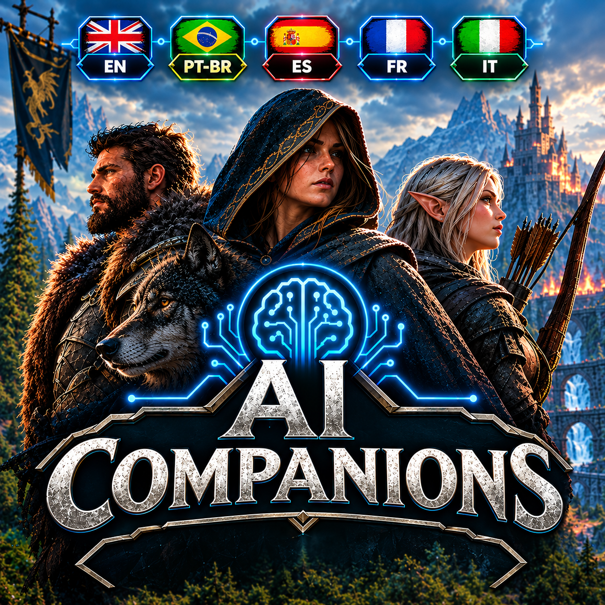
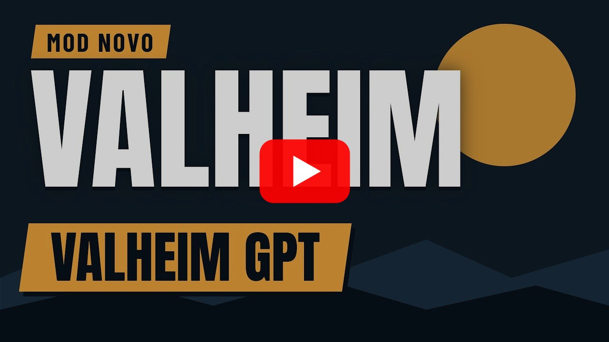

# AI Companions



> Um **companheiro NPC com IA** para **Valheim 1.0**, **em português do Brasil** — você **fala ou digita** e
> ele entende e executa.

Este projeto é um **projeto independente** baseado em [Offline Companions Reborn](https://github.com/MaddhattrRocks/Offline-Companions-Reborn)
(**MIT**) com duas coisas nossas por cima:

1. **Tradução completa para PT-BR** (interface, menus, painéis e as falas do companheiro) sobre um mod agora
   **multilíngue**, com o **inglês como idioma nativo**: os painéis seguem o **idioma do jogo**.
2. **Uma camada de IA**: ordens em **linguagem natural** (texto no chat ou **voz** por push-to-talk), com
   **personalidade**, **memória** e **conversa** — usando um **LLM** (o **Groq** por padrão, ou um modelo
   **local**) e reconhecimento de voz **local**.

O companheiro em si (trabalhos, comida, stamina, habilidades, casa, descanso, portais, carroça, menu radial)
vem do upstream e continua funcionando igual — a IA é só uma **nova entrada** para as mesmas ações.

> **Tipos de companheiro:** os **dverger** (**Mago**, **Mago de Fogo**, **Mago de Gelo** e **Suporte**) são
> **de combate** — a roda mostra só as ações de combate/suporte, e as ordens de **trabalho** (chat, voz ou tecla de
> comando) são **recusadas** com *"Sou de combate, não faço esse trabalho"*. Para trabalhar, use o **Companheiro**
> (detalhes na **[wiki](https://github.com/julianu37/AI-Companions/wiki/Como-funciona#tipos-de-companheiro)**).

## 🎬 Em ação

[](https://www.youtube.com/watch?v=40FnVEIbXyo)

> 🎥 **"Esse mod muda TUDO no Valheim! AI Companions"** — vídeo do canal **SuaTV** mostrando o mod em jogo.
> **[▶️ Assistir no YouTube](https://www.youtube.com/watch?v=40FnVEIbXyo)** (clique na imagem também abre)

---

## O que ele faz

### 🗣️ Ordens por texto e por voz

| Como | Exemplo |
|---|---|
| **Voz** (segure **`V`**, fale, solte) | *"pega 10 pedras"* · *"corta umas madeiras"* · *"ataca o greydwarf"* |
| **Chat** (tecla de chat do jogo) | *"colete 10 madeiras"* · *"segue"* · *"para de me seguir"* · *"equipa o machado de bronze"* |

A fala é transcrita **dentro do jogo** (sem serviço externo de voz) e o texto entra no **mesmo** caminho das
ordens digitadas: ordem, conversa, personalidade e memória funcionam igual.

**Exemplos que funcionam hoje:**
`colete 10 madeiras` · `pega 10 pedras` · `minere ferro` · `segue` · `para` · `para de me seguir` ·
`vem cá` · `ataca o greydwarf` · `mata o javali` · `equipa o machado de bronze` · `pega a picareta` ·
`larga a pedra` · `joga fora 5 madeira` · `abre o teu inventário` · `fica na defensiva` · `bom dia` ·
`como você está?`

> O número da ordem é um **alvo** contado no **inventário dele**: se ele já tem 10 madeiras e você pede 10,
> ele avisa *"Já temos o suficiente."* e não sai para coletar.

> Peça para ver o que ele carrega (*"abre o teu inventário"*, *"mostra o que você carrega"*) e a **janela do
> inventário do companheiro** abre para você — a mesma do toque na tecla de interagir, com nome, comida e
> equipamento. *"Fecha o inventário"* fecha.

### 🧠 Personalidade, memória e conversa

- **Personalidade** por **preset** (`viking`, `mago`, `sarcastico`, `guia`) ou **texto livre** — entra no
  prompt do LLM, então ele responde no tom escolhido.
- **Memória curta** das últimas trocas (por companheiro).
- **Conversa livre**: *"bom dia"*, *"o que achou da minha casa?"* — ele responde como personagem.

### 🔊 Ele fala (voz sintetizada local)

O companheiro **fala em voz alta** o que ele responde, na posição dele no mundo (não no centro da tela). A voz é
sintetizada **dentro do jogo** pelo **Kokoro-82M** (via `sherpa-onnx`, CPU) — sem serviço externo, sem processo
filho, nada sai da sua máquina. Três vozes em **português do Brasil**:

| `TtsVoice` | Voz |
|---|---|
| **42** (padrão) | `pf_dora` — feminina |
| **43** | `pm_alex` — masculina |
| **44** | `pm_santa` — masculina |

> **O que ele fala:** a resposta do modelo (o jeito dele — *"Deixa comigo."*) e/ou a linha do próprio mod que
> aparece no chat (*"Ok: coletar madeira (10)."*, *"Já temos o suficiente."*). As duas opções são separadas
> (`TtsSpeakReplies` / `TtsSpeakModLines`) e a regra é **a voz acompanha o que está escrito na tela**: numa
> ordem a linha do mod ganha (desligue `TtsSpeakModLines` para ouvir a resposta do modelo no lugar dela). Nada
> é falado duas vezes.

> **Sem travar o jogo:** a síntese roda numa thread de fundo e a fala é montada por **frases** — a primeira frase
> já começa a tocar enquanto a próxima é gerada. Falas repetidas saem do **cache**, na hora. Teste rápido no
> console do jogo (`F5`): `modia_tts_teste`, ou `modia_tts_teste Bom dia, chefe!` para falar um texto seu.

### 🎛️ Painel da IA (tecla `I`)

Aperte **`I`** a qualquer momento (não precisa de companheiro perto) para ajustar a IA **em jogo**, sem editar o
`.cfg`:

| O que | Como |
|---|---|
| **Personalidade** | Escolha um **preset** (Padrão, Viking leal, Mago sarcástico, Sarcástico, Guia paciente) ou escreva nas **suas palavras** e clique em **Aplicar** — vale na próxima resposta |
| **Voz** | Escolha entre as 3 vozes pt-BR e aperte **Ouvir** para escutar uma frase de exemplo na hora |
| **Selecione seu Provedor LLM** | O dropdown acima da **URL do servidor**: **Groq**, **LM Studio** ou **OpenRouter** preenchem a **URL e o modelo** (vale depois do **Aplicar**; a chave não é tocada). Uma URL de Ollama/servidor próprio aparece como **Personalizado** e nada é mexido |
| **Crie sua Chave de API Grátis AQUI** | Botão ao lado da **Chave de API**: abre no navegador a página da chave do provedor escolhido (`console.groq.com/keys` no Groq, `openrouter.ai/keys` no OpenRouter). Some no LM Studio/personalizado |
| **Volume** | Slider (vale no próximo áudio). A **velocidade da fala** fica **só no `F8`** (`[AI] TtsSpeed`) |
| **Push-to-talk** | Veja a tecla atual e aperte **Alterar** para capturar outra |
| **Liga/desliga** | Companheiro fala, falar respostas da IA, falar falas do mod, conversa livre e ordens por voz |
| **Memória** | Quantas trocas recentes ele lembra (0–12) |

Tudo é salvo no `.cfg` **na hora**. `Esc` ou o **X** fecham. Enquanto o painel está aberto, o seu personagem não
responde aos controles (e a tecla do push-to-talk não grava).

### ⚙️ Ajustes nossos em cima do upstream

- **Raio de coleta maior** (madeira/pedra/minério procurados até 25 m de você, drops catados até 12 m).
- **Chatter aleatório desligado** (as falinhas soltas a cada 15–30 s). As falas úteis continuam.
- **A tecla `V` é do push-to-talk**, sem disparar o *Toggle Auto-Pickup* do jogo (que continua disponível se
  você reatribuí-la nas configurações do Valheim).

---

## Como funciona (arquitetura)

```
voz (Microphone 16 kHz) ──► Whisper.net (STT, whisper.cpp in-process, CPU) ─┐
                                                                            ├─► mesma caixa de ordens ─► CompanionOrders ─► o companheiro executa
chat do jogo ───────────────────────────────────────────────────────────────┘            │
                                                                                          ├─► LLM (Groq por padrão, ou LM Studio/Ollama local, ou OpenRouter) ─► ação + resposta
                                                                                          └─► Kokoro-82M (TTS, sherpa-onnx in-process, CPU) ─► ele FALA na posição dele
```

- **LLM**: **Groq** por padrão (API compatível com OpenAI; só precisa da **chave gratuita**), um
  servidor **local** (LM Studio/Ollama) como opção ou o **OpenRouter** como alternativa — usado para **entender**
  a ordem e **conversar**. No painel `I`, o dropdown **"Selecione seu Provedor LLM"** preenche a URL e o modelo
  do provedor escolhido, e o botão **"Crie sua Chave de API Grátis AQUI"** abre a página da chave no navegador.
- **STT local**: `Whisper.net` (whisper.cpp) rodando **dentro do jogo**, com o modelo carregado uma vez.
- **TTS local**: `sherpa-onnx` com o modelo **Kokoro-82M** — o companheiro **fala** a resposta dentro do jogo,
  na posição dele, sem serviço externo.
- **Privacidade**: a **voz** (STT e TTS) é sempre **local**. O **LLM** é a única peça que pode ser remota: com o
  **LM Studio/Ollama local** nada sai da sua máquina; com o **Groq** (padrão) — ou o **OpenRouter** — o texto das
  ordens e da conversa vai para um **serviço remoto**.
- Nada disso bloqueia o jogo: tudo roda em threads de fundo.

---

## Requisitos

- **Valheim 1.0.x** (engine Unity 6) com **BepInEx 5.4.2351**.
- **Um LLM** para as ordens: **Groq** (padrão — só precisa de internet e da **chave gratuita** em
  https://console.groq.com/keys; o texto das ordens **sai da sua máquina**) — ou **LM Studio/Ollama** local
  (opcional — nada sai) — ou **OpenRouter** (alternativa, com o tier gratuito mais lento). Veja a
  **[wiki](https://github.com/julianu37/AI-Companions/wiki/LLM-no-LM-Studio)**.
- **Microfone** (só para as ordens por voz).
- **Windows x64** para o STT (os binários nativos do whisper.cpp são `win-x64`).

---

## Instalação

> O passo a passo **detalhado, com imagens** (incluindo a **chave do Groq** e a opção local) está na
> **[Wiki do projeto](https://github.com/julianu37/AI-Companions/wiki/Instalacao)**. Resumo:

1. Instale o **BepInExPack_Valheim** e copie a pasta do mod para `BepInEx\plugins\AI-Companions`.
2. (Opcional, para voz) deixe um modelo ggml do Whisper em `...\AI-Companions\whisper\` — ex.
   `ggml-small-q5_1.bin`.
3. (Opcional, para ele **falar**) deixe o modelo do Kokoro em `...\AI-Companions\tts\kokoro\`
   (`model.int8.onnx`, `voices.bin`, `tokens.txt`, `espeak-ng-data\`) — já vem no pacote.
4. **Para o LLM:** crie a **chave gratuita** em https://console.groq.com/keys e cole em `[AI] ApiKey` — o
   `BaseUrl` (`https://api.groq.com/openai/v1`) e o `Model` (`openai/gpt-oss-20b`) **já são o padrão**. Quer rodar
   local? LM Studio com o `qwen2.5-3b-instruct`, `[AI] BaseUrl = http://127.0.0.1:1234/v1` e `ApiKey` vazio. (O
   **OpenRouter** continua funcionando como alternativa: `https://openrouter.ai/api/v1` + `openrouter/free`.)
5. Entre no mundo. No chat: `colete 10 madeiras`. Ou segure **`V`** e fale. Ele responde **em voz alta**.

> **Atualizando para a 2.0.0? As configurações voltam aos padrões.** O arquivo de configuração passou a ser
> `BepInEx\config\AiCompanions.cfg` e o antigo (`Maddhattr.OfflineCompanionsReborn.cfg`) **não é mais lido** —
> pode ser apagado. O arquivo novo nasce com os **valores padrão**, inclusive a **`ApiKey` em branco**, que
> precisa ser colada de novo; a seção da IA virou **`[AI]`** e as **chaves são em inglês** (`Enabled`, `Model`,
> `TtsVoice`…). **Save, mundo, companheiros, casas e inventário não são afetados** — o GUID do plugin e as chaves
> `HC_*` não mudaram. A tabela completa está em
> **[Configuração](https://github.com/julianu37/AI-Companions/wiki/Configuracao)**.

---

## Controles

| Tecla | Ação |
|---|---|
| **`V`** | **Push-to-talk**: segure e fale; solte para ele entender |
| **`Z`** | Tecla de comando: olhe para algo e toque para mandar os companheiros (mover/atacar/abrir porta/sentar/consertar). Segure para chamá-los |
| **`E`** | Segure olhando um companheiro para abrir o **menu radial**; toque para abrir o painel/inventário dele |
| **`LeftAlt` + `Z`** | Editor de zona de fazenda |
| **`I`** | **Painel da IA**: personalidade, voz (com **Ouvir**), volume, memória, conversa, a tecla do push-to-talk e as **configurações do LLM** (com o seletor de provedor) — tudo salvo na hora |
| **`F8`** | Painel de configurações do mod (todas as opções, em jogo) |

> O painel da IA (tecla **`I`**, mudável em `[AI] PanelKey`) abre sem precisar de companheiro perto, fecha com
> **Esc** ou no **X**, e cada controle é gravado no `.cfg` no mesmo instante. Enquanto ele está aberto, o seu
> personagem não responde aos controles.

---

## Configuração da IA (seção `[AI]` do `BepInEx\config\AiCompanions.cfg`)

| Chave | Padrão | O que faz |
|---|---|---|
| `Enabled` | `true` | Liga as ordens por texto |
| `BaseUrl` | `https://api.groq.com/openai/v1` | Endpoint do LLM (Groq; ou LM Studio/Ollama local, ou OpenRouter) |
| `Model` | `openai/gpt-oss-20b` | Modelo usado — `openai/gpt-oss-20b` no Groq (padrão); `openrouter/free` no OpenRouter; o nome do LM Studio no local |
| `ApiKey` | *(vazio)* | **Obrigatória no Groq** (a gratuita sai em console.groq.com/keys) e no OpenRouter; vazia no LM Studio/Ollama. Nunca versione uma chave |
| `Prefix` | *(vazio)* | Vazio = toda mensagem vai ao LLM. Ex.: `/c` exige o prefixo |
| `Personality` / `PersonalityPreset` | *(vazio)* | Texto livre (ganha) ou preset (`viking`, `mago`, `sarcastico`, `guia`) |
| `Memory` | `4` | Quantas trocas recentes ele lembra (`0` desliga) |
| `Conversation` | `true` | Responder conversa livre quando não é ordem |
| `TargetRange` | `40` | Até onde procurar a criatura citada numa ordem de ataque |
| `VoiceEnabled` | `true` | Liga o push-to-talk |
| `VoiceKey` | `V` | Tecla do push-to-talk |
| `VoiceLanguage` | `pt` | Idioma da transcrição |
| `VoiceMaxSeconds` | `10` | Teto da gravação (s) |
| `VoiceInitialPrompt` | *(vocabulário das ordens)* | Enviesa o reconhecimento para as palavras das ordens |
| `VoiceDevice` | `0` | Índice do microfone |
| `SttModel` | `whisper\ggml-small-q5_1.bin` | Modelo do Whisper |
| `TtsEnabled` | `true` | Ele **fala** as respostas (TTS local, Kokoro) |
| `TtsVoice` | `42` | Voz: `42` pf_dora (fem.), `43` pm_alex (masc.), `44` pm_santa (masc.) |
| `TtsVolume` / `TtsSpeed` | `1` / `1` | Volume e velocidade da fala |
| `TtsThreads` | `4` | Núcleos para a síntese (4 = mais rápido que o tempo real) |
| `TtsSpeakReplies` | `true` | Falar a resposta do modelo |
| `TtsSpeakModLines` | `true` | Falar a linha do mod que aparece no chat (ganha numa ordem) |
| `TtsCache` | `true` | Guardar as falas já sintetizadas (as repetidas saem na hora) |
| `TtsModel` / `TtsLanguage` | `tts\kokoro\model.int8.onnx` / `pt-br` | Modelo do Kokoro e idioma (nunca vazio) |
| `PanelKey` | `I` | Tecla que abre o **painel da IA** no jogo (personalidade, voz, push-to-talk) |

> As **chaves e as descrições do `.cfg` são em inglês** (o idioma nativo do mod); o **painel `F8`** mostra os
> nomes no **idioma do jogo** — em português você lê `Ligado`, `Modelo`…; em inglês, `Enabled`, `Model`… A
> explicação de cada opção, com os padrões, está na
> **[wiki](https://github.com/julianu37/AI-Companions/wiki/Configuracao)**.

---

## Estrutura do repositório

| Caminho | O que é |
|---|---|
| `src/Companions/` | O mod (C#, net472): `Core/`, `Companion/`, `AI/`, `Jobs/`, `UI/`, `Patches/`, `Diagnostics/` |
| `src/Companions/AI/` | **A nossa camada de IA**: `LlmClient`, `LlmIntent`, `CompanionOrders`, `CompanionChatAI`, `WhisperStt`, `VoiceInput`, `CompanionTts`, `CompanionPersona`, `CompanionMemory` |
| `Translations/`, `Speech/` | Traduções PT-BR (interface e falas) — o build copia para o plugin |
| `package/` | Arquivos de pacote (ícone, README/CHANGELOG, guia e configuração) |
| `docs/` | Roadmap, visão, plano de fases, engenharia reversa e notas técnicas |
| `.opencode/` | A **equipe de agentes** usada para desenvolver o projeto |

## Documentação

- **[Wiki](https://github.com/julianu37/AI-Companions/wiki)** — o guia de quem vai instalar e usar: requisitos,
  instalação passo a passo (com imagens), **configuração do LLM (Groq, LM Studio ou OpenRouter)**, voz, comandos,
  configuração da IA e problemas comuns. (A fonte das páginas está em [`docs/wiki/`](docs/wiki/).)
- [`docs/roadmap.md`](docs/roadmap.md) — fases e status (Trilhas A–D).
- [`docs/vision.md`](docs/vision.md) — o alvo do projeto.
- [`docs/re/`](docs/re/) — engenharia reversa do Valheim 1.0 e notas do STT/voz.
- [`docs/references.md`](docs/references.md) — fontes de terceiros e licenças.
- [`AGENTS.md`](AGENTS.md) — como a equipe de agentes trabalha neste repositório.

## Build

```powershell
# Environment.props (caminhos locais) + build
dotnet build Companions.sln -c Release
# o .dll e as traduções são copiados para o DeployDir (BepInEx\plugins\...)
```

Requisitos: [.NET SDK](https://dotnet.microsoft.com/download) 8+ (ou VS 2022+) e Valheim com BepInEx instalado.
O build usa as DLLs da sua própria instalação do jogo (nenhum arquivo do jogo fica no repositório).

---

## Créditos e licença

- **Upstream:** [Offline Companions Reborn](https://github.com/MaddhattrRocks/Offline-Companions-Reborn) —
  fork do *Offline Companions* do **ProfMags** — **MIT**. O companheiro, os trabalhos, a IA de movimento/combate,
  a UI e a base de tudo isso vêm de lá.
- **Nós:** a tradução PT-BR e a **camada de IA** (LLM/voz), além de correções e ajustes.
- **STT:** [Whisper.net](https://github.com/sandrohanea/whisper.net) + [whisper.cpp](https://github.com/ggml-org/whisper.cpp)
  (MIT) e os modelos ggml do Whisper (MIT).
- Licença do projeto: **MIT** — ver [`LICENSE`](LICENSE) e [`THIRD_PARTY_NOTICES.md`](THIRD_PARTY_NOTICES.md).
