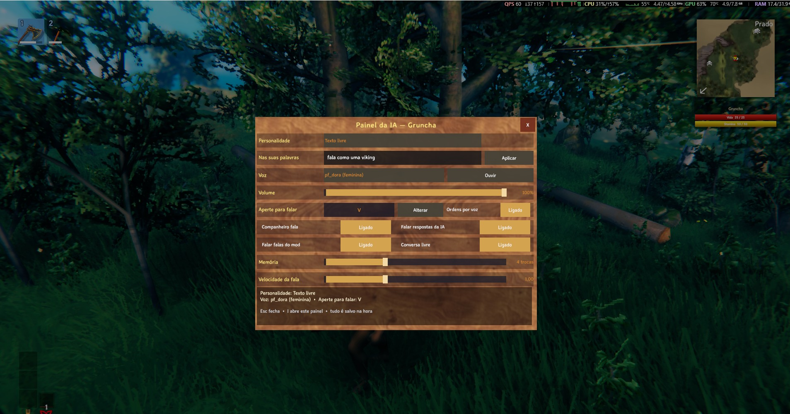

# Comandos

Teclas, ordens por chat/voz e comandos de console.

---

## Teclas

| Tecla | Ação |
|---|---|
| **`V`** | **Push-to-talk**: segure e fale; solte para ele entender |
| **`Z`** | **Tecla de comando**: olhe para algo e toque para mandar os companheiros (mover / atacar / abrir porta / sentar / consertar). **Segure** para chamá-los |
| **`E`** | **Segure** olhando um companheiro para abrir o **menu radial**; **toque** para abrir o painel / inventário dele |
| **`LeftAlt` + `Z`** | Editor de zona de fazenda |
| **`I`** | **Painel da IA**: personalidade, voz (com **Ouvir**), volume, velocidade, memória, conversa e a tecla do push-to-talk — tudo salvo na hora |
| **`F8`** | Painel de configurações do mod (todas as opções, em jogo) |
| **`F5`** | Console do jogo (para os comandos de teste do mod) |

> O painel da IA (tecla **`I`**, mudável em `[IA] PainelTecla`) abre **sem precisar de companheiro perto**,
> fecha com **`Esc`** ou no **X**, e cada controle é gravado no `.cfg` no mesmo instante. Enquanto ele está
> aberto, o seu personagem não responde aos controles.

### Menu radial (segure `E`)

Segure **`E`** olhando um companheiro para abrir a roda de ações (mover, atacar, abrir porta, sentar, consertar…).
Um **toque** em `E` abre o painel / inventário dele.

---

## Ordens por chat e por voz

Você digita no chat do jogo **ou** fala segurando **`V`**. A ordem é interpretada por um LLM: você pode dizer a
mesma coisa de **várias formas** — não precisa decorar a frase exata.

### Seguir e parar

| Você diz | O que ele faz |
|---|---|
| `segue` | Volta a seguir você |
| `para` / `para de me seguir` | Para o que está fazendo e fica parado |
| `vem cá` | Vem até você |

> Não existe um "seguir de perto" separado: as opções são **seguir** você ou **parar**.

### Coletar

| Você diz | O que ele faz |
|---|---|
| `colete 10 madeiras` / `corta umas madeiras` | Coleta **madeira** |
| `pega 10 pedras` / `colete 10 pedras` | Coleta **pedra** |
| `minere ferro` / `minere minério` | **Minera** minério |
| `colhe as frutinhas` / `pega os cogumelos` | **Forrageia** (plantas, frutas, cogumelos) |

> **O número é um alvo.** Ele conta **no inventário do companheiro** (a mochila dele — não conta baús nem
> pilhas no chão). Se ele já tem 10 madeiras e você pede 10, ele avisa *"Já temos o suficiente."* e não sai
> para coletar. O alvo vale **só para o recurso pedido**.

### Atacar

| Você diz | O que ele faz |
|---|---|
| `ataca o greydwarf` | Ataca a criatura **citada** (mesmo na postura Passiva) |
| `mata o javali` | Idem |
| `ataca o troll` | Idem |

> A criatura é procurada **primeiro na sua mira**; depois, a mais próxima dentro de `[IA] RaioDeAlvo` (padrão
> 40 m). A que você está mirando vale **sempre**, por mais longe que esteja. *"Atacar"* sem citar criatura
> vira **caça**.

### Equipar e largar

| Você diz | O que ele faz |
|---|---|
| `equipa o machado de bronze` / `pega a picareta` | Equipa o item **que ele já carrega** |
| `larga a pedra` / `joga fora 5 madeira` | Larga o item no chão (sem número = a pilha inteira) |

> `equip` e `drop` valem só para o que ele **já tem na mochila**. Item de missão nunca cai.

### Itens no chão

| Você diz | O que ele faz |
|---|---|
| `recolhe os itens` / `junte a madeira do chão` | Anda até os itens soltos e pega **um por um** |
| `pega o que está no chão` | Idem — ele pega o que estiver **mais perto**, não um item escolhido pelo nome |
| `pare de recolher` / `não pegue nada` | **Desliga** o recolhimento automático |

> O recolhimento pega **inclusive o que ele mesmo largou de propósito** — que é justamente o que o ímã
> automático do jogo ignora. Ele desiste se o item não couber inteiro na mochila ou se ficar longe demais.

### Inventário

| Você diz | O que ele faz |
|---|---|
| `abre o teu inventário` / `mostra o que você carrega` | Abre a **janela do inventário dele** para você ver |
| `fecha o inventário` | Fecha a janela (o **X** da janela fecha sempre) |

> O **fechamento por ordem** depende de como o modelo interpreta a frase — se "fecha o inventário" acabar
> abrindo a janela, use o **X** (ou o `Esc`).

### Postura de combate

| Você diz | O que ele faz |
|---|---|
| `fica na defensiva` | Postura **passiva** (defensiva) |
| `fica equilibrado` | Postura **equilibrada** |
| `ataca à distância` | Postura **à distância** |
| `parte pra cima` | Postura **corpo a corpo** |

### Trabalhos

| Você diz | O que ele faz |
|---|---|
| `cuida da plantação` | Trabalho de **fazenda** |
| `vai pescar` | Trabalho de **pesca** |
| `conserta as construções` | Trabalho de **reparo** |
| `vai cozinhar` | Trabalho de **cozinha** |
| `funde o minério` | Trabalho de **fundição** |
| `vai caçar` | Trabalho de **caça** |
| `define a casa aqui` | Define a **casa** |
| `vaga por aqui` / `para de vagar` | Liga/desliga o **vagar** |
| `aceita comandos` / `ignora comandos` | Liga/desliga **aceitar ordens** |

### Conversa

| Você diz | O que ele faz |
|---|---|
| `bom dia` | Responde como personagem |
| `como você está?` | Idem |
| `o que achou da minha casa?` | Idem |

> Quando a mensagem **não** é uma ordem, o companheiro **conversa**: fala a resposta em voz alta e a mostra no
> chat. Isso é controlado por `[IA] Conversa` (padrão `true`). Desligado = só ordens são entendidas.

---

## Comandos de console (`F5`)

| Comando | O que faz |
|---|---|
| `modia_tts_teste` | Fala uma frase de teste pelo TTS (pipeline completo: modelo, síntese e reprodução) |
| `modia_tts_teste <texto>` | Fala o texto que você escrever — ex.: `modia_tts_teste Bom dia, chefe!` |
| `modia_stt_teste` | Roda o reconhecimento do Whisper sobre um WAV, **sem** usar o microfone |

> `modia_stt_teste` transcreve o arquivo de `[IA] SttWavTeste` (padrão `whisper\jfk.wav`) e escreve o resultado
> no log. Serve para checar se o modelo do Whisper está carregando, quando as ordens por voz não saem.
>
> **O pacote não traz esse WAV** (ele saiu do pacote para economizar espaço) — ponha um arquivo seu na pasta
> `whisper\` e aponte `[IA] SttWavTeste` para ele. O comando **não** aceita o caminho como argumento.

---

## Notas importantes

- **O número é um alvo contado na mochila dele.** `colete 10` = **ter 10 no inventário do companheiro**. Com
  15, ele nem começa e diz que já tem o suficiente; com 7, ele coleta até 10 (a última árvore pode passar).
- **A ordem é lida pelo LLM**, então você pode falar do seu jeito. `pega 10 pedras`, `vou precisar de pedra`,
  `junta umas pedras` — todas devem cair na mesma ação.
- **`[IA] Prefixo`** (padrão vazio): se você preencher, por exemplo, `/c`, **só** as mensagens que começam com
  esse prefixo vão para o modelo. O resto do chat fica em paz.
- **`[IA] CooldownSegundos`** (padrão `3`): tempo mínimo entre duas ordens, para uma rajada de mensagens não
  inundar o modelo.
- **O chat e a voz entram pelo mesmo caminho.** O que funciona digitado funciona falado, com personalidade,
  memória e conversa iguais.
- **`despawn` não é exposto ao modelo.** Você não pode mandar o companheiro desaparecer por chat ou voz.

---

## Ajustes de conveniência do mod

- **A tecla `V`** não dispara mais o *Toggle Auto-Pickup* do jogo (veja **[Voz](Voz)**).
- **Raio de coleta maior:** madeira/pedra/minério são procurados a até **25 m** de você, e os drops são
  catados a até **12 m**.
- **Chatter aleatório desligado** por padrão: as falinhas soltas a cada 15–30 s não acontecem mais. As falas
  úteis (ordens, mudança de modo, respostas da IA, eventos) continuam.

Para ver todas as opções, vá em **[Configuração](Configuracao)**.
