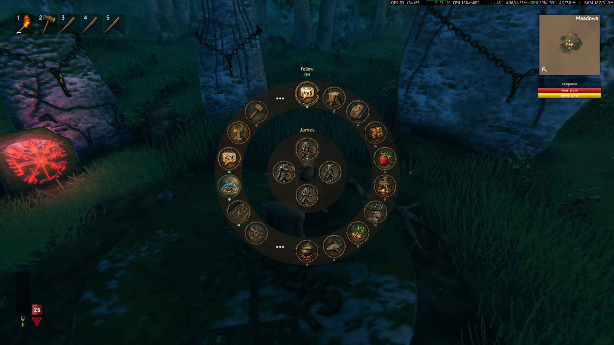

> 🌍 [English](Commands) · [Português](Commands-pt) · [Español](Commands-es) · [Français](Commands-fr) · **Italiano**

# Ordini

Tasti, ordini via chat/voce e comandi della console.

---

## Tasti

| Tasto | Azione |
|---|---|
| **`V`** | **Push-to-talk**: tienilo premuto e parla; rilascia per farlo capire |
| **`Z`** | **Tasto di comando**: guarda qualcosa e toccalo per mandare i compagni (muoversi / attaccare / aprire una porta / sedersi / riparare). **Tieni premuto** per chiamarli |
| **`E`** | **Tieni premuto** guardando un compagno per aprire il **menu radiale**; **tocca** per aprire il suo pannello / inventario |
| **`LeftAlt` + `Z`** | Editor della zona di coltivazione |
| **`I`** | **Pannello IA**: una **scheda per compagno** (nome, tipo, Richiama, Aspetto, la sua voce e personalità) e la **scheda IA** (evocatore di compagni, impostazioni del LLM con il **selettore del provider**, volume, memoria, conversazione e push-to-talk) — tutto salvato subito. La **velocità della voce** resta nel **`F8`** |
| **`F8`** | Pannello delle impostazioni della mod (tutte le opzioni, in gioco) |
| **`F5`** | Console del gioco (per i comandi di prova della mod) |

> Il pannello IA (tasto **`I`**, modificabile in `[AI] PanelKey`) si apre **senza bisogno di un compagno vicino**, si
> chiude con **`I`**, **`Esc`** o la **X**, e ogni controllo viene salvato subito (nel `.cfg`, quando è un'opzione
> globale; nel compagno, quando è della sua scheda). Mentre è aperto, il tuo personaggio non risponde ai controlli, e
> il tasto viene ignorato con l'inventario, la mappa, il menu o il pannello `F8` aperti.

> **Tipi:** i **dverger** (**Mago**, **Mago del fuoco**, **Mago del ghiaccio** e **Supporto**) sono **da
> combattimento** — la ruota mostra solo le azioni di combattimento/supporto e gli ordini di **lavoro** (**chat**,
> **voce** o il **tasto di comando**) vengono rifiutati con *"Sono da combattimento, non faccio questo lavoro."*. Per
> lavorare, usa il tipo **Compagno** (**[Come funziona](How-it-works-it#tipi-di-compagno)**).

### Menu radiale (tieni premuto `E`)

Tieni premuto **`E`** guardando un compagno per aprire la ruota delle azioni (muoversi, attaccare, aprire una porta,
sedersi, riparare…). Un **tocco** su `E` apre il suo pannello / inventario.

---

## Ordini via chat e voce

Scrivi nella chat del gioco **o** parli tenendo premuto **`V`**. L'ordine viene interpretato da un LLM: puoi dire la
stessa cosa in **diversi modi** — non devi memorizzare la frase esatta.

### Per nome

Inizia il messaggio con il **nome** di un compagno per parlare **solo** con lui: `Gruncha, raccogli 5 pietre` (il
prompt, la personalità, la memoria e l'ordine sono suoi). **Senza** il nome, l'ordine vale per **tutti** quelli che
possono eseguirlo. Un inizio che sembra un nome e non esiste (`Tizio, raccogli 10 pietre`) viene segnalato — e non
viene ordinato niente —, ma una forma di cortesia continua a valere (`capo, raccogli 10 pietre`).

> Il nome è quello che gli hai dato nella **scheda del compagno** (pannello `I`) o il nome del tipo, se non è mai stato
> rinominato.

### Seguire e fermare

| Dici | Cosa fa |
|---|---|
| `seguimi` | Torna a seguirti |
| `fermati` / `smetti di seguirmi` | Ferma quello che sta facendo e resta fermo — e la risposta dice **il lavoro** che ha fermato ("smettere di raccogliere legna", "smettere di cucinare") |
| `vieni qui` | Viene da te |

> Non c'è un "seguire da vicino" separato: le opzioni sono **seguirti** o **fermarsi**.

### Raccogliere

| Dici | Cosa fa |
|---|---|
| `raccogli 10 legna` / `taglia un po' di legna` | Raccoglie **legna** |
| `raccogli 10 pietre` / `prendi 10 pietre` | Raccoglie **pietra** |
| `estrai il ferro` / `estrai il minerale` | **Estrae** minerale |
| `raccogli le bacche` / `prendi i funghi` | **Raccoglie** (piante, frutti, funghi) |

> **Il numero è un obiettivo.** Lo conta **nell'inventario del compagno** (la sua sacca — non contano casse né pile a
> terra). Se ha già 10 di legna e chiedi 10, avvisa *"Ne abbiamo già abbastanza."* e non va a raccogliere. L'obiettivo
> vale **solo per la risorsa chiesta**.

### Attaccare

| Dici | Cosa fa |
|---|---|
| `attacca quel greydwarf` | Attacca la creatura **nominata** (anche in posizione Passivo) |
| `uccidi il cinghiale` | Lo stesso |
| `attacca il troll` | Lo stesso |

> La creatura viene cercata **prima nella tua mira**; poi, la più vicina entro `[AI] TargetRange` (40 m di default).
> Quella che stai mirando vale **sempre**, per quanto lontana sia. *"Attaccare"* senza nominare una creatura diventa
> **caccia**.

### Equipaggiare e lasciare

| Dici | Cosa fa |
|---|---|
| `equipaggia l'ascia di bronzo` / `prendi il piccone` | Equipaggia l'oggetto **che porta già** |
| `lascia la pietra` / `butta via 5 legna` | Lascia l'oggetto a terra (senza numero = tutta la pila) |

> `equip` e `drop` valgono solo per quello che ha **già nella sacca**. Un oggetto di missione non cade mai.

### Oggetti a terra

| Dici | Cosa fa |
|---|---|
| `raccogli gli oggetti` / `raccogli la legna per terra` | Cammina fino agli oggetti sparsi e li raccoglie **uno per uno** |
| `prendi quello che c'è a terra` | Lo stesso — prende quello che è **più vicino**, non un oggetto scelto per nome |
| `smetti di raccogliere` / `non raccogliere niente` | **Spegne** la raccolta automatica |

> La raccolta prende **anche quello che ha lasciato apposta** — che è proprio quello che la calamita automatica del
> gioco ignora. Rinuncia se l'oggetto non entra intero nella sacca o se è troppo lontano.

### Porte, alveari, navi, fuochi e casse

| Tu dici | Cosa fa |
|---|---|
| `chiudi la porta` / `apri la porta` | Apre o chiude la **porta** che sta guardando |
| `svuota l'alveare` / `prendi il miele` | Svuota l'**alveare** e tiene il miele |
| `sali sulla nave` / `imbarca` | Sale sulla **nave**, nel posto che indichi |
| `siediti accanto al fuoco` | Si siede accanto al **fuoco** che sta guardando |
| `metti questo nella cassa` / `mettilo via` | Mette quello che porta nella **cassa** |

> Il bersaglio è l'oggetto che **stai guardando**, con lo stesso raggio e gli stessi strati del tasto di comando.
> Senza niente nel mirino prende il più vicino a te: **20 m** per una porta o un alveare, **30 m** per una nave,
> **5 m** per un fuoco o una cassa — mai la sua sacca. L'ordine arriva a **un** compagno: quello che hai chiamato per
> nome, o il più vicino a quell'oggetto che può ricevere ordini.

> La risposta dice cosa è successo: "Chiudo la porta.", "Sono a bordo!", "Mi siedo accanto al fuoco.", "Metto 12
> oggetto/i nella cassa.". Una porta **chiusa a chiave** risponde "È chiusa a chiave.", un alveare **vuoto** "Non c'è
> ancora miele lì dentro." e una cassa **piena** "In quella cassa non c'è più posto."; senza niente intorno dice che
> non ne vede.

> Il fuoco dev'essere **acceso**, e la cassa dev'essere una vera cassa libera da usare: non una lapide, un carro, la
> stiva di una nave, una cassa di un sotterraneo o una dentro un'area protetta dove non può entrare.

### Inventario

| Dici | Cosa fa |
|---|---|
| `apri il tuo inventario` / `mostrami cosa porti` | Apre **la finestra dell'inventario** per farti vedere |
| `chiudi l'inventario` | Chiude la finestra (la **X** della finestra chiude sempre) |

> Chiudere è un'azione a sé (`inventory_close`): se il modello risponde "aprire" per una frase con verbo di chiusura,
> la mod corregge con **la tua** frase. La **X** della finestra e `Esc` chiudono sempre.

### Posizione di combattimento

| Dici | Cosa fa |
|---|---|
| `resta sulla difensiva` | Posizione **passiva** (difensiva) |
| `resta equilibrato` | Posizione **equilibrata** |
| `attacca a distanza` | Posizione **a distanza** |
| `combatti corpo a corpo` | Posizione **corpo a corpo** |

### Lavori

| Dici | Cosa fa |
|---|---|
| `occupati della coltura` | Lavoro di **coltivazione** |
| `vai a pescare` | Lavoro di **pesca** |
| `ripara le costruzioni` | Lavoro di **riparazione** |
| `vai a cucinare` | Lavoro di **cucina** |
| `fondi il minerale` | Lavoro di **fusione** |
| `vai a cacciare` | Lavoro di **caccia** |
| `imposta la casa qui` | Imposta la **casa** |
| `gironzola qui intorno` / `smetti di gironzolare` | Accende/spegne il **gironzolare** |
| `accetta ordini` / `ignora ordini` | Accende/spegne **accettare ordini** |

### Conversazione

| Dici | Cosa fa |
|---|---|
| `buongiorno` | Risponde come personaggio |
| `come stai?` | Lo stesso |
| `cosa ne pensi di casa mia?` | Lo stesso |

> Quando il messaggio **non** è un ordine, il compagno **conversa**: dice la risposta ad alta voce e la mostra nella
> chat. Lo controlla `[AI] Conversation` (`true` di default). Spento = si capiscono solo gli ordini.

---

## Comandi della console (`F5`)

| Comando | Cosa fa |
|---|---|
| `modia_tts_teste` | Dice una frase di prova con il TTS (pipeline completo: modello, sintesi e riproduzione) |
| `modia_tts_teste <testo>` | Dice il testo che scrivi — per esempio `modia_tts_teste Buongiorno, capo!` |
| `modia_stt_teste` | Esegue il riconoscimento Whisper su un WAV, **senza** usare il microfono |

> `modia_stt_teste` trascrive il file di `[AI] SttWavTest` (`whisper\jfk.wav` di default) e scrive il risultato nel
> log. Serve a controllare se il modello Whisper si sta caricando, quando gli ordini vocali non escono.
>
> **Il pacchetto non porta quel WAV** (è uscito dal pacchetto per risparmiare spazio) — metti un file tuo nella
> cartella `whisper\` e punta `[AI] SttWavTest` su di lui. Il comando **non** accetta il percorso come argomento.

---

## Note importanti

- **La lingua segue il gioco.** Dalla 1.9.0 l'interfaccia, le frasi, i preset di personalità e il contratto del LLM
  sono in **cinque lingue** (PT-BR, EN, ES, FR, IT) e seguono la **lingua del gioco** — gli ordini si capiscono in
  quella lingua, e la voce e il riconoscimento vocale sono **automatici** (`auto` / `0`).
- **Il numero è un obiettivo contato nella sua sacca.** `raccogli 10` = **avere 10 nell'inventario del compagno**. Con
  15 non inizia nemmeno e dice che ne ha già abbastanza; con 7 raccoglie fino a 10 (l'ultimo albero può superarlo).
- **L'ordine lo legge il LLM**, quindi puoi parlare a modo tuo. `prendi 10 pietre`, `mi serve della pietra`,
  `raccogli un po' di pietre` — tutte dovrebbero finire nella stessa azione.
- **`[AI] Prefix`** (vuoto di default): se lo riempi, per esempio con `/c`, **solo** i messaggi che iniziano con quel
  prefisso vanno al modello. Il resto della chat resta in pace.
- **`[AI] CooldownSeconds`** (`3` di default): tempo minimo tra due ordini, perché una raffica di messaggi non inondi
  il modello.
- **La chat e la voce entrano dallo stesso percorso.** Quello che funziona scritto funziona parlato, con la stessa
  personalità, memoria e conversazione.
- **`despawn` non è esposto al modello.** Non puoi ordinare al compagno di sparire via chat o voce.

---

## Regolazioni di comodità della mod

- **Il tasto `V`** non attiva più il *Toggle Auto-Pickup* del gioco (vedi **[Voce](Voice-it)**).
- **Raggio di raccolta più grande:** legna/pietra/minerale vengono cercati fino a **25 m** da te, e gli oggetti a terra
  vengono presi fino a **12 m**.
- **Chatter casuale spento** di default: le frasette ogni 15–30 s non ci sono più. Le frasi utili (ordini, cambio di
  modalità, risposte dell'IA, eventi) restano.

Per vedere tutte le opzioni, vai in **[Configurazione](Configuration-it)**.
