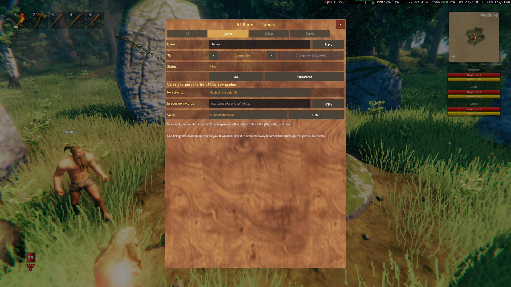
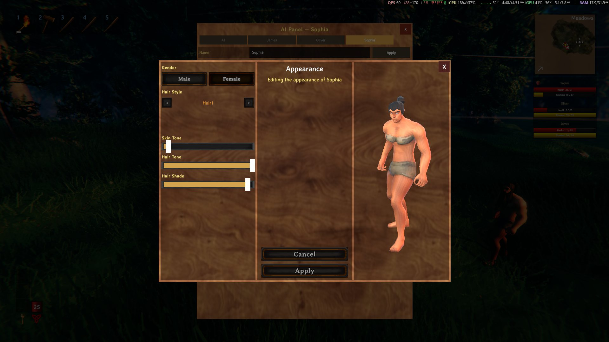

> 🌍 [English](Configuration) · [Português](Configuration-pt) · [Español](Configuration-es) · **Français** · [Italiano](Configuration-it)

# Configuration

Où se trouve le fichier de configuration, comment l'éditer en jeu et ce que fait chaque option de la section `[AI]`.

---

## Où se trouve le `.cfg`

```
<Valheim>\BepInEx\config\AiCompanions.cfg
```

Le fichier est **généré par BepInEx** au premier chargement du mod, et il est réécrit quand tu changes quelque chose
depuis les panneaux. Il fait environ **2000 lignes** et **~340 options** au total, réparties en plusieurs sections
(`[General]`, `[Gathering]`, `[Hunting]`, `[Speech]`, `[Advanced]`, `[AI]` et d'autres).

> Le nom du fichier **n'est plus** le GUID du plugin : jusqu'à la **1.8.2** c'était
> `Maddhattr.OfflineCompanionsReborn.cfg` et **à partir de la 1.8.3** c'est **`AiCompanions.cfg`**. Le **GUID** du
> plugin est toujours `Maddhattr.OfflineCompanionsReborn` — c'est l'**identité** du mod en jeu et sur le réseau (c'est
> ce qui relie le monde, la sauvegarde et les compagnons), mais il **ne** donne plus son nom au fichier. L'ancien
> `.cfg` **reste sur le disque, ignoré** : il peut être supprimé sans crainte.

> **Tu viens de la 1.8.2 ou d'avant ?** Les réglages **reviennent aux valeurs par défaut** (c'était le changement de
> la 1.8.3 : le nouveau fichier est créé directement avec les valeurs par défaut) — y compris l'**`ApiKey`**, qui doit
> être collée à nouveau. **La sauvegarde, le monde, les compagnons, les maisons et l'inventaire ne sont pas touchés**
> (les clés `HC_*` et le GUID n'ont pas changé). Les valeurs de l'ancien fichier ne sont **pas** migrées exprès : les
> clés ont changé de nom. La **1.9.x garde le fichier** et ne déplace que les anciennes valeurs fixes de voix/langue
> vers `auto`.

La section **`[AI]`** a **39 clés**. Voilà à quoi elle ressemble dans le fichier (dans cet exemple, avec
l'**alternative locale** configurée : `127.0.0.1`, `qwen2.5-3b-instruct` et la clé vide — dans le **défaut**, le
`BaseUrl` est **Groq**, avec le modèle `openai/gpt-oss-20b`, et l'`ApiKey` est obligatoire) :

```ini
[AI]
Enabled = true
BaseUrl = http://127.0.0.1:1234/v1
Model = qwen2.5-3b-instruct
ApiKey =
Temperature = 0.1
```

> L'exemple ci-dessus est l'**alternative locale** ; dans le **défaut**, les quatre premières lignes sont
> `Enabled = true`, `BaseUrl = https://api.groq.com/openai/v1`, `Model = openai/gpt-oss-20b` et
> `ApiKey = <ta clé>`. Jusqu'à la **1.8.2**, les clés et les descriptions étaient en portugais (`Ligado`, `Modelo`…) ;
> **à partir de la 1.8.3**, elles sont en **anglais** (`Enabled`, `Model`…), comme dans la table ci-dessous.

---

## Éditer en jeu

Pas besoin d'ouvrir le `.cfg` dans le Bloc-notes pour le quotidien :

| Panneau | Touche | Ce qu'il édite |
|---|---|---|
| **Réglages du mod** | **`F8`** | **Toutes** les options du mod, en jeu |
| **Panneau de l'IA** | **`I`** | La couche d'IA et **chaque compagnon** : l'**onglet IA** (invocateur, réglages du LLM, voix globale et push-to-talk) et **un onglet par compagnon** (nom, type, apparence, sa voix et sa personnalité) |

### Panneau de l'IA (touche `I`)

Le panneau s'ouvre sur l'**onglet IA** (sans avoir besoin d'un compagnon à côté) et a, en haut, **un onglet par
compagnon** — quand un de ces onglets est ouvert, le titre devient **son nom**. Les onglets défilent horizontalement
quand il y a beaucoup de compagnons. Tout est enregistré **tout de suite** : les options qui valent pour tous restent
dans l'**onglet IA**, et ce qui appartient à un compagnon reste dans **son onglet**.

#### Onglet IA

| Quoi | Comment |
|---|---|
| **Invoquer un nouveau compagnon** | Choisis le **Type** et appuie sur **Invoquer** : il naît **gratuitement**, sans passer par le Trader, avec le nom du type numéroté (« Guerrier 2 »). Le compteur en dessous montre combien sont **sur la scène** ; le plafond est `[General] MaxCompanions` (**10** par défaut, en comptant **vivants + morts + perdus**) |
| **Réglages du LLM** | Les interrupteurs **Activé**, **Sortie structurée** et **Afficher la réponse dans le chat** ; les champs **URL du serveur**, **Modèle**, **Clé d'API** (**masquée**) et **Préfixe** ; les curseurs **Température**, **Timeout (s)**, **Cooldown (s)** et **Rayon de cible (m)** ; et les boutons **Appliquer** et **Tester la connexion** |
| **Choisis ton fournisseur LLM** | Le menu déroulant juste **au-dessus de l'URL du serveur** : choisir **Groq**, **LM Studio** ou **OpenRouter** **remplit** l'URL et le modèle (voir la table ci-dessous). **Personnalisé (URL manuelle)** ne touche à rien |
| **Volume** | Le curseur du TTS (`[AI] TtsVolume`). La **vitesse de la parole** reste **seulement dans le panneau `F8`** (`[AI] TtsSpeed`) — le bouton **Écouter** utilise la valeur de là-bas |
| **Maintiens pour parler** | La touche du push-to-talk (**`V`** par défaut), le bouton **Changer** pour la modifier et l'interrupteur **Ordres vocaux** |
| **Le compagnon parle / Dire les réponses de l'IA / Dire les phrases du mod / Conversation libre** | Les interrupteurs de voix et de conversation (`TtsEnabled`, `TtsSpeakReplies`, `TtsSpeakModLines`, `Conversation`) |
| **Mémoire** | Combien d'échanges récents il retient (0–12) |

> Les champs de texte (URL, modèle, clé, préfixe) ne valent qu'après **Appliquer** — et au **message suivant**, sans
> redémarrer le jeu. La clé ne va jamais dans le log.

> **Types :** les **dverger** (**Mage**, **Mage de feu**, **Mage de glace** et **Soutien**) sont des **combattants** :
> la roue n'affiche que les actions de combat/soutien et les ordres de **travail** (par le **chat**, par la **voix** ou
> par la **touche de commande**) sont refusés avec *« Je suis un combattant, je ne fais pas ce travail. »*. Pour
> travailler, utilise le type **Compagnon**. Ça vaut pour le **Type** de l'invocateur et pour **Changer de type** de
> l'onglet du compagnon — voir **[Comment ça marche](How-it-works-fr#types-de-compagnon)**.

**Sélecteur de fournisseur** (le sous-titre **« Choisis ton fournisseur LLM »**, avec le même menu que le **Type** de
l'invocateur) — il **s'ouvre déjà sur le fournisseur que ton `.cfg` utilise** et, quand tu en choisis un, il remplit
les champs :

| Fournisseur | URL | Modèle |
|---|---|---|
| **Groq** (par défaut) | `https://api.groq.com/openai/v1` | `openai/gpt-oss-20b` |
| **LM Studio** | `http://127.0.0.1:1234/v1` | `qwen2.5-3b-instruct` |
| **OpenRouter** | `https://openrouter.ai/api/v1` | `openrouter/free` |
| **Personnalisé (URL manuelle)** | *(ne touche à rien)* | *(ne touche à rien)* |

> Choisir dans le sélecteur **remplit seulement les champs** : ça vaut après **Appliquer**, comme n'importe quelle
> modification là-bas. L'**`ApiKey` n'est jamais touchée** (ni remplie ni supprimée) — elle reste à toi. Et le
> sélecteur **n'est pas un nouveau réglage** : il **déduit** le fournisseur de `[AI] BaseUrl` lui-même, donc une URL
> **Ollama** ou d'un serveur à toi apparaît comme **Personnalisé (URL manuelle)** et rien n'est écrasé — il n'y a pas
> de second endroit qui pourrait diverger du `.cfg`.

**Bouton « Crée ta clé d'API gratuite ICI »** — sur la ligne de la **Clé d'API**, dans la moitié droite : il **ouvre
le navigateur** sur la page des clés du fournisseur choisi (**Groq** → `console.groq.com/keys` ; **OpenRouter** →
`openrouter.ai/keys`), pour que tu prennes la clé sans quitter le jeu. Il **n'apparaît pas** sur **LM Studio** ni sur
**Personnalisé** (ceux-là n'ont pas de clé) et il **n'est pas un sélecteur** : cliquer ne change aucun état ensuite.


#### Onglet du compagnon

| Quoi | Comment |
|---|---|
| **Nom** | Le champ avec le nom actuel + **Appliquer** (**Entrée** applique aussi). Le nom compte dans le HUD, dans le survol, dans la roue et dans les ordres par le nom. Un compagnon **mort** ne peut pas être renommé |
| **Type** | Les flèches `<` `>` le choisissent et **Changer de type (renaît)** l'applique, **avec confirmation** : il renaît comme le nouveau type et **tout reste** (nom, inventaire, équipement, apparence, voix, personnalité, maison, lit, compétences) — seul le **travail en cours** recommence |
| **État** | **Vivant** ou **Mort** — et mourir **ne** libère pas de place dans le plafond |
| **Appeler** | Ramène le compagnon près de toi : il vient en marchant et, s'il est trop loin, revient par le rappel du jeu lui-même |
| **Apparence** | Ouvre l'**éditeur d'apparence** (juste en dessous) |
| **Personnalité** | La liste avec **« Suivre le modèle ([AI]) »** en premier et les presets (**Viking loyal**, **Mage sarcastique**, **Sarcastique**, **Guide patient**) — **choisir enregistre déjà**. **Avec tes mots** est le champ libre, appliqué par l'**Appliquer** à côté |
| **Voix** | La liste avec **« Suivre le modèle ([AI]) »** en premier et les **voix de la langue du jeu** — choisir enregistre déjà et vaut pour la **phrase suivante** ; **Écouter** joue une phrase d'exemple tout de suite. Une voix gardée pour une **autre** langue n'est pas utilisée (c'est la voix par défaut de la langue active qui joue) |

> La voix et la personnalité choisies ici appartiennent à **ce** compagnon, gardées dans **son ZDO** : elles voyagent
> dans la **pierre tombale** et reviennent au respawn. Celui qui est sur « suivre le modèle » obéit à ce qui est dans
> l'**onglet IA** — changer la globale atteint tous ceux qui n'ont pas de choix propre. **Appeler** et **Apparence**
> sont désactivés avec le compagnon mort.



**Éditeur d'apparence** (le bouton **Apparence**) : genre, coupe de cheveux, style de barbe, teint, couleur et nuance
des cheveux, avec un **bonhomme 3D** qui change en direct pendant que tu choisis. **Appliquer** écrit dans le
compagnon **sans respawn** ; **Annuler** ferme sans rien changer.



Le panneau se ferme avec **`I`**, avec **`Esc`** ou sur la **X** — et `Esc` sort d'abord d'un champ de texte et ferme
une liste ouverte, puis le panneau. La touche **`I`** est ignorée pendant que tu tapes (chat, console, recherche du
marchand, les champs du panneau lui-même) et avec l'**inventaire**, la **carte**, le **menu**, le panneau **`F8`** ou
le sélecteur du premier compagnon ouverts ; et le panneau **se ferme tout seul** quand tu meurs ou quittes le monde.

> Ce qui n'est pas dans le panneau `I` reste dans le **`F8`**, qui édite **toutes** les sections du `.cfg` avec les
> mêmes noms de clés — l'indication dans le pied du panneau dit exactement ça.

---

## Section `[AI]` — toutes les clés

Il y a **39 clés**, toutes en **anglais** (la **langue native** du mod depuis la 1.8.3 — le `.cfg` et les descriptions
compris). Les valeurs par défaut sont celles du code source : si tu n'as jamais rien touché, c'est ça qui est en
vigueur.

> **`[AI]` est la section du `.cfg` ; `[IA]` est l'étiquette des logs.** Les **lignes de log** du mod commencent
> toujours par `[IA]` (`[IA] Prompt:`, `[IA] Tempo:`, `[IA] Request #…`) — c'est le préfixe du message dans
> `LogOutput.log`, pas un chemin de configuration. Ne cherche pas `[IA]` dans le `.cfg` : là, la section est `[AI]`.

| Clé | Défaut | Ce qu'elle fait |
|---|---|---|
| `Enabled` | `true` | Active les ordres par texte. Désactivé = rien n'est envoyé au modèle |
| `BaseUrl` | `https://api.groq.com/openai/v1` | Endpoint du LLM. Le `/chat/completions` est ajouté tout seul. Le défaut est **Groq** (qui demande l'`ApiKey`) ; les alternatives sont **LM Studio** (`http://127.0.0.1:1234/v1`) ou **Ollama** (`http://127.0.0.1:11434/v1`) pour tout faire tourner en local, et **OpenRouter** (`https://openrouter.ai/api/v1`), qui fonctionne mais a un tier gratuit plus lent. Voir **[LLM (LM Studio, Groq ou OpenRouter)](LLM-fr)** |
| `Model` | `openai/gpt-oss-20b` | Nom du modèle, comme le serveur le liste. `openai/gpt-oss-20b` est le défaut (Groq, tier gratuit). Alternatives : `openrouter/free` sur OpenRouter ; sur LM Studio utilise le nom qu'il affiche (p. ex. `qwen2.5-3b-instruct`) |
| `ApiKey` | *(vide)* | Clé d'API du serveur. **Obligatoire sur Groq** (la gratuite vient de `console.groq.com/keys`) et aussi sur OpenRouter (`openrouter.ai/keys`) ; vide pour LM Studio/Ollama local |
| `Temperature` | `0.1` | À quel point le modèle improvise. Garde-la basse pour que le même ordre donne toujours le même JSON |
| `TimeoutSeconds` | `30` | Secondes d'attente du modèle. La requête tourne en arrière-plan |
| `Prefix` | *(vide)* | Vide = chaque message du chat va au modèle. P. ex. `/c` exige le préfixe |
| `ShowReplyInChat` | `true` | Affiche dans le chat la réponse brute du modèle (utile en test) |
| `CooldownSeconds` | `3` | Temps minimum entre deux ordres |
| `TargetRange` | `40` | Jusqu'où (m) chercher la créature nommée dans un ordre d'attaque. Celle que tu vises compte toujours |
| `Personality` | *(vide)* | La personnalité **avec tes mots** (jusqu'à 600 caractères). Elle gagne sur le preset |
| `PersonalityPreset` | *(vide)* | La valeur du `.cfg` est un id : `viking`, `mago`, `sarcastico`, `guia` ou `custom`. Vide/inconnu = le défaut (loyal et pratique). Le panneau affiche le nom dans la langue du jeu |
| `Memory` | `4` | Combien d'échanges récents il retient et envoie avec le message suivant. `0` = sans mémoire (plafond 12) |
| `Conversation` | `true` | Répondre à la conversation libre quand le message n'est pas un ordre |
| `StructuredOutput` | `true` | Demande au serveur le format JSON (`response_format`/`json_schema`). C'est ce qui permet les petits modèles |
| `SttTest` | `false` | Test : lance la reconnaissance Whisper seule ~25 s après le chargement et l'écrit dans le log |
| `SttModel` | `whisper\ggml-small-q5_1.bin` | Modèle Whisper (relatif au dossier du plugin ou chemin absolu) |
| `SttWavTest` | `whisper\jfk.wav` | WAV que `modia_stt_teste` transcrit. **Le paquet n'apporte pas ce fichier** — pointe-le sur un WAV à toi |
| `VoiceEnabled` | `true` | Active le push-to-talk |
| `VoiceKey` | `V` | Touche du push-to-talk |
| `VoiceLanguage` | `auto` | Langue de la parole (code Whisper). `auto` suit la **langue du jeu** (PT-BR, EN, ES, FR, IT) ; un code explicite gagne toujours. Vide vaut aussi `auto` |
| `VoiceMaxSeconds` | `10` | Plafond de l'enregistrement, en secondes |
| `VoiceSilenceThreshold` | `0.01` | À quel point l'audio doit être fort pour compter comme de la parole |
| `VoiceInitialPrompt` | *(vide)* | Prompt initial de Whisper : il oriente la reconnaissance vers les mots des ordres. Vide = le **vocabulaire des ordres de la langue du jeu**, écrit par le mod ; ce que tu tapes ici gagne (`none` coupe le biais) |
| `VoiceDevice` | `0` | Index du micro (le log imprime la liste) |
| `VoiceShowText` | `true` | Affiche dans le chat/HUD ce que le micro a entendu |
| `PanelKey` | `I` | Touche qui ouvre le **panneau de l'IA** |
| `TtsEnabled` | `true` | Il **dit** les réponses (TTS local, Kokoro) |
| `TtsVoice` | `0` | Quelle voix : `0` = **automatique** (la voix par défaut de la langue du jeu) ; un id explicite **de cette langue** gagne (`42` pf_dora, `43` pm_alex, `44` pm_santa en portugais ; `3` af_heart, `2` af_bella, `6` af_nicole, `14` am_fenrir, `16` am_michael, `18` am_puck en anglais ; `28` ef_dora, `29` em_alex en espagnol ; `30` ff_siwis en français ; `35` if_sara, `36` im_nicola en italien) |
| `TtsSpeed` | `1` | Vitesse de la parole |
| `TtsThreads` | `4` | Cœurs du CPU pour la synthèse |
| `TtsVolume` | `1` | Volume de la voix (0 = muet) |
| `TtsModel` | `tts\kokoro\model.int8.onnx` | Modèle Kokoro. Voix/tokens/espeak dans le **même dossier** |
| `TtsLanguage` | `auto` | Langue du texte parlé (code Kokoro). `auto` suit la **langue du jeu** (`pt-br`, `en-us`, `es`, `fr`, `it`) ; un code explicite gagne toujours. **Jamais vide** — le modèle exige une langue |
| `TtsCache` | `true` | Garde les phrases déjà synthétisées |
| `TtsSpeakReplies` | `true` | Dit la réponse du modèle |
| `TtsSpeakModLines` | `true` | Dit la phrase du mod qui apparaît dans le chat (elle gagne dans un ordre) |
| `TtsReverbZoneMix` | `0` | Quelle part des zones de reverb du monde entre dans la voix. `0` = sèche ; `0.19` = un « espace » subtil |
| `EcoDiag` | `false` | Diagnostic audio : écrit dans le log (une fois par session) l'`AudioListener`, les zones de reverb et comment les sources du jeu sont configurées |

---

## Langue

**Cinq langues : portugais du Brésil, anglais, espagnol, français et italien** — et l'**anglais est la langue native**
du mod :

- **La langue du jeu décide de tout** : l'interface (914 clés), les phrases du compagnon (221 lignes), les presets de
  personnalité, le contrat du LLM et la **voix et la reconnaissance vocale**. Avec le jeu en **portugais**, les noms
  des options du **`F8`** et les onglets apparaissent en **PT** (`Ligado`, `Modelo`, `VozTecla`…) ; avec le jeu en
  **anglais**, les noms natifs apparaissent (`Enabled`, `Model`, `VoiceKey`…) ; l'espagnol, le français et l'italien
  ont leur propre fichier. Le **panneau `I`** est traduit pareil. **Changer la langue ne demande pas de redémarrer** :
  les panneaux se reconstruisent à la prochaine ouverture et le HUD, les phrases et le TTS/STT suivent.
- **`[AI] VoiceLanguage`, `TtsLanguage` et `TtsVoice` sont automatiques par défaut** (`auto`, `auto`, `0`) : le mod
  les résout depuis la **langue du jeu**. Voix par langue (celle par défaut en premier) : `pt-br` → `pf_dora`,
  `pm_alex`, `pm_santa` ; `en-us` → `af_heart`, `af_bella`, `af_nicole`, `am_fenrir`, `am_michael`, `am_puck` ;
  `es` → `ef_dora`, `em_alex` ; `fr` → `ff_siwis` ; `it` → `if_sara`, `im_nicola`.
- **Une valeur explicite gagne toujours** — et le `F8` et le panneau `I` affichent la valeur **effective**, par
  exemple `Automatique (fr · ff_siwis)`.
- **Dans le `.cfg`**, les **clés et les descriptions sont en anglais, toujours** — ça **ne** change pas avec la langue
  du jeu (pareil pour `package/CONFIGURATION.md`). C'est pour ça que le **nom de la clé est l'anglais**, même avec le
  jeu en français : la clé est l'identifiant de l'option, pas le libellé que tu lis à l'écran.
- **Les nouvelles langues entrent par un fichier**, sans toucher au code : `Translations/<Langue>.json` (914 clés)
  apporte les textes de l'interface (y compris les noms des options et des onglets du `F8`) et
  `Speech/<Langue>.json` (221 lignes) apporte les **phrases du compagnon** — le même schéma. **L'anglais n'a pas
  besoin de fichier**, parce que les clés **sont** le texte.
- **Les langues que le modèle Kokoro ne parle pas** (allemand, russe, polonais, turc, coréen, suédois et ukrainien)
  utilisent la **voix anglaise** — l'interface et les phrases peuvent être traduites ; l'audio est en anglais.

---

## Poids et capacité de charge

La limite de poids du compagnon est **du mod**, pas du jeu : le vanilla **n'impose pas** de plafond à un `Humanoid`
qui n'est pas un joueur. Deux clés décident du comportement et **les deux sont la valeur de base** — les objets avec
un **bonus de charge** s'ajoutent **par-dessus** :

| Section / clé | Défaut | Ce qu'elle fait |
|---|---|---|
| `[General] MaxCarryWeight` | `300` | Le plafond **de base** de poids du compagnon (50–2000). C'est le `x/300` du panneau et de la barre du **HUD** et ce qui déclenche **`Encumbered`** (marche lente). Le **Megingjord** (+150) s'ajoute par-dessus : avec le défaut, son plafond effectif devient **450** |
| `[Gathering] OverweightThreshold` | `298` | Le poids **de base** auquel le compagnon de **récolte** (bois, pierre, minerai, cueillette et le potager) arrête de prendre des choses et rentre décharger (50–500). Avec le **Megingjord** dans le sac, il ne rentre qu'autour de **448**. **Chasse et pêche n'utilisent pas cette clé** (elles ont leurs propres options de sac plein) |

> **Le bonus compte avec l'objet n'importe où dans le sac** — pas besoin de l'équiper dans la case d'utilité (sur un
> `Humanoid` qui n'est pas un joueur, elle ne survit même pas au rechargement). Et il compte **une seule fois** : deux
> ceintures identiques **ne s'empilent pas**, comme le jeu traite les effets d'équipement. La valeur est lue dans
> l'**asset** (`SE_Stats.m_addMaxCarryWeight`), jamais dans un `150` fixe — une ceinture moddée à +250 fonctionne
> pareil.
>
> Le plafond effectif compte dans **`Encumbered`**, dans le `x/450` du **panneau du compagnon** et de la barre du
> **HUD**, dans le refus du **loot** et du **ramassage au sol**, chez le **forgeron**, dans l'**upkeep**, dans le « sac
> plein » de la **pêche/chasse** et dans l'avertissement « je suis plein ». Chaque changement de bonus écrit **une
> ligne** dans le log (jamais par frame) : `[Carry] "Thorin": +150 de capacidade (Megingjord) - teto 450`.

---

## Ce que **nous** avons changé par rapport à l'upstream

En plus de la traduction et de la couche d'IA, le projet a ajusté quelques valeurs par défaut de l'upstream. Si tu
viens d'Offline Companions Reborn, voilà ce qui a changé de valeur :

| Section / clé | Défaut de l'upstream | Notre défaut | Pourquoi |
|---|---|---|---|
| `[Advanced] GatheringSearchRadius` | 30 | **50** | En te suivant, le compagnon peut être à 25 m et la cible à 25 m de l'autre côté — l'anneau de recherche doit couvrir ~50 m |
| `[Gathering] FollowRange` | 10 | **25** | Il travaille jusqu'à 25 m de toi, au lieu de rester collé |
| `[Gathering] ForageFollowRange` | 10 | **20** | La cueillette reste « ce que tu as dépassé », mais avec de la marge |
| `[Gathering] Range` | 40 | **60** | Portée de la récolte avec **Suivre désactivé** |
| `[Advanced] GatheringDropRadius` | 8 | **12** | Un arbre peut tomber plus loin que 8 m ; les objets restaient derrière |
| `[Looting] CollectRadius` | *(nouveau)* | **10** | Rayon de l'ordre « ramasse les objets au sol » |
| `[General] MaxCompanions` | *(nouveau)* | **10** | Plafond de compagnons par joueur, en comptant **vivants + morts + perdus** (mourir ne libère pas de place) |
| `[Speech] Chatter` | un choix : `Off`/`Rare`/`Normal`/`Often` (par défaut `Normal`) | **`true`/`false`** (par défaut `false`) | Là-bas le chatter aléatoire a quatre niveaux - une phrase toutes les 1,5–3 min en `Normal`. Ici c'est un simple **marche/arrêt** : désactivé (le défaut) aucune phrase ne vient du minuteur, activé elle revient toutes les `[Speech] MinInterval`/`MaxInterval` (15–30 s). Les phrases utiles (ordres, problèmes, le travail en cours) sortent dans les deux cas |
| `[Death] RespawnDelay` | 300 | **30** | Secondes avant qu'un compagnon mort ne revienne tout seul (avec `AutoRespawn` activé), et 30 est la plus petite valeur acceptée. Attendre cinq minutes ne faisait que l'éloigner plus longtemps - la tombe reste le moyen de le récupérer, avec son équipement |
| `[Advanced] UiDiag` | *(nouveau)* | **`false`** | Diagnostic d'UI (clics/couches) : opt-in, zéro coût désactivé |
| `[AI] EcoDiag` | *(nouveau)* | **`false`** | Diagnostic audio du compagnon : opt-in |

> Les cinq rayons de récolte sont migrés automatiquement **seulement** s'ils sont exactement sur l'ancienne valeur.
> Une valeur que tu as choisie à la main n'est **jamais** écrasée.

Les deux diagnostics (`UiDiag` et `EcoDiag`) sont **opt-in** : désactivés, ils n'écrivent rien et ne coûtent rien ;
activés, ils écrivent **une fois par session** et sont la première chose à regarder quand un clic ou un son paraît
bizarre.

---

## Tout voir dans le panneau `F8`

Le panneau **`F8`** montre **toutes** les sections du `.cfg`, avec les mêmes plages de valeurs. Les **noms** des
options et des **onglets** apparaissent dans la **langue du jeu** : en portugais tu lis `Ligado`, `Modelo`,
`VozTecla`… ; en anglais, les noms natifs (`Enabled`, `Model`, `VoiceKey`…) — c'est la clé elle-même, parce que
l'anglais n'a pas besoin de traduction. C'est le moyen le plus rapide de vérifier ce qui est en vigueur maintenant,
sans quitter le jeu.

![Le panneau F8 ouvert sur la section [AI], avec les options de la couche d'IA](images/en-f8-panel-advanced-configurations.jpg)

> La capture vient d'un build avec les **clés en anglais** (`Conversation`, `StructuredOutput`, `VoiceEnabled`,
> `TtsVoice`…). Depuis la **1.8.3**, le `.cfg` est en anglais ; avec le jeu en **portugais**, le panneau continue
> d'afficher les noms en PT.

> Les panneaux du mod se placent **au-dessus du HUD du jeu** dans l'ordre de dessin — c'est ce qui garantit qu'un clic
> sur le panneau arrive au panneau, et pas au HUD.
