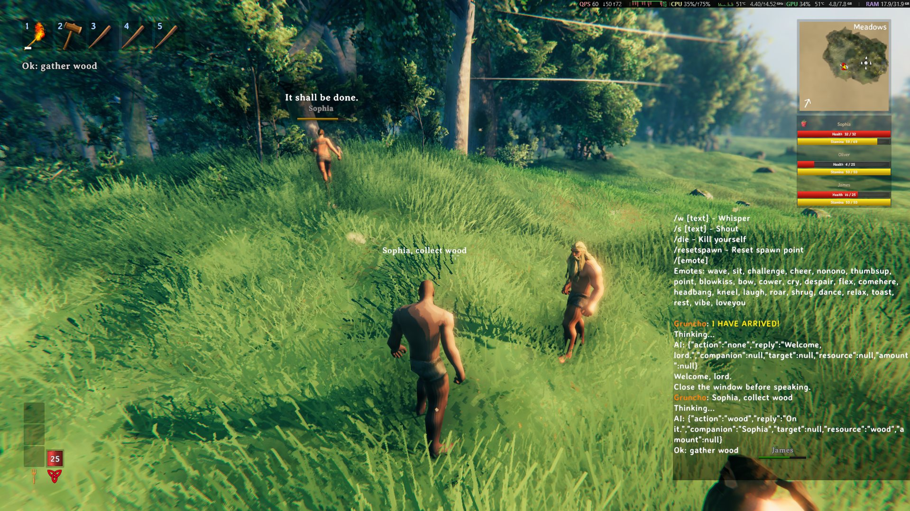
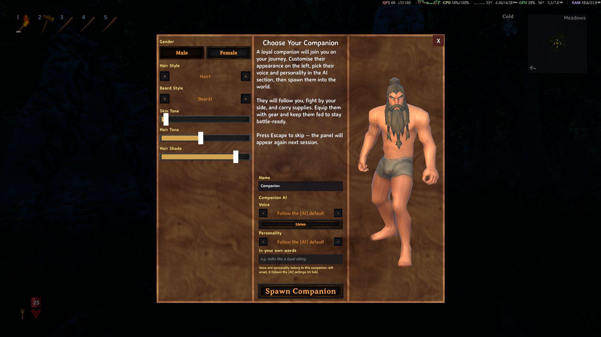
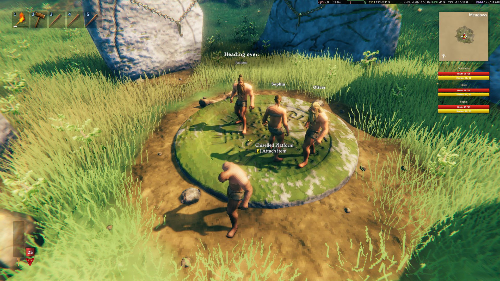
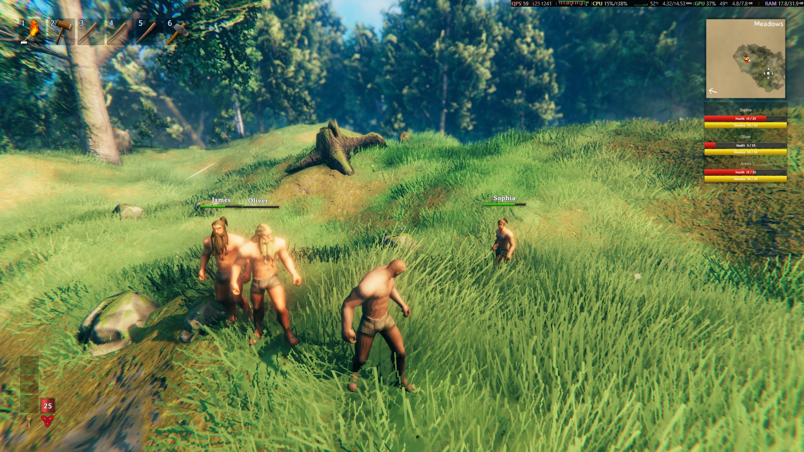

> 🌍 [English](Home) · [Português](Home-pt) · **Español** · [Français](Home-fr) · [Italiano](Home-it)

# AI Companions

Un **compañero NPC con IA** para **Valheim 1.0**: le **hablas o escribes** y él entiende y actúa.

> **Tipos de compañero: los dverger son de combate**
>
> **Mago**, **Mago de Fuego**, **Mago de Hielo** y **Apoyo** son **de combate**: luchan normalmente y la rueda
> muestra solo las acciones de combate/apoyo — las órdenes de **trabajo** por chat, voz o la tecla de comando son
> **rechazados** con *"Soy de combate, no hago ese trabajo."*. Para trabajar, usa el tipo **Compañero** (detalles en
> **[Cómo funciona](How-it-works-es#tipos-de-compañero)**).

## En acción

**1. Una orden en el chat** — `Sophia, recoge madera`: su respuesta y el bocadillo de habla en el mundo.

**2. Tu primer compañero, a tu manera** — género, pelo, barba, tono de piel, tono de pelo, el nombre y la voz y
personalidad de **ese** compañero; luego **Invocar compañero**.

**3. Una tropa entera** — hasta **10** compañeros, cada uno con su pestaña en el panel `I` y su nombre en la lista
de la pantalla.

**4. Contigo en el camino** — te siguen, luchan y llevan lo que recogen.

## Qué es

Este proyecto es un **proyecto independiente** basado en [Offline Companions Reborn](https://github.com/MaddhattrRocks/Offline-Companions-Reborn)
(**MIT**) — que a su vez es un fork de *Offline Companions*, de **ProfMags** — con dos cosas nuestras encima:

1. **Cinco idiomas** — **portugués de Brasil, inglés, español, francés e italiano**: la interfaz (1001 claves), las
   frases del compañero (221 líneas), los presets de personalidad y el contrato del LLM siguen el **idioma del
   juego**, con el **inglés como idioma nativo**, y un idioma nuevo es **un archivo**.
2. **Una capa de IA**: órdenes en **lenguaje natural** (texto en el chat o **voz** por push-to-talk), con
   **personalidad**, **memoria** y **conversación libre** — y la voz y el reconocimiento del habla **eligen el idioma
   y la voz solos**.

El compañero en sí (trabajos, comida, stamina, habilidades, casa, descanso, portales, carro, menú radial) viene del
upstream y sigue funcionando igual — la IA es solo una **nueva entrada** para las mismas acciones.

> **La voz corre toda en tu máquina.** El reconocimiento del habla (STT) y la voz sintetizada (TTS) son **100%
> locales**: no se envía nada. Entender las órdenes usa un **LLM** — el camino recomendado es el **LM Studio**
> (u Ollama) local, donde **nada** sale; el `.cfg` viene apuntado a **Groq**, un **servicio remoto** (el texto
> de las órdenes y de la conversación **sale de tu máquina**). Mira
> **[LLM (LM Studio, Groq u OpenRouter)](LLM-es)**.

## Qué hace

| Función | Cómo |
|---|---|
| **Órdenes por chat** | `recoge 10 de madera` · `sígueme` · `para` · `ataca a ese greydwarf` · `equipa el hacha de bronce` |
| **Órdenes por voz** | Mantén **`V`**, habla y suelta — el habla se transcribe dentro del juego |
| **Él habla** | Voz sintetizada **en el idioma del juego**, saliendo **de su posición** en el mundo |
| **Personalidad** | Presets (**Viking leal**, **Mago sarcástico**, **Sarcástico**, **Guía paciente** — los nombres siguen el idioma del juego) o tus propias palabras |
| **Memoria y conversación** | `buenos días`, `¿qué tal?` — responde como personaje y recuerda la conversación |
| **Varios compañeros** | Hasta **10**, cada uno con su pestaña en el panel `I`; el invocador crea uno nuevo **gratis** (sin el Trader) |
| **Orden por nombre** | `Gruncha, recoge 10 piedras` vale **solo** para él; sin el nombre, la orden vale para todos |
| **Apariencia** | Editor con **vista previa 3D**: género, pelo, barba, piel y tono de pelo, sin renacer |
| **Panel de IA** | Tecla **`I`**: una pestaña por compañero (nombre, tipo, Llamar, Apariencia, voz y personalidad), el invocador, volumen, push-to-talk y los **ajustes del LLM** (con el **selector de proveedor**) — todo guardado al momento |

## Requisitos en resumen

| Elemento | Detalle |
|---|---|
| **Valheim 1.0.x** + **BepInEx 5.4.2351** | La base de todo — paso a paso en **[Instalación](Installation-es)** |
| **Un LLM** | **LM Studio** (recomendado): el modelo corre en tu máquina y no sale nada — lo descargas una vez (~1,9 GB) y dejas el servidor encendido. **Groq** (lo que viene en el `.cfg`): solo la **clave gratis** (https://console.groq.com/keys) e internet — el texto de las órdenes **sale de tu máquina**. **OpenRouter** sigue funcionando como alternativa |
| **Micrófono** | Solo para las órdenes por voz |

## Primeros pasos

1. Mira lo que necesitas en **[Requisitos](Requirements-es)**.
2. Sigue el paso a paso de **[Instalación](Installation-es)**.
3. Configura el LLM en **[LLM (LM Studio, Groq u OpenRouter)](LLM-es)** — el camino recomendado es el **LM
   Studio** local (sin clave, nada sale); **Groq** es lo que viene en el `.cfg` (solo la clave gratis) y
   **OpenRouter** es la alternativa.
4. Mira las teclas y las órdenes en **[Comandos](Commands-es)**.
5. Si algo no funciona, ve a **[Problemas comunes](Troubleshooting-es)**.

## Índice de la wiki

| Página | Qué tiene |
|---|---|
| **[Requisitos](Requirements-es)** | Qué es obligatorio y qué es opcional |
| **[Instalación](Installation-es)** | Paso a paso con imágenes |
| **[LLM (LM Studio, Groq u OpenRouter)](LLM-es)** | LM Studio como camino recomendado, Groq como la opción de nube que viene en el `.cfg` (clave gratis) y OpenRouter como alternativa |
| **[Voz](Voice-es)** | STT (Whisper) y TTS (Kokoro): cómo funcionan y cómo ajustarlos |
| **[Comandos](Commands-es)** | Teclas, órdenes de chat/voz y comandos de consola |
| **[Configuración](Configuration-es)** | El `.cfg`, la sección `[AI]` y los paneles `F8` e `I` |
| **[Problemas comunes](Troubleshooting-es)** | Síntoma → causa → solución |
| **[Cómo funciona](How-it-works-es)** | Arquitectura y el camino de una orden |
| **[Historial de versiones](https://github.com/julianu37/AI-Companions/blob/main/package/CHANGELOG.md)** | El changelog completo, de la 1.6.0 a la 1.9.6 |
| **[Créditos y licencia](Credits-and-license-es)** | Upstream, terceros y licencias |

## Enlaces rápidos

| Qué | Dónde |
|---|---|
| **Releases (descarga)** | https://github.com/julianu37/AI-Companions/releases |
| **Repositorio** | https://github.com/julianu37/AI-Companions |
| **Changelog** | https://github.com/julianu37/AI-Companions/blob/main/package/CHANGELOG.md |
| **Upstream (MIT)** | https://github.com/MaddhattrRocks/Offline-Companions-Reborn |

La release publicada más reciente es la **1.9.6** (02/11/2026), con **un** paquete:

| Archivo | Tamaño | Qué viene |
|---|---|---|
| `AI_Companions-1.9.6.zip` | ~314 MB | El mod, las traducciones **y** los modelos de voz (STT + TTS) ya listos |

> **Un solo paquete.** Desde la **1.9.4** la release viene **con** los modelos de voz, ya **dentro** de
> `BepInEx\plugins\AI-Companions\` (`whisper\` y `tts\`) — no hay nada que descargar aparte. El paquete
> **sin modelos** quedó **descontinuado** (el último fue el de la 1.9.1).

> **La 1.9.6 — la actualización de la construcción.** El compañero ahora **construye lo que le pides**: una
> bancada, un cofre, una cama, un refugio, una tienda, una cabaña 2x2 o la casa entera (4x4, 6x6 y 8x8), en los
> cinco idiomas. Encuentra el sitio con las reglas del propio juego, paga pieza por pieza de la mochila y de los
> cofres, recoge lo que falta, **allana el terreno con la azada** y vuelve solo a terminar la obra, en el mismo
> ancla y la misma pieza. La puerta va siempre **la última**. Órdenes: `construye una bancada aquí`, `construye
> una cabaña aquí`, `construye una casa aquí`, `construye una casa 6x6 aquí`, `allana un terreno 10x10 aquí` (la
> tabla completa está en **[Comandos](Commands-es#construcción)**).

> **La 1.9.5 en resumen — el lote de la revisión de 10 especialistas.** Veinte correcciones, ninguna función nueva:
>
> - **El Santuario y la lista de compañeros hablan los cinco idiomas** — la confirmación de "traer de vuelta"
>   y las líneas de "visto por última vez/murió" estaban fijas en inglés.
> - **Lápida más segura:** si la llamada interna del juego que usa el parche se rompe, ahora avisa una vez en
>   el log y deja que el juego retire la lápida como siempre, en vez de retenerla para siempre; y la cama
>   solo se registra como guardada cuando se guardó de verdad.
> - **El radio de la casa sobrevive** a la muerte, al renacer y a la lista de compañeros
>   (`HC_Respawn_HomeRadius`), y la comprobación de "ya lleva escudo" funciona — la búsqueda antigua no existía.
> - **`[Speech] MinInterval`/`MaxInterval` valen de verdad:** la frase ociosa usa los dos (15–30 s por defecto;
>   el código tenía 90–180 s fijos).
> - **El LLM dejó de pagar tres peticiones por orden** (cuando el servidor rechaza las dos formas estructuradas,
>   los siguientes mensajes van directo en el formato antiguo), el **`[Advanced] ConfigVersion`** hace que las
>   migraciones de config corran **una vez** y el **`F8` dejó de asignar memoria por frame**.

> **1.9.1:** el paquete es ~54 MB más ligero — el modelo `ggml-base-q5_1.bin`, que no se usaba, ya no viene (sigue
> siendo una descarga opcional).

> **La 1.9.0 en una línea:** el mod habla **cinco idiomas** (portugués, inglés, español, francés e italiano) siguiendo
> el **idioma del juego**, y la **voz y el reconocimiento del habla son automáticos** — `[AI] TtsVoice = 0` y
> `TtsLanguage` / `VoiceLanguage` = `auto`, y un valor explícito sigue ganando. **Cambiar el idioma del juego no
> exige reiniciar.**

> **¿Vienes de una versión anterior?** El mod ahora se llama **AI Companions** (era *ModAI-BR-Companions*) y la
> carpeta ahora es `BepInEx\plugins\AI-Companions\`: **borra la carpeta antigua**
> (`BepInEx\plugins\ModAI-BR-Companions\`) antes de extraer — dos copias del mismo plugin hacen que BepInEx cargue el
> mod dos veces. **Nada tuyo se pierde**: la partida, los compañeros, la casa y el inventario siguen valiendo (el GUID
> del plugin y las claves `HC_*` se conservaron a propósito).

> La **1.9.0** es la release de los **cinco idiomas**: **portugués, inglés, español, francés e italiano** — la
> interfaz, las frases del compañero, los presets de personalidad y el contrato del LLM siguen el **idioma del
> juego**, y la voz y el reconocimiento del habla **eligen el idioma solos** (`[AI] VoiceLanguage`, `TtsLanguage` y
> `TtsVoice` = `auto` / `0`). Cambiar el idioma del juego **no exige reiniciar**: los paneles se reconstruyen en la
> próxima apertura y el HUD, las frases y el TTS/STT acompañan.
>
> La **1.8.3** es donde el **inglés se volvió el idioma nativo** (claves y descripciones del `.cfg`) y el
> **portugués se volvió traducción** — los paneles (`I` y `F8`) siguen el **idioma del juego**, y un idioma nuevo
> entra por `Translations/<Idioma>.json` + `Speech/<Idioma>.json`.
>
> La **1.8.2** deja la elección del LLM a un clic: en la sección **Ajustes del LLM** del panel `I`, el desplegable
> **"Elige tu proveedor LLM"** rellena la **URL y el modelo** de **Groq**, **LM Studio** u **OpenRouter** (la clave
> sigue contigo), y el botón **"Crea tu clave de API gratis AQUÍ"** abre la página de la clave en el navegador. La
> **velocidad del habla** se quedó **solo en el panel `F8`**.
>
> La **1.8.1** trae **Groq como LLM por defecto** (gratis y rápido: la clave sale en `console.groq.com/keys`), con
> **LM Studio/Ollama** como opción local y **OpenRouter** todavía disponible — solo que su tier gratuito es más
> lento. Y mantiene todo lo que trajo la **1.8.0**: **varios compañeros**, cada uno con su pestaña en el panel `I`
> (nombre, tipo, apariencia, voz y personalidad propias, orden por nombre y un tope de 10), el **editor de
> apariencia con vista previa 3D** y la sección **Ajustes del LLM** en el panel `I`.
>
> La **1.8.0** corrigió el **peso**: el **Megingjord** (+150) y los demás objetos con bonus de carga **suman** al
> tope del compañero (el `/300` pasa a `/450`), valiendo con el cinturón **en cualquier lugar de la mochila** — no
> hace falta equiparlo — y **una sola vez** (dos cinturones no se acumulan).
