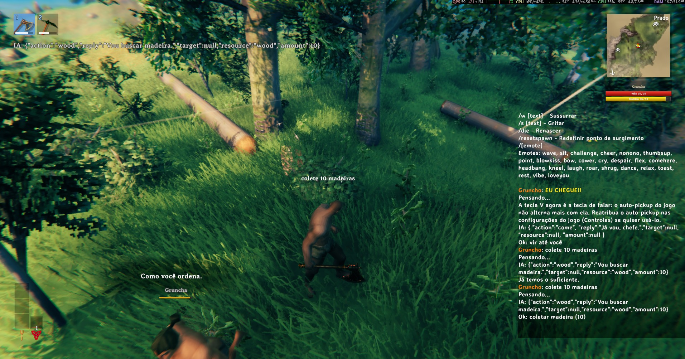
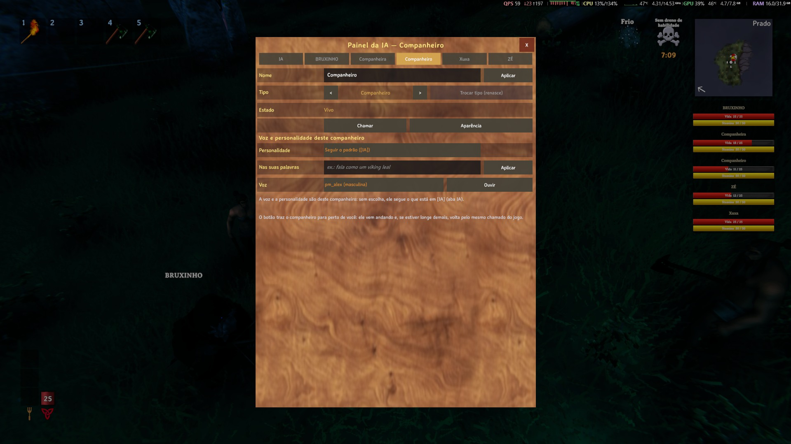
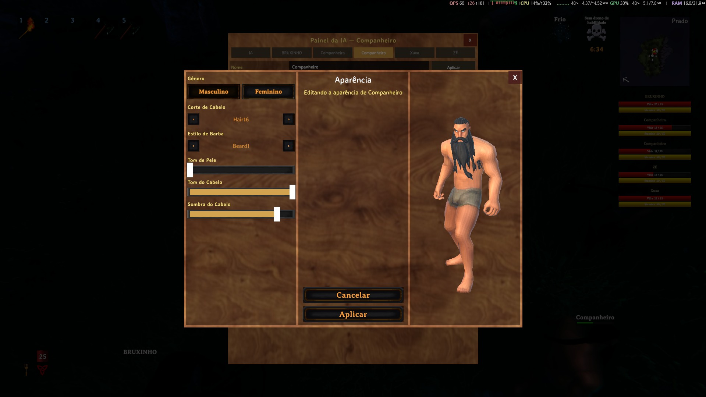
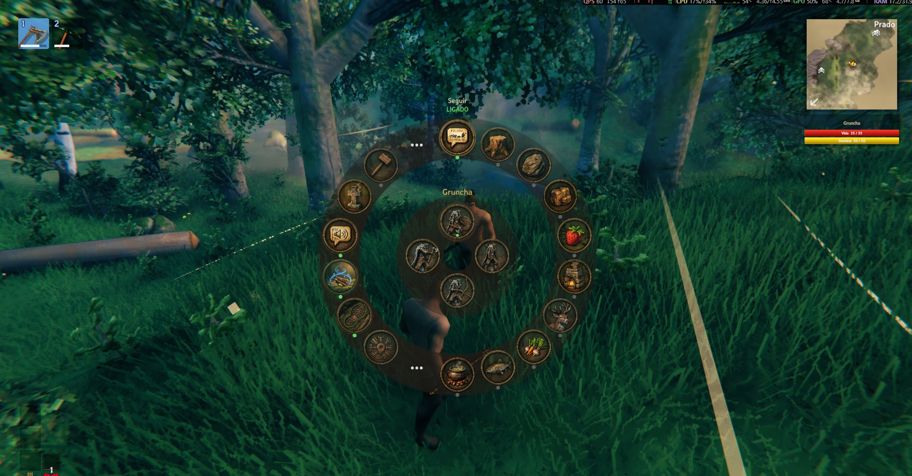

> 🌍 [English](Home) · **Português**

# AI Companions

Um **companheiro NPC com IA** para **Valheim 1.0**, em **português do Brasil** — você **fala ou digita** e ele
entende e executa.

> Vídeo do canal **SuaTV**: **"Esse mod muda TUDO no Valheim! AI Companions"**.
> **[Assistir no YouTube](https://www.youtube.com/watch?v=40FnVEIbXyo)** — clicar na imagem também abre.

> **Tipos de companheiro: os dverger são de combate**
>
> **Mago**, **Mago de Fogo**, **Mago de Gelo** e **Suporte** são **de combate**: lutam normalmente e a roda mostra só
> as ações de combate/suporte — ordens de **trabalho** por chat, voz ou tecla de comando são **recusadas** com
> *"Sou de combate, não faço esse trabalho"*. Para trabalhos, use o **Companheiro** (detalhes em
> **[Como funciona](How-it-works-pt#tipos-de-companheiro)**).

## Em ação

**1. Uma ordem no chat** — `colete 10 madeiras`: a resposta dele e o balão de fala no mundo.

**2. Uma aba por companheiro (tecla `I`)** — nome, tipo, Chamar, Aparência e a voz/personalidade **daquele**
companheiro.

**3. Editor de aparência** — gênero, corte de cabelo, barba, pele, tom e sombra do cabelo, com o boneco mudando
**ao vivo** enquanto você escolhe.

**4. Painel `F8`, seção `[AI]`** — as opções da camada de IA, com os mesmos nomes de chave do `.cfg`.

![O painel F8 aberto na seção [AI], com as opções da camada de IA](images/3-painel-f8.jpg)

**5. Menu radial (segure `E` olhando o companheiro)** — as ações dele à mão.

## O que é

Este projeto é um **projeto independente** baseado em [Offline Companions Reborn](https://github.com/MaddhattrRocks/Offline-Companions-Reborn)
(**MIT**) — que por sua vez é um fork do *Offline Companions*, do **ProfMags** — com duas coisas nossas por cima:

1. **Tradução PT-BR** (interface, menus, painéis e as falas do companheiro) sobre um mod agora **multilíngue**,
   com o **inglês como idioma nativo**: os painéis seguem o **idioma do jogo** e um idioma novo é **um arquivo**.
2. **Uma camada de IA**: ordens em **linguagem natural** (texto no chat ou **voz** por push-to-talk), com
   **personalidade**, **memória** e **conversa livre**.

O companheiro em si (trabalhos, comida, stamina, habilidades, casa, descanso, portais, carroça, menu radial)
vem do upstream e continua funcionando igual — a IA é só uma **nova entrada** para as mesmas ações.

> **A voz roda toda na sua máquina.** O reconhecimento da fala (STT) e a voz sintetizada (TTS) são **100%
> locais**: nada é enviado. O entendimento das ordens usa um **LLM** — por padrão o **Groq**, que é um
> **serviço remoto** (o texto das ordens e da conversa **sai da sua máquina**). Para não enviar nada, troque-o
> pela opção local, **LM Studio** (ou Ollama). Veja **[LLM (Groq, LM Studio ou OpenRouter)](LLM-pt)**.

## O que ele faz

| Recurso | Como |
|---|---|
| **Ordens por chat** | `colete 10 madeiras` · `segue` · `para` · `ataca o greydwarf` · `equipa o machado de bronze` |
| **Ordens por voz** | Segure **`V`**, fale e solte — a fala é transcrita dentro do jogo |
| **Ele fala** | Voz sintetizada em PT-BR, saindo **da posição dele** no mundo |
| **Personalidade** | Presets (`viking`, `mago`, `sarcastico`, `guia`) ou as suas palavras |
| **Memória e conversa** | `bom dia`, `como você está?` — ele responde como personagem e lembra da conversa |
| **Vários companheiros** | Até **10**, cada um com a sua aba no painel `I`; o invocador cria um novo **de graça** (sem o Trader) |
| **Ordem pelo nome** | `Gruncha, colete 10 pedras` vale **só** para ele; sem o nome, a ordem vale para todos |
| **Aparência** | Editor com **preview 3D**: gênero, cabelo, barba, pele e tom do cabelo, sem respawn |
| **Painel da IA** | Tecla **`I`**: uma aba por companheiro (nome, tipo, Chamar, Aparência, voz e personalidade), o invocador, volume, push-to-talk e as **configurações do LLM** (com o **seletor de provedor**) — tudo salvo na hora |

## Requisitos em resumo

| Item | Detalhe |
|---|---|
| **Valheim 1.0.x** + **BepInEx 5.4.2351** | A base de tudo — passo a passo em **[Instalação](Installation-pt)** |
| **Um LLM** | **Groq** (padrão): só a **chave gratuita** (https://console.groq.com/keys) e internet — o texto das ordens **sai da sua máquina**. A opção local, **LM Studio** ou Ollama, é **opcional** e não envia nada; o **OpenRouter** continua funcionando como alternativa |
| **Windows x64** | Obrigatório para a voz (os binários nativos são `win-x64`) |
| **Microfone** | Só para as ordens por voz |

## Começando

1. Veja o que você precisa em **[Requisitos](Requirements-pt)**.
2. Siga o passo a passo de **[Instalação](Installation-pt)**.
3. Configure o LLM em **[LLM (Groq, LM Studio ou OpenRouter)](LLM-pt)** — o padrão é o **Groq**
   (só a chave gratuita); o **LM Studio** local é opcional e o **OpenRouter** é alternativa.
4. Veja as teclas e as ordens em **[Comandos](Commands-pt)**.
5. Se algo não funcionar, vá em **[Problemas comuns](Troubleshooting-pt)**.

## Índice da wiki

| Página | O que tem |
|---|---|
| **[Requisitos](Requirements-pt)** | O que é obrigatório e o que é opcional |
| **[Instalação](Installation-pt)** | Passo a passo com imagens |
| **[LLM (Groq, LM Studio ou OpenRouter)](LLM-pt)** | O Groq como padrão (chave gratuita), o LM Studio local como opção e o OpenRouter como alternativa |
| **[Voz](Voice-pt)** | STT (Whisper) e TTS (Kokoro): como funcionam e como ajustar |
| **[Comandos](Commands-pt)** | Teclas, ordens de chat/voz e comandos de console |
| **[Configuração](Configuration-pt)** | O `.cfg`, a seção `[AI]` e os painéis `F8` e `I` |
| **[Problemas comuns](Troubleshooting-pt)** | Sintoma → causa → solução |
| **[Como funciona](How-it-works-pt)** | Arquitetura e o caminho de uma ordem |
| **[Histórico de versões](https://github.com/julianu37/AI-Companions/blob/main/package/CHANGELOG.md)** | O changelog completo, da 1.6.0 à 1.8.3 |
| **[Créditos e licença](Credits-and-license-pt)** | Upstream, terceiros e licenças |

## Links rápidos

| O quê | Onde |
|---|---|
| **Releases (download)** | https://github.com/julianu37/AI-Companions/releases |
| **Repositório** | https://github.com/julianu37/AI-Companions |
| **Changelog** | https://github.com/julianu37/AI-Companions/blob/main/package/CHANGELOG.md |
| **Upstream (MIT)** | https://github.com/MaddhattrRocks/Offline-Companions-Reborn |
| **Vídeo** | https://www.youtube.com/watch?v=40FnVEIbXyo |

A release publicada mais recente é a **1.8.3** (25/10/2026), com **dois** arquivos para escolher:

| Arquivo | Tamanho | O que vem |
|---|---|---|
| `AI_Companions-1.8.3.zip` | ~368 MB | O mod **e** os modelos de voz (STT + TTS) já prontos |
| `AI_Companions-1.8.3-sem-modelos.zip` | ~28,5 MB | Só o mod e as traduções — você baixa os modelos por fora |

> **Qual escolher?** Se você quer só instalar e usar, pegue o **completo**. Se a sua internet é lenta (ou você já
> tem os modelos), pegue o **sem-modelos** e siga a seção de modelos em **[Instalação](Installation-pt)**.

> ### Atualizando para a 1.8.3? As configurações voltam aos padrões
>
> A **1.8.3** trocou o **arquivo** de configuração: agora ele é **`BepInEx\config\AiCompanions.cfg`**, e o antigo
> (`Maddhattr.OfflineCompanionsReborn.cfg`) **não é mais lido** — pode ser apagado. O arquivo novo nasce com os
> **valores padrão**, inclusive a **`ApiKey` em branco**: se você usa o Groq ou o OpenRouter, **cole a chave de
> novo** (painel `I` → **Configurações do LLM**). A seção da IA também mudou de nome (`[IA]` → **`[AI]`**) e as
> chaves agora são em **inglês** (`Ligado` virou `Enabled`, `Modelo` virou `Model`…).
>
> **O que NÃO se perde:** o **save**, o **mundo**, os **companheiros**, as casas e o inventário — o **GUID** do
> plugin e as chaves `HC_*` não mudaram. Só a configuração volta ao padrão.

> **Já tem uma versão anterior?** O mod passou a se chamar **AI Companions** (era *ModAI-BR-Companions*) e a pasta
> agora é `BepInEx\plugins\AI-Companions\`: **apague a pasta antiga** (`BepInEx\plugins\ModAI-BR-Companions\`)
> antes de extrair — duas cópias do mesmo plugin fazem o BepInEx carregar o mod duas vezes. **Nada seu se perde**:
> o save, os companheiros, a casa e o inventário continuam valendo (o GUID do plugin e as chaves `HC_*` foram
> preservados de propósito).

> A **1.8.3** é a versão **multilíngue**: o **inglês é o idioma nativo** (chaves e descrições do `.cfg`) e o
> **português é a tradução** — os painéis (`I` e `F8`) seguem o **idioma do jogo**, e um idioma novo entra por
> `Translations/<Idioma>.json` + `Speech/<Idioma>.json`.
>
> A **1.8.2** deixa a escolha do LLM a um clique: na seção **Configurações do LLM** do painel `I`, o dropdown
> **"Selecione seu Provedor LLM"** preenche a **URL e o modelo** de **Groq**, **LM Studio** ou **OpenRouter** (a
> chave continua com você), e o botão **"Crie sua Chave de API Grátis AQUI"** abre a página da chave no navegador.
> A **velocidade da fala** ficou **só no painel `F8`**.
>
> A **1.8.1** traz o **Groq como LLM padrão** (grátis e rápido: a chave sai em `console.groq.com/keys`), com o
> **LM Studio/Ollama** como opção local e o **OpenRouter** ainda disponível — só que o tier gratuito dele é mais lento.
> E mantém tudo o que a **1.8.0** trouxe: **vários companheiros**, cada um com a sua aba no painel `I` (nome, tipo,
> aparência, voz e personalidade próprias, ordem pelo nome e um teto de 10), o **editor de aparência com preview 3D** e
> a seção **Configurações do LLM** no painel `I`.
>
> A **1.8.0** corrigiu o **peso**: o **Megingjord** (+150) e os demais itens com bônus de carga **somam** no teto do
> companheiro (o `/300` vira `/450`), valendo com o cinto em **qualquer lugar da mochila** — não precisa equipar —
> e **uma vez só** (dois cintos não empilham).

<!-- D4: add Español/Français/Italiano -->
