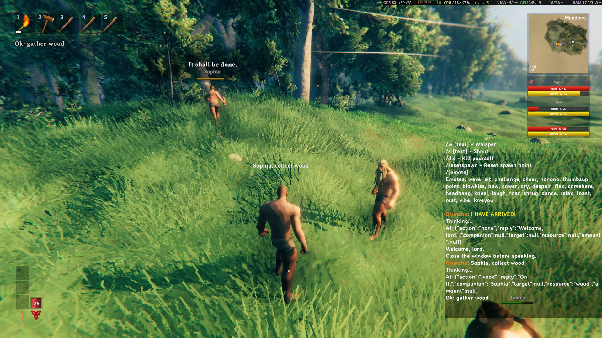
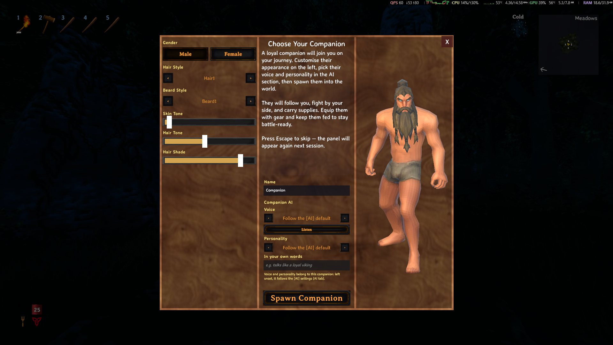
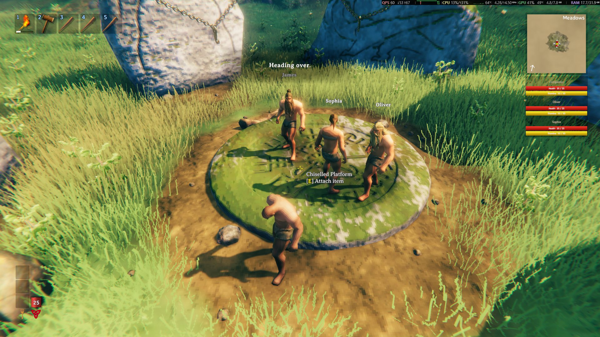
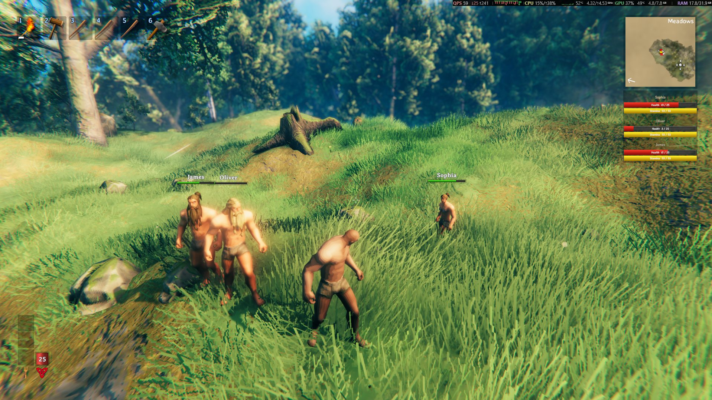

> 🌍 **English** · [Português](Home-pt) · [Español](Home-es) · [Français](Home-fr) · [Italiano](Home-it)

# AI Companions

An **AI NPC companion** for **Valheim 1.0**: you **speak or type** and he understands and acts.

> **Companion types: the dverger are combat types**
>
> **Mage**, **Fire Mage**, **Ice Mage** and **Support** are **combat** types: they fight normally and the ring
> shows only the combat/support actions — **work** orders by chat, voice or the command key are **refused**
> with *"I fight, I don't do that work."*. To work, use the **Companion** type (details in
> **[How it works](How-it-works#companion-types)**).

## In action

**1. An order in the chat** — `Sophia, collect wood`: his reply and his speech balloon in the world.

**2. Your first companion, made your way** — gender, hair, beard, skin tone, hair tone, the name and the voice and
personality of **that** companion; then **Spawn Companion**.

**3. A whole crew** — up to **10** companions, each one with its own tab in the `I` panel and its name in the
roster on the screen.

**4. With you on the road** — they follow, they fight and they carry what they gather.

## What it is

This project is an **independent project** based on [Offline Companions Reborn](https://github.com/MaddhattrRocks/Offline-Companions-Reborn)
(**MIT**) — which in turn is a fork of *Offline Companions*, by **ProfMags** — with two things of ours on top:

1. **Five languages** — **Portuguese (Brazil), English, Spanish, French and Italian**: the interface (914 keys),
   the companion's speech (221 lines), the personality presets and the LLM contract follow the **game's language**,
   with **English as the native language**, and a new language is **one file**.
2. **An AI layer**: orders in **natural language** (text in the chat or **voice** through push-to-talk), with
   **personality**, **memory** and **free conversation** — and the voice and the speech recognition **pick the
   language and the voice by themselves**.

The companion itself (jobs, food, stamina, skills, home, rest, portals, cart, radial menu) comes from the upstream
and keeps working the same — the AI is only a **new entry point** for the same actions.

> **The voice all runs on your machine.** Speech recognition (STT) and the synthesized voice (TTS) are **100%
> local**: nothing is sent. Understanding the orders uses an **LLM** — the recommended path is the local
> **LM Studio** (or Ollama), where **nothing** leaves; the `.cfg` ships pointed at **Groq**, a **remote
> service** (the text of the orders and of the conversation **leaves your machine**). See
> **[LLM (LM Studio, Groq or OpenRouter)](LLM)**.

## What it does

| Feature | How |
|---|---|
| **Chat orders** | `collect 10 wood` · `follow` · `stop` · `attack the greydwarf` · `equip the bronze axe` |
| **Voice orders** | Hold **`V`**, speak and release — the speech is transcribed inside the game |
| **He speaks** | Synthesized voice **in the game's language**, coming **from his position** in the world |
| **Personality** | Presets (**Loyal Viking**, **Sarcastic Mage**, **Sarcastic**, **Patient Guide** — the names follow the game's language) or your own words |
| **Memory and conversation** | `good morning`, `how are you?` — he answers as a character and remembers the conversation |
| **Several companions** | Up to **10**, each one with its own tab in the `I` panel; the summoner creates a new one **for free** (no Trader) |
| **Order by name** | `Gruncha, collect 10 stones` applies **only** to him; without the name, the order applies to all |
| **Appearance** | Editor with a **3D preview**: gender, hair, beard, skin and hair tone, no respawn |
| **AI panel** | Key **`I`**: one tab per companion (name, type, Call, Appearance, voice and personality), the summoner, volume, push-to-talk and the **LLM settings** (with the **provider picker**) — everything saved right away |

## Requirements at a glance

| Item | Detail |
|---|---|
| **Valheim 1.0.x** + **BepInEx 5.4.2351** | The base of everything — step by step in **[Installation](Installation)** |
| **An LLM** | **LM Studio** (recommended): the model runs on your machine and nothing leaves — you download it once (~1.9 GB) and keep the server on. **Groq** (what the `.cfg` ships with): only the **free key** (https://console.groq.com/keys) and internet — the text of the orders **leaves your machine**. **OpenRouter** still works as an alternative |
| **Microphone** | Only for the voice orders |

## Getting started

1. See what you need in **[Requirements](Requirements)**.
2. Follow the step by step in **[Installation](Installation)**.
3. Configure the LLM in **[LLM (LM Studio, Groq or OpenRouter)](LLM)** — the recommended path is the local
   **LM Studio** (no key, nothing leaves); **Groq** is what the `.cfg` ships with (only the free key) and
   **OpenRouter** is the alternative.
4. See the keys and the orders in **[Commands](Commands)**.
5. If something does not work, go to **[Troubleshooting](Troubleshooting)**.

## Wiki index

| Page | What is in it |
|---|---|
| **[Requirements](Requirements)** | What is required and what is optional |
| **[Installation](Installation)** | Step by step with images |
| **[LLM (LM Studio, Groq or OpenRouter)](LLM)** | LM Studio as the recommended path, Groq as the cloud option that comes in the `.cfg` (free key) and OpenRouter as an alternative |
| **[Voice](Voice)** | STT (Whisper) and TTS (Kokoro): how they work and how to tune them |
| **[Commands](Commands)** | Keys, chat/voice orders and console commands |
| **[Configuration](Configuration)** | The `.cfg`, the `[AI]` section and the `F8` and `I` panels |
| **[Troubleshooting](Troubleshooting)** | Symptom → cause → solution |
| **[How it works](How-it-works)** | Architecture and the path of an order |
| **[Changelog](https://github.com/julianu37/AI-Companions/blob/main/package/CHANGELOG.md)** | The full changelog, from 1.6.0 to 1.9.1 |
| **[Credits and license](Credits-and-license)** | Upstream, third parties and licenses |

## Quick links

| What | Where |
|---|---|
| **Releases (download)** | https://github.com/julianu37/AI-Companions/releases |
| **Repository** | https://github.com/julianu37/AI-Companions |
| **Changelog** | https://github.com/julianu37/AI-Companions/blob/main/package/CHANGELOG.md |
| **Upstream (MIT)** | https://github.com/MaddhattrRocks/Offline-Companions-Reborn |

The most recent published release is **1.9.1** (26/10/2026), with **two** files to choose from:

| File | Size | What comes in it |
|---|---|---|
| `AI_Companions-1.9.1.zip` | ~314 MB | The mod **and** the voice models (STT + TTS) ready to use |
| `AI_Companions-1.9.1-sem-modelos.zip` | ~28.5 MB | Only the mod and the translations — you download the models separately |

> **Which one should you pick?** If you just want to install and play, take the **full** one. If your internet is
> slow (or you already have the models), take the **no-models** one and follow the models section in
> **[Installation](Installation)**.

> **1.9.1:** the package is ~54 MB lighter — the unused `ggml-base-q5_1.bin` model is no longer shipped (it is still
> an optional download).

> **1.9.0 in one line:** the mod speaks **five languages** (Portuguese, English, Spanish, French and Italian)
> following the **game's language**, and the **voice and the speech recognition are automatic** — `[AI] TtsVoice = 0`
> and `TtsLanguage` / `VoiceLanguage` = `auto`, and an explicit value still wins. **Changing the game's language does
> not need a restart.**

> **Coming from an older version?** The mod is now called **AI Companions** (it was *ModAI-BR-Companions*) and the
> folder is now `BepInEx\plugins\AI-Companions\`: **delete the old folder** (`BepInEx\plugins\ModAI-BR-Companions\`)
> before extracting — two copies of the same plugin make BepInEx load the mod twice. **Nothing of yours is lost**:
> the save, the companions, the house and the inventory still work (the plugin GUID and the `HC_*` keys were
> preserved on purpose).

> **1.9.0** is the **five-language** release: **Portuguese, English, Spanish, French and Italian** — the interface,
> the companion's speech, the personality presets and the LLM contract follow the **game's language**, and the voice
> and the speech recognition **pick the language by themselves** (`[AI] VoiceLanguage`, `TtsLanguage` and `TtsVoice`
> = `auto` / `0`). Changing the game's language **does not need a restart**: the panels rebuild on the next open and
> the HUD, the speech and the TTS/STT follow along.
>
> **1.8.3** is where **English became the native language** (keys and descriptions of the `.cfg`) and **Portuguese
> became a translation** — the panels (`I` and `F8`) follow the **game's language**, and a new language comes in
> through `Translations/<Language>.json` + `Speech/<Language>.json`.
>
> **1.8.2** puts the LLM choice one click away: in the **LLM settings** section of the `I` panel, the dropdown
> **"Pick your LLM provider"** fills in the **URL and the model** of **Groq**, **LM Studio** or **OpenRouter**
> (the key stays with you), and the **"Create your free API key HERE"** button opens the key page in the browser.
> The **speech speed** now lives **only in the `F8` panel**.
>
> **1.8.1** brings **Groq as the default LLM** (free and fast: the key comes from `console.groq.com/keys`), with
> **LM Studio/Ollama** as the local option and **OpenRouter** still available — only its free tier is slower.
> And it keeps everything **1.8.0** brought: **several companions**, each one with its own tab in the `I` panel
> (name, type, own appearance, voice and personality, order by name and a cap of 10), the **appearance editor with
> a 3D preview** and the **LLM settings** section in the `I` panel.
>
> **1.8.0** fixed the **weight**: the **Megingjord** (+150) and the other items with a carry bonus **add up** to
> the companion's ceiling (the `/300` becomes `/450`), counting with the belt **anywhere in the bag** — no need to
> equip it — and **only once** (two belts do not stack).
