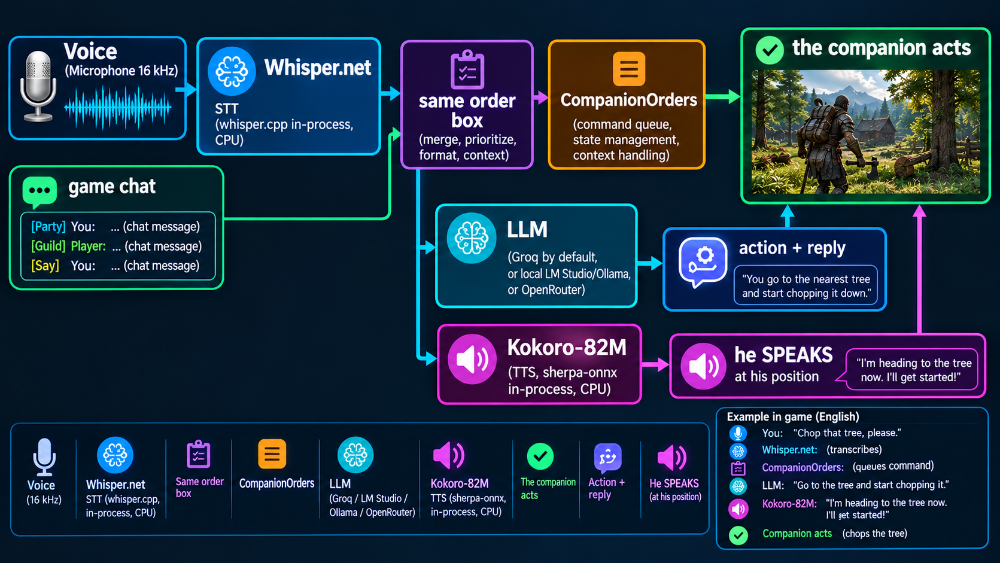
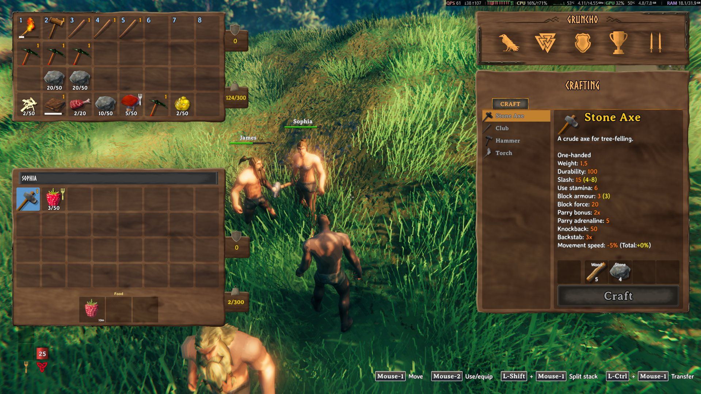

> 🌍 **English** · [Português](How-it-works-pt) · [Español](How-it-works-es) · [Français](How-it-works-fr) · [Italiano](How-it-works-it)

# How it works

The architecture of the mod and the path an order takes, from your microphone (or from the chat) to the companion
acting.

---

## Overview



Three AI pieces, all on **background threads** (the LLM can be remote; the STT and the TTS are always local):

| Piece | What it is | Where it runs |
|---|---|---|
| **LLM** | Understands the order and talks | **LM Studio/Ollama** (local, recommended) or **Groq** (remote, what the `.cfg` ships with) — any OpenAI-compatible endpoint |
| **STT** | Transcribes your speech | `Whisper.net` (whisper.cpp) inside the game |
| **TTS** | Makes the companion speak | `sherpa-onnx` + Kokoro-82M inside the game |

---

## The path of an order

1. **Input.** You type in the chat **or** hold `V` and speak. In both cases the text falls into the **same** entry
   point — there is no duplicated logic between chat and voice.
2. **Prompt.** The mod assembles the prompt of the message: the fixed **contract** (in the **game's language**) +
   the companion's **name** + the **personality** + the recent **memory**.
3. **LLM.** The text goes to the configured server (`POST {BaseUrl}/chat/completions`) in a **background Task** — the
   game never waits.
4. **Intent JSON.** The model returns a structured intent with five fields:

```json
{ "action": "wood", "reply": "I'll get some wood.", "target": null, "resource": "wood", "amount": 20 }
```

5. **Tolerant parser.** The mod reads the intent accepting variations (`action`, `reply`, `target`, `resource`,
   `amount`) and **validates** the target against the real world — it never invents an item or a creature.
6. **Execution.** The intent becomes the **same action as the radial menu**: the combat stance, the job, the
   equipment, the target… Everything goes through the same path as the mod's normal controls.

> The result queue is **thread-safe** and is drained in `Update`. No blocking the main thread.

---

## Structured output (JSON schema)

The request to the LLM carries a **JSON schema** (`response_format`) that fixes the five keys and the **closed list
of 30 actions** — the same list as the contract, from `follow` to `none`.

That is what **unlocks small models**: with the schema, the server is forced to answer in the right format. Measured
with the current prompt, `qwen2.5-3b-instruct` gave **0/6** JSON answers and went to **6/6**.

If the server **does not support** the format, the mod **falls back on its own** into a chain of attempts, one at a
time:

1. `json_schema` (the ideal)
2. `{"type":"json_object"}` (loose JSON)
3. **without** `response_format` (the old format)

Only a **refusal of the format** triggers the next attempt — a timeout, a network error or a server error is **not**
retried. One line in the log says when the structured output is on and **a single warning** appears if the mod
reaches the old format.

Key: `[AI] StructuredOutput` (default `true`).

---

## Personality, memory and conversation

- **Personality:** presets written inside the mod (**Loyal Viking**, **Sarcastic Mage**, **Sarcastic**,
  **Patient Guide**; the names follow the game's language) or the player's **free text** — the free text **wins**
  over the preset. It goes into the prompt, so the companion answers in the tone you chose.
- **Memory:** the latest `[AI] Memory` exchanges **per companion** (0–12). The memory goes as **text in the system
  prompt**, never as extra messages — the JSON contract is still the last thing the model reads. It is **forgotten**
  when the companion dies, is dismissed or you change worlds, and **nothing is saved in the world**.
- **Free conversation:** when the action is `none` and there is a `reply`, the companion **speaks** (balloon + voice)
  and the text appears in the chat. In an **order** the mod's localized line wins, and the `reply` only goes to the
  log — nothing is said twice.


---

## The companion's voice (TTS)

- The voice **follows the game's language**: `[AI] TtsLanguage` and `TtsVoice` come as `auto` / `0`, so the default
  voice of that language is used unless you picked one. Changing the language needs no restart.
- The Kokoro model is loaded **once**, in the background, when you enter the world.
- The synthesis runs on a **dedicated background thread**; the finished pieces come back through another queue and
  are drained in `Update`.
- The speech is assembled **sentence by sentence**: the first one already plays while the next one is generated.
- The **mod's fixed lines** go into a **cache** (by bytes, discarding the oldest ones) and come out instantly. The
  model's replies, which are new every time, **do not** go into the cache.
- The playback uses **one** **3D** `AudioSource` at the companion's position — the sound comes from where he is, not
  from the middle of the screen.

The rule for **what is spoken** is simple: **the voice follows what is written on the screen**. In an order, the
mod's line; in a conversation, the model's reply. Nothing is spoken twice.

---

## Not freezing the game

This is a project requirement, not a detail:

- Every network call (LLM) runs in a **background Task**, with a configurable **timeout**.
- The STT and the TTS run on **background threads** with thread-safe queues, drained in `Update`.
- No `Find*` or LINQ per frame; what can be cached per frame, is cached.
- The `AudioClip`s and temporary objects are **destroyed** when they finish.

---

## Privacy

**The voice and the transcription never leave your machine:**

- Your speech is transcribed **inside the game** (Whisper, local).
- The companion's voice is synthesized **inside the game** (Kokoro, local).
- The **LLM** is the only one that can be remote: the `.cfg` ships pointed at **Groq** (or **OpenRouter**, as an
  alternative), and then the text of the orders and of the conversation **leaves your machine**. The recommended
  path is the local **LM Studio/Ollama**, where nothing leaves
  (**[LLM (LM Studio, Groq or OpenRouter)](LLM)**).

The `ApiKey`, when there is one, stays only in the local `.cfg` — never commit it or share that file with the key
filled in.

---

## Companion types

A companion's **type** comes from the **prefab** the game uses to create it, and it is what decides **what the
companion does**:

- **Companion** (the default) is a copy of the **player character** — it is this "player body" that the jobs use, and
  it is the **only complete type**.
- **Mage**, **Fire Mage**, **Ice Mage** and **Support** are the **dverger**, copies of the game's dverger (`Dverger`,
  `DvergerMage`…): they are **combat** types, by design.

**The dverger are combat types.** Their **ring** shows only the combat and support actions — **Follow**, **Repair and
Restock**, **Despawn**, **Command**, **Pickup**, **Wander**, **Set Home** and the **four stances**
(Balanced/Melee/Ranged/Passive), the same as the upstream. They fight normally and keep answering combat, movement and
pickup orders.

**Work** orders — gathering, mining, farming, fishing, hunting, cooking, smelting, repairing, restocking — are
**refused**, whether they come from the **chat**, from the **voice** or from the **command key** (aiming at a tree, a
rock or a smelter). The answer is always the same line: **"I fight, I don't do that work."** And nothing changes: the
**current mode** and the **order target** stay as they were.

Changing the **type** of a companion that was working to a dverger also **discards the order target** — he goes back
to **following** you.

**For jobs, use the "Companion" type.** On the dverger, the **panel** hides the food slots per type and the armour
pieces stay in the bag instead of equipped.


---

## What comes from the upstream and what is ours

| Comes from the upstream (Offline Companions Reborn, MIT) | Is ours |
|---|---|
| The companion: jobs, food, stamina, skills, home, rest, portals, cart | **The localization in five languages** — 914 UI keys and 221 lines per language, with **English native** |
| The movement and combat AI, the jobs, the radial menu and the base UI | The **AI layer**: chat/voice orders, personality, memory, conversation |
| All the game logic the orders trigger | The **local TTS** (Kokoro) and the **local STT** (Whisper) |
| | The **AI panel** (key `I`) |
| | Tweaks: bigger gathering radius, chatter off, the `V` key patch |
| | The `.cfg` with a **name of its own** (`AiCompanions.cfg`), the `[AI]` section and the keys in English |



> The AI **does not** replace anything: it is only a **new entry point** for the actions that already existed.

---

## Technical documentation

The detail of each phase (the reason behind each decision) is in the repository:

- Roadmap and phases: https://github.com/julianu37/AI-Companions/blob/main/docs/roadmap.md
- Reverse engineering notes of Valheim 1.0: https://github.com/julianu37/AI-Companions/tree/main/docs/re
- Changelog: https://github.com/julianu37/AI-Companions/blob/main/package/CHANGELOG.md
