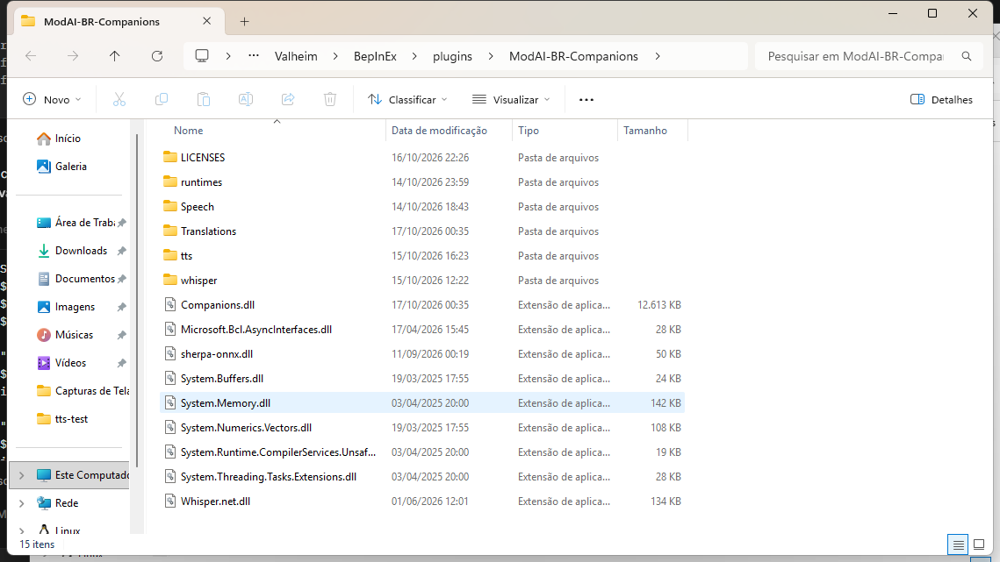

> 🌍 [English](Installation) · [Português](Installation-pt) · [Español](Installation-es) · **Français** · [Italiano](Installation-it)

# Installation

Le pas à pas complet, de zéro jusqu'au compagnon qui répond à un ordre.

Avant de commencer, vérifie que tu as tout ce qui est dans **[Exigences](Requirements-fr)**.

---

## 1. Avoir Valheim installé

Le jeu doit être en version **1.0.x** (Unity 6). L'installation Steam par défaut est dans :

```
C:\Program Files (x86)\Steam\steamapps\common\Valheim
```

Dans les étapes suivantes, `<Valheim>` est ce dossier.

---

## 2. Installer BepInEx

Le mod est un plugin BepInEx 5. Installe **BepInExPack_Valheim 5.4.2351** :

1. Télécharge-le depuis https://github.com/BepInEx/BepInEx/releases
2. Extrais-le dans `<Valheim>`, de sorte que `winhttp.dll` et le dossier `BepInEx\` se retrouvent à la **racine** du
   jeu.
3. Lance Valheim **une fois** et ferme-le. BepInEx crée `BepInEx\plugins\`, `BepInEx\config\` et
   `BepInEx\LogOutput.log`.

Documentation officielle : https://docs.bepinex.dev/

---

## 3. Télécharger la release du mod

Va sur **https://github.com/julianu37/AI-Companions/releases** et télécharge **un** des deux fichiers :

| Fichier | Taille | Quand le choisir |
|---|---|---|
| `AI_Companions-1.9.0.zip` | ~368 Mo | **Recommandé.** Il vient déjà avec les modèles de voix (STT + TTS). Installe et joue |
| `AI_Companions-1.9.0-sem-modelos.zip` | ~28,5 Mo | Internet lent, ou tu as déjà les modèles et tu veux les télécharger à part |

> La différence, ce sont **seulement** les modèles de voix. Le mod et les traductions sont les mêmes dans les deux.
>
> *(La **1.9.0** est la release des **cinq langues** — portugais, anglais, espagnol, français et italien —, avec la
> voix et la reconnaissance vocale **automatiques**, en suivant la **langue du jeu**. La **1.8.3** est la version où
> l'anglais est devenu la **langue native** : le `.cfg` est passé à `AiCompanions.cfg` et la section de l'IA est
> passée à `[AI]`, avec les clés en anglais. La **1.8.2** a ajouté un **sélecteur de fournisseur de LLM** et le
> bouton de la **clé d'API** au panneau `I`. La **1.8.0** a apporté la correction du poids — le **Megingjord** +150
> s'ajoute maintenant au plafond du compagnon — et la **1.8.1** change le LLM par défaut pour **Groq** (gratuit et
> rapide), en gardant LM Studio comme option locale et OpenRouter comme alternative. La **1.7.0** a été la release
> qui a renommé le mod en **AI Companions**.)*

---

## 4. Extraire dans le dossier de Valheim

Le zip vient déjà avec la structure de dossiers prête : dedans, le dossier est `BepInEx\plugins\AI-Companions\`. Tu
n'as donc qu'à l'extraire **à la racine de Valheim** (`<Valheim>`) et chaque fichier arrive au bon endroit. Si tu
utilises un gestionnaire de mods, pointe le zip dessus — le gestionnaire l'installe directement, sans rien renommer.

> Si tu préfères le faire à la main, le résultat final doit être
> `<Valheim>\BepInEx\plugins\AI-Companions\`, avec `Companions.dll` **dedans**. BepInEx charge les plugins depuis
> **n'importe quel** sous-dossier de `BepInEx\plugins\` — garder ce nom évite juste la confusion au moment de mettre à
> jour.

> **Tu mets à jour depuis une version plus ancienne ?** Supprime l'ancien dossier `BepInEx\plugins\ModAI-BR-Companions\`
> **avant** d'extraire. Le mod a changé de nom (c'était *ModAI-BR-Companions*), mais le **GUID** et les clés `HC_*`
> sont les mêmes : la **sauvegarde**, les compagnons, la maison et l'inventaire continuent à valoir. Deux dossiers
> avec le même plugin = BepInEx charge le mod deux fois.

À la fin, le dossier doit ressembler à ça :



```
<Valheim>\
└── BepInEx\
    └── plugins\
        └── AI-Companions\
            ├── LICENSES\
            ├── runtimes\
            ├── Speech\                     ← les phrases du compagnon (5 langues)
            ├── Translations\               ← les textes de l'interface (5 langues)
            ├── tts\                        ← le modèle du TTS (Kokoro)
            ├── whisper\                    ← les modèles du STT (Whisper)
            ├── Companions.dll              ← le mod
            ├── Microsoft.Bcl.AsyncInterfaces.dll
            ├── sherpa-onnx.dll
            ├── System.Buffers.dll
            ├── System.Memory.dll
            ├── System.Numerics.Vectors.dll
            ├── System.Runtime.CompilerServices.Unsafe.dll
            ├── System.Threading.Tasks.Extensions.dll
            └── Whisper.net.dll
```

> Le zip apporte aussi `README.md`, `CHANGELOG.md` et `icon.png` à la **racine** — c'est ce que le gestionnaire de
> mods affiche dans la fiche du mod.

> Ces DLL `System.*` et les deux de voix (`Whisper.net.dll`, `sherpa-onnx.dll`) doivent rester **à côté de
> `Companions.dll`** — ce sont les dépendances que le mod utilise pour le STT et le TTS.

---

## 5. Modèles de voix

**Si tu as téléchargé le paquet complet, cette étape est faite** — les modèles sont déjà venus dans les dossiers
`whisper\` et `tts\`.

Si tu as téléchargé le **sans modèles**, place les fichiers comme ça :

| Où les mettre | Fichiers |
|---|---|
| `...\AI-Companions\whisper\` | `ggml-small-q5_1.bin` (181 Mo) — le modèle par défaut de la reconnaissance vocale |
| `...\AI-Companions\tts\kokoro\` | `model.int8.onnx` (109 Mo), `voices.bin` (27 Mo), `tokens.txt` et le dossier `espeak-ng-data\` |

> Dans le paquet **sans modèles**, `tokens.txt` et le dossier `espeak-ng-data\` **viennent déjà** — il ne manque que
> `ggml-small-q5_1.bin` (Whisper) et `model.int8.onnx` + `voices.bin` (Kokoro).

Où les télécharger :

- **Whisper (ggml) :** https://huggingface.co/ggerganov/whisper.cpp/tree/main — prends `ggml-small-q5_1.bin`.
  `ggml-base-q5_1.bin` (57 Mo) est plus rapide et moins précis ; voir **[Voix](Voice-fr)**.
- **Kokoro (sherpa-onnx) :** les releases de https://github.com/k2-fsa/sherpa-onnx — le paquet du modèle
  `kokoro-int8-multi-lang` (qui apporte `model.int8.onnx`, `voices.bin`, `tokens.txt` et `espeak-ng-data`).

> La qualité, la vitesse et les alternatives sont détaillées dans **[Voix](Voice-fr)**.

---

## 6. Configurer le LLM (Groq)

Les ordres sont compris par un **LLM**. Le mod vient déjà pointé sur **Groq**, qui est le chemin le plus simple : il
n'y a rien à installer — seulement la **clé gratuite** et internet.

1. Crée le compte et la clé sur **https://console.groq.com/keys**.
2. Dans `<Valheim>\BepInEx\config\AiCompanions.cfg`, section `[AI]`, vérifie les trois valeurs
   (les deux premières **sont déjà les valeurs par défaut** ; seule la clé est à remplir) :

   ```ini
   BaseUrl = https://api.groq.com/openai/v1
   Model = openai/gpt-oss-20b
   ApiKey = <ta clé>
   ```

3. En jeu, appuie sur **`I`** → onglet **IA** → **Réglages du LLM** → **Tester la connexion** (tu peux aussi coller la
   clé et changer l'URL/le modèle juste là, sans ouvrir le fichier).

> **Sans éditer le fichier :** au-dessus de l'**URL du serveur** il y a le menu déroulant **« Choisis ton fournisseur
> LLM »** — choisir **Groq**, **LM Studio** ou **OpenRouter** **remplit l'URL et le modèle** (la clé n'est pas
> touchée ; ça vaut après **Appliquer**). Et, sur la ligne de la **Clé d'API**, le bouton **« Crée ta clé d'API
> gratuite ICI »** ouvre la page de la clé dans le navigateur (`console.groq.com/keys` sur Groq). La vitesse de la
> parole, qui a quitté ce panneau, reste dans le **`F8`**.


> Cette capture est de la **1.8.2** : le **sélecteur de fournisseur** est sur **Groq** (la valeur par défaut), l'URL
> et le modèle viennent de Groq et le bouton de la clé apparaît à droite de la **Clé d'API**. Si tu choisis **LM
> Studio**, le bouton disparaît (il n'y a pas de clé).

> **Avec Groq, le texte des ordres quitte ta machine** (c'est un service distant) et le tier gratuit a une limite de
> requêtes et de **tokens par minute** (~4 ordres par minute avec le `gpt-oss-20b`). Pour tout faire tourner **en
> local** — et que **rien** ne sorte — utilise **LM Studio** comme **alternative facultative** : installe-le depuis
> https://lmstudio.ai, télécharge `qwen2.5-3b-instruct` (Q4_K_M), active le **Local Server** (port **1234**) et
> change dans le `.cfg` : `BaseUrl = http://127.0.0.1:1234/v1` et `Model = qwen2.5-3b-instruct` (avec l'`ApiKey`
> **vide**).

Le guide complet des trois chemins (Groq → LM Studio local → OpenRouter) est dans
**[LLM (Groq, LM Studio ou OpenRouter)](LLM-fr)**.

---

## 7. Premier lancement et le log

1. Lance Valheim.
2. Ouvre `<Valheim>\BepInEx\LogOutput.log`.
3. Cherche ces deux lignes :

```
AI Companions v1.9.0 loading...
AI Companions loaded successfully! (N methods patched)
```

Si elles apparaissent, le mod s'est chargé.

> Le `v1.9.0` est la **version que tu as installée** (le numéro du zip que tu as téléchargé) et le `N` est combien de
> méthodes du jeu le mod a ajustées — ce nombre peut changer d'une version à l'autre.

> Au **premier lancement après une mise à jour depuis la 1.8.2 ou avant**, le log montre aussi que le fichier de
> configuration a changé de nom : `[Config] Maddhattr.OfflineCompanionsReborn.cfg was replaced by AiCompanions.cfg ...`
> — c'est l'avis normal de la 1.8.3, et l'ancien `.cfg` peut être supprimé.

> **C'est normal** de voir une erreur **PlayFab / NullReferenceException** au démarrage — elle **n'est pas** du mod et
> ne bloque rien. Si tu veux confirmer, voir **[Problèmes courants](Troubleshooting-fr)**.

---

## 8. Premier test en jeu

Avec le monde ouvert et le compagnon à côté de toi :

1. **Par texte :** ouvre le chat du jeu et tape `ramasse 10 bois`.
   Il devrait répondre et partir ramasser. *(Le nombre est un objectif compté dans son inventaire — s'il a déjà 10
   bois, il dit « On en a déjà assez. »)*
2. **Par la voix :** maintiens **`V`**, dis `ramasse 10 pierres` et relâche. Le texte reconnu apparaît dans le chat.
3. **Sa voix :** il devrait **dire** la réponse à voix haute, à sa position dans le monde.
4. **Panneau de l'IA :** appuie sur **`I`** pour régler la personnalité, la voix, le volume et la touche du
   push-to-talk.

Pour voir toutes les touches et tous les ordres, va dans **[Ordres](Commands-fr)**.

---

## Liste de vérification

- [ ] Valheim 1.0.x installé
- [ ] BepInEx 5.4.2351 extrait à la racine du jeu
- [ ] Release **1.9.0** téléchargée (le paquet complet ou celui sans modèles)
- [ ] Dossier `BepInEx\plugins\AI-Companions\` créé avec `Companions.dll` et les dépendances
- [ ] Modèles de voix dans `whisper\` et `tts\kokoro\`
- [ ] Configuration **vérifiée** dans `BepInEx\config\AiCompanions.cfg` (elle ne revient aux valeurs par défaut que si
      tu viens de la **1.8.2 ou avant**) et l'ancien `.cfg` supprimé
- [ ] Clé gratuite de Groq créée et `[AI] ApiKey` remplie (ou le LM Studio local configuré)
- [ ] `[AI] BaseUrl` et `[AI] Model` vérifiés dans le `.cfg`
- [ ] **Tester la connexion** (panneau `I`) répondant `Connexion OK`
- [ ] Log avec `AI Companions loaded successfully!`
- [ ] `ramasse 10 bois` dans le chat fonctionne
- [ ] Maintenir `V` et parler fonctionne

Si un point échoue, voir **[Problèmes courants](Troubleshooting-fr)**.

<!-- D4: add Español/Français/Italiano -->
