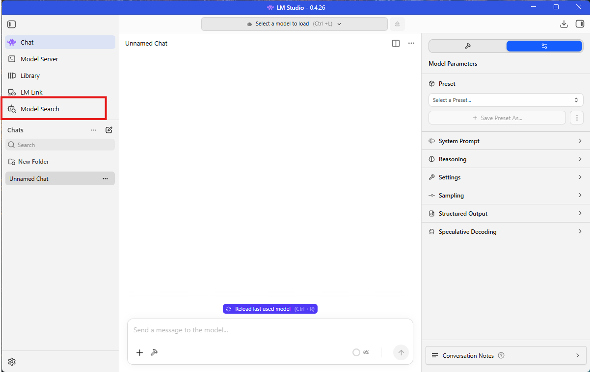
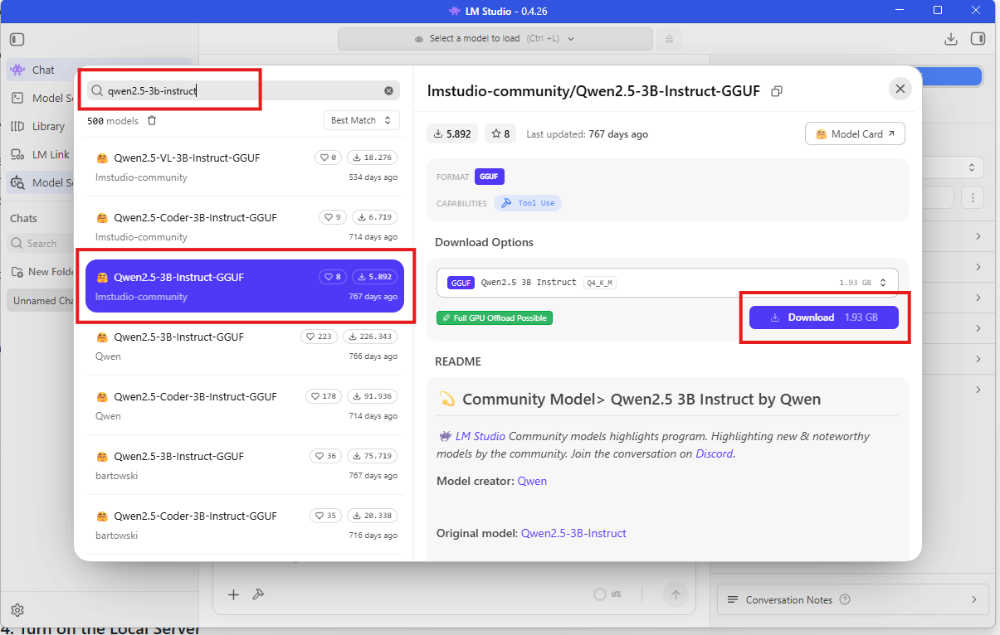
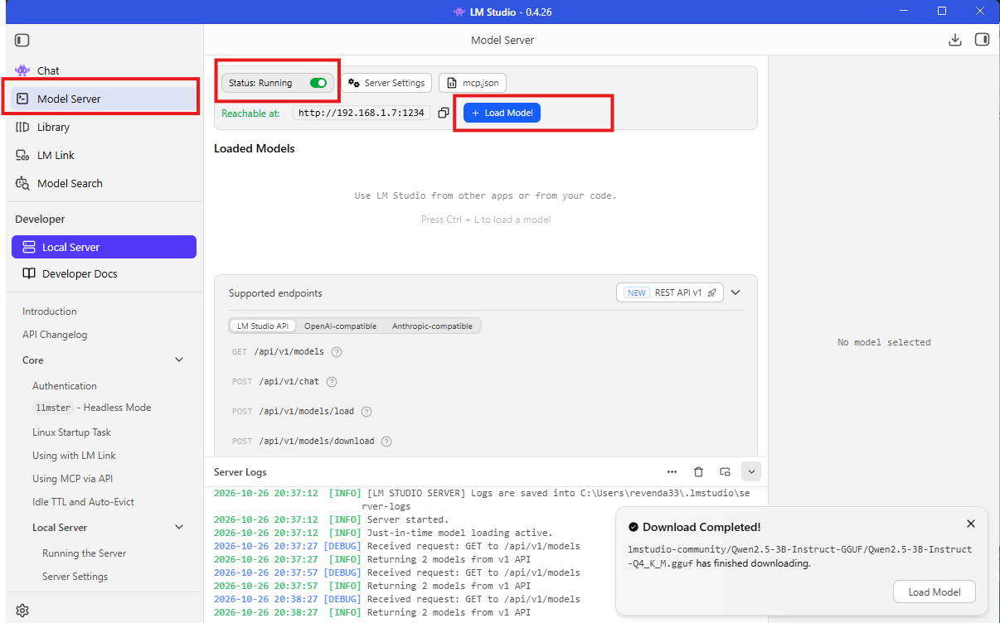
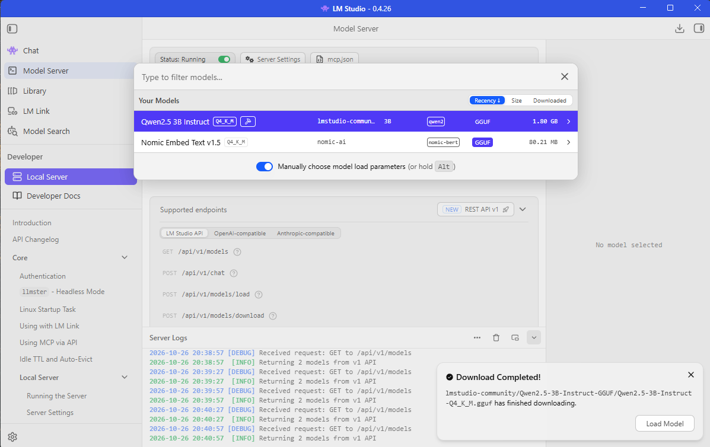
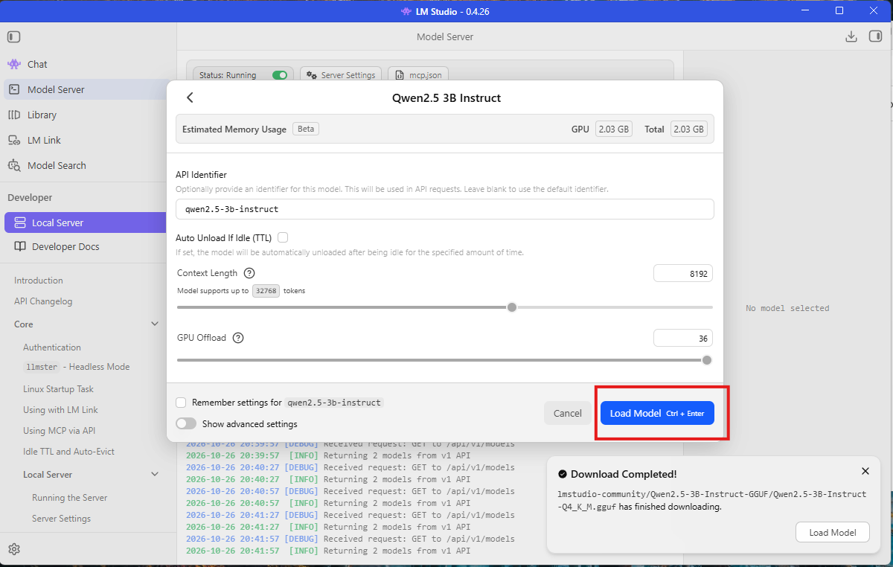
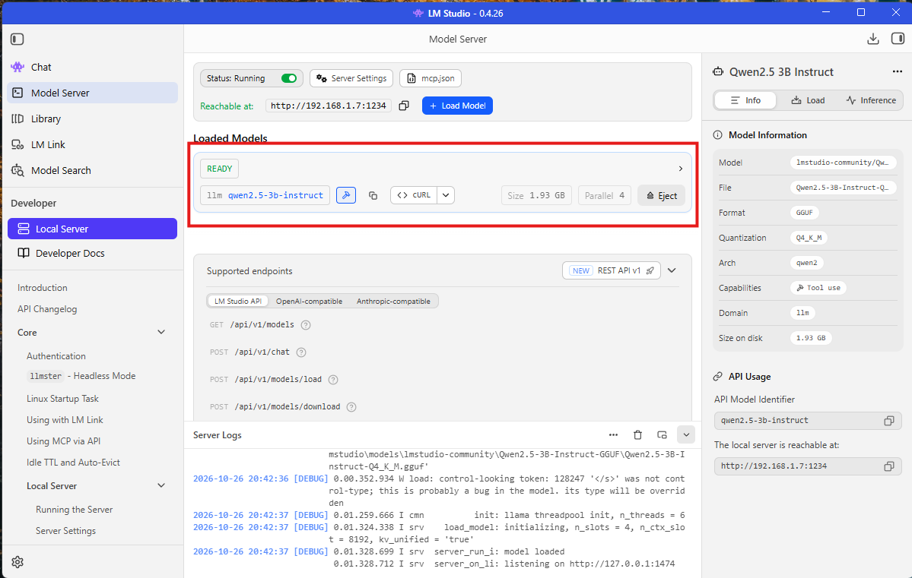

> 🌍 [English](LLM) · [Português](LLM-pt) · [Español](LLM-es) · **Français** · [Italiano](LLM-it)

# LLM (LM Studio, Groq ou OpenRouter)

Le mod comprend les ordres en envoyant le texte à un **LLM** par une API **compatible OpenAI**. Il y a trois chemins,
et tu en choisis **un** :

| Chemin | Ce qu'il faut | Où va le texte | Quand le choisir |
|---|---|---|---|
| **LM Studio** (ou Ollama) — **recommandé** | le modèle téléchargé et le serveur allumé | reste **sur ta machine** | Tu veux la confidentialité, sans clé et sans limite de requêtes |
| **Groq** — cloud | internet et une **clé gratuite** | **quitte ta machine** (service distant) | Tu veux que ça marche sans rien installer, et vite |
| **OpenRouter** — alternative | internet et une **clé gratuite** | **quitte ta machine** (service distant) | Tu utilises déjà OpenRouter ou tu veux essayer un autre modèle |

La page commence par **LM Studio**, le chemin recommandé : le modèle tourne sur ton ordinateur et rien n'en sort.
Ensuite vient **Groq**, le service cloud qui n'a besoin que de la clé gratuite, et en dernier **OpenRouter** — qui
fonctionne aussi, mais dont le tier gratuit est **lent**.

> **Tu viens d'une version plus ancienne (ou de la 1.8.2) ?** En **1.8.3** le fichier est devenu
> **`AiCompanions.cfg`** et les réglages **reviennent aux valeurs par défaut** — y compris l'`ApiKey`, qui doit être
> collée à nouveau. La section a aussi changé de nom : c'était `[IA]`, maintenant c'est **`[AI]`**, avec les clés en
> **anglais** (`Model`, pas `Modelo`). L'ancien `.cfg` (`Maddhattr.OfflineCompanionsReborn.cfg`) reste sur le disque et
> **n'est pas** lu.
> La **1.9.x ne remet rien à zéro** : si le fichier est déjà `AiCompanions.cfg`, il reste tel quel (seules les anciennes
> valeurs fixes de voix/langue passent à `auto`).
> Changer de fournisseur, c'est juste éditer `BaseUrl`, `Model` et `ApiKey` (dans le `.cfg` ou dans la section
> **Réglages du LLM** du panneau `I`).

---

## 1. LM Studio : local, privé et recommandé

**LM Studio** est une application qui fait tourner le modèle **sur ton propre ordinateur** : rien ne quitte ta machine,
il n'y a ni clé ni file d'attente, et il n'y a pas de limite de requêtes ni de tokens. Les captures ci-dessous sont de
**LM Studio 0.4.26**.

### 1.1. Installer LM Studio

Télécharge-le sur **https://lmstudio.ai** et installe-le. C'est une application à fenêtre, pas de ligne de commande.

### 1.2. Télécharger le modèle

Dans la barre latérale, ouvre **Model Search** (l'icône loupe), cherche **`qwen2.5-3b-instruct`** et choisis
**`lmstudio-community/Qwen2.5-3B-Instruct-GGUF`**.

*L'élément **Model Search** dans la barre latérale.*



La page du modèle affiche *Full GPU Offload Possible* : télécharge la quantification **Q4_K_M** (**~1,93 Go**).

*Le résultat de la recherche, avec la quantification **Q4_K_M** (1,93 Go) et le bouton **Download**.*



> **Pourquoi un modèle aussi petit ?** Parce qu'il est **rapide** (ordres en ~0,35–0,4 s) et que, avec la **sortie
> structurée** du mod, il répond au bon format de façon fiable. Un 3B tourne bien même sur un CPU.

### 1.3. Activer le Local Server

Dans la barre latérale, ouvre **Local Server** et vérifie que le **Status** est **Running** (vert) sur le port **1234**.

*Le serveur allumé : **Status: Running** sur le port 1234.*



### 1.4. Charger le modèle

Appuie sur **+ Load Model** et choisis **Qwen2.5-3B-Instruct Q4_K_M**.

*La liste du **+ Load Model**, avec `Qwen2.5 3B Instruct Q4_K_M` sélectionné.*



### 1.5. Confirmer l'API Identifier et charger

L'écran de chargement affiche l'**API Identifier** **`qwen2.5-3b-instruct`** — c'est **ce** nom qui va dans
`[AI] Model` (le nom exact que le serveur expose, pas le nom du dossier téléchargé). Le **Context Length** est
**8192**, le **GPU Offload** est au maximum et la mémoire estimée est d'environ **2 Go** de RAM/VRAM.

*L'écran de chargement : **API Identifier** `qwen2.5-3b-instruct`, **Context Length** 8192 et **GPU Offload** au maximum.*



Appuie sur **Load Model**. Quand c'est fini, **Loaded Models** affiche **READY** et `llm qwen2.5-3b-instruct`
(1,93 Go) — tu peux aller au jeu.

*Le modèle prêt : **READY**, `llm qwen2.5-3b-instruct`, **Size 1,93 Go** et **Parallel 4**.*



### 1.6. Pointer le mod dessus

En jeu, ouvre le panneau **`I`** → **Réglages du LLM** → le menu de fournisseur → **LM Studio** (il remplit l'URL et le
modèle) → **Appliquer** → **Tester la connexion**. Ou édite le `.cfg`, section `[AI]` :

```ini
BaseUrl = http://127.0.0.1:1234/v1
Model   = qwen2.5-3b-instruct
ApiKey  = (vide)
```

> **Le mod naît pointé sur Groq** (`https://api.groq.com/openai/v1` + `openai/gpt-oss-20b`) : c'est pour ça que tu
> choisis **LM Studio** ici (dans le menu ou dans le `.cfg`) — c'est un changement de deux minutes.

> Le **Tester la connexion** du panneau `I` fonctionne pareil ici : change l'URL et le modèle dans les champs, teste et
> seulement ensuite clique sur **Appliquer**.

---

## 2. Groq : juste la clé et internet (cloud)

**Groq** est un service qui parle la **même API qu'OpenAI** et sert des modèles ouverts, avec un **tier gratuit**. Pour
le mod, c'est l'option cloud la plus simple : rien à installer et pas de serveur à laisser ouvert — et le `.cfg`
arrive déjà pointé dessus.

### 2.1. Crée ta clé gratuite

1. Ouvre **https://console.groq.com** et crée le compte (e-mail ou connexion sociale).
2. Va sur **https://console.groq.com/keys** et clique sur **Create API Key** (donne-lui un nom quelconque, p. ex.
   `Valheim`).
3. **Copie la clé générée** — c'est elle qui va dans `[AI] ApiKey`. Elle s'affiche **une seule fois** ; si tu fermes la
   fenêtre sans la copier, crées-en une autre.

### 2.2. Quoi mettre dans le `.cfg` (ou dans le panneau)

Ouvre `<Valheim>\BepInEx\config\AiCompanions.cfg` et vérifie la section `[AI]` :

```ini
[AI]
BaseUrl = https://api.groq.com/openai/v1
Model = openai/gpt-oss-20b
ApiKey = <ta clé>
StructuredOutput = true
```

| Clé | Valeur | Pourquoi |
|---|---|---|
| `BaseUrl` | `https://api.groq.com/openai/v1` | L'adresse de Groq. Le `/chat/completions` est ajouté tout seul |
| `Model` | `openai/gpt-oss-20b` | Le modèle ouvert d'OpenAI servi par Groq. Il est rapide et suit bien la sortie structurée |
| `ApiKey` | **ta clé** | Sur Groq elle est **obligatoire**. Vide ou fausse, le serveur refuse la requête avec une erreur d'authentification |
| `StructuredOutput` | `true` | Demande le format JSON au serveur — c'est ce qui fait marcher les petits modèles. `gpt-oss-20b` accepte `json_schema` en mode **strict** (décodage contraint), qui est le mode que le mod utilise |

Tu peux aussi le faire **en jeu**, sans ouvrir le fichier : touche **`I`** → onglet **IA** → **Réglages du LLM**.
C'est là que se trouvent l'**URL du serveur**, le **Modèle**, la **Clé d'API** et les boutons **Appliquer** et
**Tester la connexion** — et, **au-dessus de l'URL**, le menu déroulant **« Choisis ton fournisseur LLM »** : choisir
**Groq**, **LM Studio** ou **OpenRouter** **remplit l'URL et le modèle** tout seul (la **clé n'est pas touchée** et rien
n'est enregistré avant **Appliquer**). Sur la ligne de la **Clé d'API** il y a le bouton **« Crée ta clé d'API gratuite
ICI »**, qui **ouvre dans le navigateur** la page des clés du fournisseur choisi (`console.groq.com/keys` sur Groq,
`openrouter.ai/keys` sur OpenRouter) — il disparaît sur LM Studio, qui n'a pas de clé.

> Les deux sont **seulement un raccourci** : le `.cfg` continue à commander et c'est lui qui compte. Le sélecteur
> **déduit** le fournisseur de `BaseUrl` lui-même, donc une URL **Ollama** ou d'un serveur à toi apparaît comme
> **Personnalisé (URL manuelle)** et rien n'est écrasé.


> Dans la capture ci-dessus, le sélecteur est sur **Groq** (le fournisseur qui vient dans le `.cfg`), avec l'URL `https://api.groq.com/openai/v1`, le
> modèle `openai/gpt-oss-20b` et la clé masquée. Changer le sélecteur pour **LM Studio** ou **OpenRouter** remplit
> l'URL et le modèle de ce fournisseur — et le bouton de la clé se met à pointer sur sa page (ou disparaît, sur LM
> Studio).

> `BaseUrl`, `Model` et `ApiKey` apparaissent aussi dans le panneau **`F8`**, mais ce sont des clés de **texte** :
> pour coller une clé, le champ du panneau `I` (ou le `.cfg` lui-même) est plus confortable. Ce que tu enregistres là
> vaut pour le **message suivant**, sans redémarrer le jeu.

### 2.3. Tester la connexion

Avec l'URL, le modèle et la clé remplis, appuie sur **Tester la connexion** (dans le panneau `I`, à côté
d'**Appliquer**). Le test tourne **en arrière-plan** — le jeu ne se fige pas — et répond dans le **chat/HUD**, en plus
de laisser une ligne `[IA]` dans le log. Il commence par demander au serveur la **liste des modèles** et, si le serveur
n'a pas cette liste, il envoie une requête de chat minimale. Le résultat est l'un de ceux-ci :

- **Connexion OK : N modèle(s) sur le serveur** — l'URL a répondu.
- **Connexion OK : … et le modèle configuré est dans la liste** — le meilleur cas.
- **Connexion OK : … mais "<modèle>" n'est pas dans la liste** — l'URL a répondu, mais le nom n'apparaissait pas dans
  la liste renvoyée par le serveur. Vérifie que le `Model` est écrit exactement `openai/gpt-oss-20b` et passe au test
  en jeu, en envoyant un ordre réel.
- **Échec de la connexion : …** — il vient avec la raison (statut/message du serveur) : URL fausse, clé vide/fausse,
  adresse sans `http://`/`https://`…

> **Ce qui confirme la clé, c'est un ordre réel.** **Tester la connexion** dit que l'URL répond et que le modèle est
> dans la liste ; si ça passe mais que l'ordre échoue en **401**, le problème est la clé — voir
> **[Problèmes courants](Troubleshooting-fr)**.

### 2.4. À quoi s'attendre de la réponse

La compréhension continue à tourner **en arrière-plan** : un modèle lent **ne fige pas** le jeu. La latence apparaît
dans le log, à chaque ordre :

```
[IA] Tempo: 378 ms (... tokens, ... tokens/s)
```

Avec `openai/gpt-oss-20b` sur Groq la réponse arrive en une **fraction de seconde** dans notre mesure — bien plus vite
que le tier gratuit d'OpenRouter. Le modèle est servi à ~**1 000 tokens/s** et a une fenêtre de **131 072 tokens**
(complétion maximale 65 536), ce qui dépasse largement le prompt du mod (source :
https://console.groq.com/docs/models). Le mod avertit dans le log quand un ordre dépasse **5 s**, et
`[AI] TimeoutSeconds` (**30** par défaut) est le plafond d'attente.

### 2.5. Limites du tier gratuit

Ce que la documentation de Groq indique aujourd'hui pour `openai/gpt-oss-20b` sur le plan gratuit (source :
https://console.groq.com/docs/rate-limits — les chiffres peuvent changer) :

| Limite | Valeur |
|---|---|
| Requêtes par minute (**RPM**) | **30** |
| Requêtes par jour (**RPD**) | **1 000** |
| Tokens par minute (**TPM**) | **8 000** |
| Tokens par jour (**TPD**) | **200 000** |

En pratique, **le TPM est la limite qui mord en premier** : le prompt du mod dépense environ **1 800 tokens par
ordre**, ce qui donne **~4 ordres par minute**. Au-delà, Groq répond **429** et l'ordre est refusé avec un
avertissement — rien ne casse et rien ne reste bloqué ; attends un peu et renvoie-le.

- Le plafond de **8 000 tokens par minute** tient une session normale d'ordres espacés. L'usage intensif (beaucoup
  d'ordres et de conversation tout le temps) le heurte — là, l'**option locale** (section 1) résout le problème, sans
  limite de requêtes.
- `[AI] CooldownSeconds` (**3** par défaut) aide : il évite qu'une rafale de messages devienne une rafale de requêtes.
- **429** est une limite de requêtes/tokens, **401** c'est la clé — la différence est dans
  **[Problèmes courants](Troubleshooting-fr)**.

> **La sortie structurée continue à fonctionner.** `gpt-oss-20b` accepte `json_schema` en mode **strict** et aussi le
> mode *best-effort* ; **streaming** et **tool use** ne sont pas pris en charge avec la sortie structurée — et le mod
> **n'utilise ni l'un ni l'autre** (source : https://console.groq.com/docs/structured-outputs).

### 2.6. Confidentialité et la clé

- **Avec Groq, le texte des ordres et de la conversation quitte ta machine.** Il va sur les serveurs de Groq — la
  persona, la mémoire et ce que tu tapes entrent dans cet envoi. **N'écris rien de sensible** dans le chat du
  compagnon.
- Groq est un **service distant** : c'est sa politique de données qui s'applique, pas celle du mod.
- La reconnaissance vocale (**STT**) et la **voix du compagnon** (**TTS**) restent **locales** : seul le texte de
  l'ordre va au LLM.
- **La clé reste dans le `.cfg`.** Ne partage pas ce fichier avec la clé remplie et ne mets jamais une clé dans un
  dépôt. Si elle fuit, supprime-la sur **https://console.groq.com/keys** et crées-en une autre.
- Tu veux que **rien ne sorte** de la machine ? Utilise LM Studio (ou Ollama) dans la section 1 — là le LLM est local
  aussi.

---

## 3. OpenRouter (fonctionne encore, mais le gratuit est lent)

**OpenRouter** a été le défaut jusqu'à la **1.7.0** et **continue à fonctionner**. Il donne accès à plusieurs modèles
avec la même clé, y compris les **gratuits** — mais le routeur gratuit (`openrouter/free`) est **lent et imprévisible** :
chaque requête choisit un modèle gratuit différent et passe par la file du fournisseur. C'est pour ça qu'il a quitté la
place de défaut. Utilise-le si tu **as déjà** la configuration ou si tu veux **essayer un autre modèle** du catalogue.

```ini
[AI]
BaseUrl = https://openrouter.ai/api/v1
Model = openrouter/free
ApiKey = <ta clé de openrouter.ai/keys>
```

| Clé | Valeur | Pourquoi |
|---|---|---|
| `BaseUrl` | `https://openrouter.ai/api/v1` | L'adresse d'OpenRouter |
| `Model` | `openrouter/free` | **Free Models Router** : à chaque requête il choisit un modèle **gratuit** (et filtre ceux qui prennent en charge la sortie structurée) |
| `ApiKey` | **ta clé** | Sur OpenRouter elle est **obligatoire**. La gratuite vient de **https://openrouter.ai/keys** |

- Les modèles **gratuits** (avec `:free` dans le nom) ont une limite de **20 requêtes par minute** et un **plafond
  journalier** par compte : **50 requêtes par jour** pour qui **n'a jamais acheté de crédit** et **1 000 par jour** à
  partir de **10 crédits achetés** (au total, pas par mois).
- La latence **varie** d'un ordre à l'autre et peut prendre quelques secondes aux heures de pointe.
- OpenRouter lui-même décrit les modèles gratuits comme **pour essayer et pour un usage à faible volume**.
- Le **Tester la connexion** du panneau `I` marche aussi ici — et, comme la liste de modèles d'OpenRouter est
  **publique**, il peut répondre `Connexion OK` même avec une clé fausse : ce qui confirme la clé, c'est un ordre réel.
- Avec OpenRouter, le texte des ordres et de la conversation **quitte ta machine**, comme avec Groq. C'est sa politique
  de données qui s'applique. Clé fuitée ? Supprime-la sur **https://openrouter.ai/settings/keys** et crées-en une
  autre.

---

## 4. Comment savoir que ça marche

Entre dans le monde et tape dans le chat `ramasse 10 bois` (ça vaut pour Groq, pour **LM Studio** et pour
**OpenRouter**). Si ça marche :

- Le compagnon répond (et parle) une confirmation et part ramasser.
- Dans le log (`BepInEx\LogOutput.log`) les lignes `[IA]` apparaissent avec le résultat et le temps.

---

## 5. Autres modèles et serveurs

N'importe quel endpoint **compatible OpenAI** fait l'affaire — le mod ne fait que `POST {BaseUrl}/chat/completions`.

### Modèles

| Modèle | Serveur | Remarque |
|---|---|---|
| **`openai/gpt-oss-20b`** | **Groq** | **Option cloud.** Modèle ouvert, ~1 000 tokens/s, fenêtre de 131 072 tokens. Répond en une fraction de seconde |
| **`qwen2.5-3b-instruct`** | LM Studio | **Recommandé.** Rapide (~0,35–0,4 s par ordre) et fiable avec la sortie structurée |
| `openrouter/free` | OpenRouter | Routeur de modèles gratuits : en choisit un par requête. Rien à installer, mais la latence varie |
| `google/gemma-4-e4b` | LM Studio | Il marche aussi, mais il est **bien plus lent** (~3 s par ordre) |
| Modèles plus gros | n'importe lequel | Meilleurs en conversation, mais ils **ont besoin d'un GPU** pour répondre vite en local |
| Modèles payants de Groq/OpenRouter | — | Il suffit de changer le `Model` pour le nom du catalogue — et, là, ce sont les crédits du compte qui sont dépensés |

### Autres serveurs

- **Ollama :** `http://127.0.0.1:11434/v1`
- **llama.cpp** avec le serveur en mode OpenAI
- **API payante** (OpenAI, etc.) : pointe le `BaseUrl` et remplis l'`ApiKey` — en te rappelant que, là, tes messages
  **quittent ta machine**, comme avec Groq et OpenRouter.

> **Ne mets jamais une clé d'API dans un dépôt.** L'`ApiKey` reste dans le `.cfg` local ; ne partage pas ce fichier
> avec la clé remplie.

### Réglages utiles

| Clé `[AI]` | Défaut | Ce qu'elle fait |
|---|---|---|
| `Temperature` | `0.1` | Garde-la basse : le même ordre doit toujours donner le même JSON |
| `TimeoutSeconds` | `30` | Combien de temps attendre le modèle. La requête tourne en arrière-plan — un modèle lent ne fige pas le jeu |
| `StructuredOutput` | `true` | Si ton serveur/modèle ne le prend pas en charge, le mod retombe tout seul sur l'ancien format et avertit dans le log |
| `CooldownSeconds` | `3` | Temps minimum entre deux ordres, pour qu'une rafale de messages n'inonde pas le modèle |

---

## Si ça ne marche pas

Les quatre cas ci-dessous couvrent presque tout :

| Ce qui apparaît | Ce que c'est | Quoi faire |
|---|---|---|
| **401** (*unauthorized* / *invalid api key*) | L'`ApiKey` est vide, fausse ou vient d'un autre serveur | Colle la bonne clé : `console.groq.com/keys` (Groq), `openrouter.ai/keys` (OpenRouter) — ou laisse-la **vide** sur LM Studio/Ollama |
| **429** (*rate limit*) | Limite de **requêtes ou de tokens** du tier gratuit | Attends quelques secondes et renvoie l'ordre ; réduis la fréquence ; utilise LM Studio local pour un usage intensif |
| **404** / **400** | L'**URL** (`BaseUrl`) ou le **modèle** (`Model`) sont faux | Vérifie `https://api.groq.com/openai/v1` + `openai/gpt-oss-20b` (Groq) ou `https://openrouter.ai/api/v1` + `openrouter/free` (OpenRouter) |
| **Prend trop de temps** | File du fournisseur ou modèle trop gros | Voir « met trop de temps à répondre » dans **[Problèmes courants](Troubleshooting-fr)** |

Le pas à pas de chaque symptôme est dans **[Problèmes courants](Troubleshooting-fr)** — y compris « il ne répond à
rien », « répond une erreur d'authentification », « met trop de temps à répondre » et « répond mal ou ignore le
nombre ».
