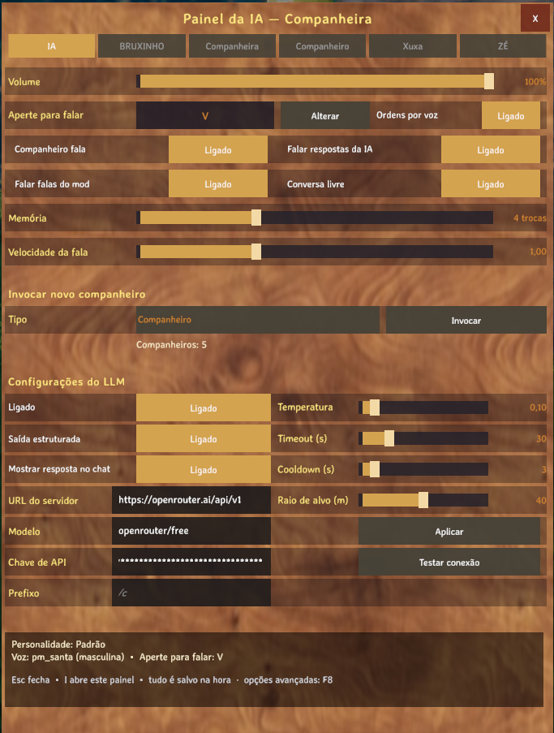
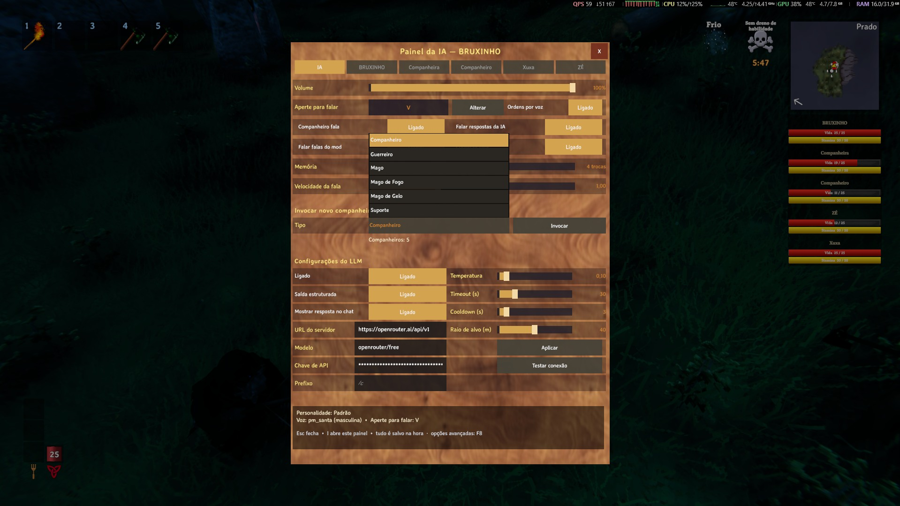

# LLM (OpenRouter ou LM Studio)

O mod entende as ordens mandando o texto para um **LLM** por uma API **compatível com a OpenAI**. Há dois
caminhos, e você escolhe um:

| Caminho | O que precisa | Para onde vai o texto | Quando escolher |
|---|---|---|---|
| **OpenRouter** — **padrão** | internet e uma **chave gratuita** | **sai da sua máquina** (serviço remoto) | Quer usar sem instalar nada |
| **LM Studio** (ou Ollama) — opcional | o modelo baixado e o servidor ligado | fica **na sua máquina** | Quer privacidade total ou uso intenso |

Esta página começa pelo **OpenRouter**, porque ele **já é o padrão** do mod: instalou, pôs a chave e pronto. A
opção local (**LM Studio**) continua funcionando igual e está logo abaixo.

---

## 1. OpenRouter: só a chave e a internet

O OpenRouter é um serviço que fala a **mesma API da OpenAI** e dá acesso a vários modelos, inclusive os
**gratuitos**. Para o mod, é o caminho mais rápido: não há nada para instalar nem servidor para deixar aberto — o
`.cfg` já vem apontado para ele.

### 1.1. Crie a sua chave gratuita

1. Abra **https://openrouter.ai** e crie a conta (e-mail ou login social).
2. Vá em **https://openrouter.ai/keys** e clique em **Create Key** (dê um nome qualquer, ex.: `Valheim`).
3. **Copie a chave gerada** — é ela que vai no `[IA] ApiKey`.

> O OpenRouter recomenda definir um **limite de crédito** em cada chave. Para o uso gratuito do mod não é preciso
> comprar crédito: a chave só serve para identificar a sua conta.

### 1.2. O que colocar no `.cfg` (ou no painel)

Abra `<Valheim>\BepInEx\config\Maddhattr.OfflineCompanionsReborn.cfg` e confira a seção `[IA]`:

```ini
[IA]
BaseUrl = https://openrouter.ai/api/v1
Modelo = openrouter/free
ApiKey = <a sua chave>
SaidaEstruturada = true
```

| Chave | Valor | Por quê |
|---|---|---|
| `BaseUrl` | `https://openrouter.ai/api/v1` | Endereço do OpenRouter — **já é o padrão**. O `/chat/completions` é adicionado sozinho |
| `Modelo` | `openrouter/free` | **Roteador de modelos gratuitos**: a cada pedido ele escolhe um modelo **sem custo** (e filtra os que suportam a saída estruturada) — **já é o padrão** |
| `ApiKey` | **a sua chave** | No OpenRouter ela é **obrigatória**. Vazia ou errada, o servidor recusa o pedido com erro de autenticação |
| `SaidaEstruturada` | `true` | Pede o formato JSON ao servidor — é o que faz modelos pequenos funcionarem. Se um modelo não aceitar, o mod cai sozinho no formato antigo e avisa no log |

Você também pode fazer isso **em jogo**, sem abrir o arquivo: tecla **`I`** → aba **IA** → **Configurações do
LLM**. É onde ficam a **URL do servidor**, o **Modelo**, a **Chave de API** e os botões **Aplicar** e **Testar
conexão**:



> `BaseUrl`, `Modelo` e `ApiKey` também aparecem no painel **`F8`**, mas são chaves de **texto**: para colar uma
> chave, o campo do painel `I` (ou o próprio `.cfg`) é mais confortável. O que você salva ali vale na **próxima
> mensagem**, sem reiniciar o jogo.

### 1.3. Teste a conexão

Com a URL, o modelo e a chave preenchidos, aperte **Testar conexão** (no painel `I`, ao lado de **Aplicar**). O
teste roda **em segundo plano** — o jogo não trava — e responde no **chat/HUD**, além de deixar uma linha `[IA]
Conexao:` no log. Ele começa pedindo a **lista de modelos** ao servidor e, se o servidor não tiver essa lista,
manda um pedido mínimo de chat. O resultado é um destes:

- **Conexão OK: N modelo(s) no servidor** — a URL respondeu.
- **Conexão OK: … e o modelo configurado está na lista** — o melhor caso.
- **Conexão OK: … mas "<modelo>" não está na lista** — a URL respondeu, mas o nome não apareceu na lista que o
  servidor devolve. Com o `openrouter/free` isso **pode** acontecer (ele é um roteador, e a lista do servidor é o
  catálogo de modelos): siga para o teste em jogo, mandando uma ordem de verdade.
- **Falha na conexão: …** — vem com o motivo (status/mensagem do servidor): URL errada, servidor local desligado,
  endereço sem `http://`/`https://`…



> **O teste não prova que a chave está certa.** No OpenRouter a lista de modelos é **pública**: com a chave
> vazia ou errada o teste ainda pode responder *Conexão OK*, e o **erro de autenticação** só aparece na primeira
> ordem (no log e no aviso). Quem confirma a chave é uma ordem de verdade — veja
> **[Problemas comuns](Problemas-comuns)**.

### 1.4. O que esperar da resposta

O entendimento continua rodando **em segundo plano**: um modelo lento **não** trava o jogo. A latência aparece no
log, em cada ordem:

```
[IA] Tempo: 378 ms (… tokens, … tokens/s)
```

Com o `openrouter/free`, o número **varia bastante**: o roteador escolhe um modelo gratuito diferente a cada
pedido, e a fila do provedor muda ao longo do dia. Pode ser rápido numa ordem e demorar alguns segundos na
seguinte — não é um valor fixo como o do modelo local. O mod avisa no log quando uma ordem passa de **5 s**, e o
`[IA] TimeoutSegundos` (padrão **30**) é o teto de espera.

### 1.5. Limites e dicas do tier gratuito

O que a documentação do OpenRouter informa hoje (confira em **https://openrouter.ai/docs** — os números podem
mudar):

- Os modelos **gratuitos** (os que têm `:free` no nome) têm limite de **20 pedidos por minuto** e um **teto
  diário de pedidos** por conta.
- O teto diário depende do histórico da conta: **50 pedidos por dia** para quem **nunca comprou crédito** e
  **1000 por dia** a partir de **10 créditos comprados** (no total, não por mês).
- Como o `openrouter/free` só encaminha para modelos gratuitos, o uso dele cai nesse mesmo tipo de limite (a
  página de limites do OpenRouter é que diz como o roteador é contado).
- O próprio OpenRouter descreve os modelos gratuitos como **para experimentar e para uso de baixo volume**: eles
  podem ter **fila**, variação de disponibilidade e latência.

Na prática, o teto de **50 pedidos por dia** atende uma sessão normal de ordens esporádicas; **uso intenso**
(muitas ordens e conversa o tempo todo) esbarra no limite diário ou na fila. Aí a **opção local** (abaixo)
resolve — e de graça, sem limite de pedidos.

> O `[IA] CooldownSegundos` (padrão **3**) ajuda: ele evita que uma rajada de mensagens vire uma rajada de
> pedidos.

### 1.6. Privacidade e a chave

- **Com o OpenRouter, o texto das ordens e da conversa sai da sua máquina.** Ele vai para os servidores do
  OpenRouter e de lá para o provedor do modelo escolhido — a persona, a memória e o que você digita entram nesse
  envio. **Não escreva nada sensível** no chat do companheiro.
- O OpenRouter informa que **não registra** prompts e respostas por padrão (há um opt-in nas preferências da
  conta) e que encaminha os pedidos a provedores que, quando possível, não registram nem treinam com os dados;
  ainda assim, é um **serviço remoto** — a política dele é que vale, não a do mod.
- O reconhecimento de voz (**STT**) e a **voz do companheiro** (**TTS**) continuam **locais**: só o texto da
  ordem vai para o LLM.
- **A chave fica no `.cfg`.** Não compartilhe esse arquivo com a chave preenchida e nunca versione uma chave. Se
  ela vazar, apague em **https://openrouter.ai/settings/keys** e crie outra.
- Quer **nada saindo** da máquina? Use o LM Studio (ou o Ollama) logo abaixo — aí o LLM também é local.

---

## 2. Alternativa local: LM Studio (opcional)

Aqui **nada sai do seu computador**: o modelo roda na sua máquina. É o caminho para quem quer privacidade total,
para quem joga sem internet ou para quem faz uso intenso e não quer depender de fila. Em troca, você precisa
baixar o modelo e deixar o servidor ligado durante o jogo.

### 2.1. Instale o LM Studio

Baixe em **https://lmstudio.ai** e instale. É um aplicativo de janela, sem linha de comando.

### 2.2. Baixe o modelo

O modelo **recomendado** é o **`qwen2.5-3b-instruct`**, quantização **Q4_K_M** (~**1,93 GB**).

No LM Studio:

1. Abra a aba de **busca de modelos** (o ícone de lupa, na barra lateral).
2. Procure por **`qwen2.5-3b-instruct`**.
3. Escolha a quantização **Q4_K_M** e baixe (~1,93 GB).

> **Por que um modelo tão pequeno?** Porque ele é **rápido** (ordens em ~0,35–0,4 s) e, com a **saída
> estruturada** do mod, responde no formato certo de forma confiável. Um 3B roda bem até em CPU.

### 2.3. Carregue o modelo

Na aba de **chat**, no topo, escolha o `qwen2.5-3b-instruct` que você baixou. Ele fica **READY** quando terminar
de carregar.

### 2.4. Ligue o Local Server

Abra a aba **Model Server** na barra lateral (nas versões antigas do LM Studio ela se chama **Developer**) e
ligue o **Local Server** (o botão **Start** / **Running**).


Confira na tela:

| O que olhar | Valor esperado |
|---|---|
| **Status** | `Running` |
| **Porta** | `1234` |
| **Modelo carregado** | `qwen2.5-3b-instruct` (READY, ~1,93 GB) |
| **Parallel** | `4` |
| **Endpoints** | OpenAI-compatible (`/v1/models`, `/v1/chat/completions`) |
| **API Model Identifier** | `qwen2.5-3b-instruct` — é **este** nome que vai no `[IA] Modelo` |

> O **API Model Identifier** (no painel *Model Information*) é o nome exato que o servidor expõe. Use-o no
> `.cfg`, e não o nome da pasta do download.

### 2.5. O que colocar no `.cfg` para usar o LM Studio

O padrão do mod agora é o OpenRouter, então **troque** as duas primeiras chaves e **apague** a chave de API:

```ini
[IA]
BaseUrl = http://127.0.0.1:1234/v1
Modelo = qwen2.5-3b-instruct
ApiKey =
SaidaEstruturada = true
```

| Chave | Valor | Por quê |
|---|---|---|
| `BaseUrl` | `http://127.0.0.1:1234/v1` | Endereço do servidor do LM Studio. O `/chat/completions` é adicionado sozinho |
| `Modelo` | `qwen2.5-3b-instruct` | O **API Model Identifier** que o LM Studio mostra |
| `ApiKey` | *(vazio)* | O LM Studio local não pede chave |
| `SaidaEstruturada` | `true` | Pede o formato JSON ao servidor — é o que faz modelos pequenos funcionarem |

> O **Testar conexão** do painel `I` funciona igual aqui: troque a URL e o modelo nos campos, teste e só depois
> clique em **Aplicar**.

### 2.6. `127.0.0.1` vs `localhost` — use o IP

No caso local, use o endereço **`http://127.0.0.1:1234/v1`** (IPv4) e não `localhost`.

> **No Windows, o `localhost` resolve primeiro para o IPv6 (`::1`)**. O servidor do LM Studio só escuta **IPv4**,
> então cada requisição tenta o IPv6 primeiro, espera o tempo limite e **só depois** cai para o IPv4. Isso
> adiciona cerca de **2,5 s de pedágio em cada ordem**.

Com o endereço explícito `http://127.0.0.1:1234/v1` a resposta volta direto. O texto de ajuda do `BaseUrl` no
`.cfg` (e no painel `F8`) também explica a diferença.

---

## 3. Como saber que está funcionando

Entre no mundo e digite no chat `colete 10 madeiras` (vale para o OpenRouter **e** para o LM Studio). Se
funcionar:

- O companheiro responde (e fala) uma confirmação e sai para coletar.
- No log (`BepInEx\LogOutput.log`) aparecem as linhas `[IA]` com o resultado e o tempo.

---

## 4. Outros modelos e servidores

Qualquer endpoint **compatível com a OpenAI** serve — o mod só faz `POST {BaseUrl}/chat/completions`.

### Modelos

| Modelo | Observação |
|---|---|
| **`openrouter/free`** | **Padrão.** Roteador do OpenRouter: escolhe um modelo gratuito por pedido. Sem instalar nada; a latência varia |
| **`qwen2.5-3b-instruct`** | **Recomendado no LM Studio.** Rápido (~0,35–0,4 s por ordem) e confiável com a saída estruturada |
| `google/gemma-4-e4b` | Também funciona no LM Studio, mas é **bem mais lento** (~3 s por ordem) |
| Modelos maiores | Melhores em conversa, mas **precisam de GPU** para responder rápido |
| Modelos pagos do OpenRouter | Basta trocar o `Modelo` pelo nome do catálogo — e, aí, os créditos da conta é que são gastos |

### Outros servidores

- **Ollama:** `http://127.0.0.1:11434/v1`
- **llama.cpp** com servidor no modo OpenAI
- **API paga** (OpenAI, etc.): aponte o `BaseUrl` e preencha o `ApiKey` — lembrando que, aí, as suas mensagens
  **saem da sua máquina**, como no OpenRouter.

> **Nunca versione uma chave de API.** O `ApiKey` fica no `.cfg` local; não compartilhe esse arquivo com a chave
> preenchida.

### Ajustes úteis

| Chave `[IA]` | Padrão | O que faz |
|---|---|---|
| `Temperatura` | `0.1` | Mantenha baixo: a mesma ordem deve dar sempre o mesmo JSON |
| `TimeoutSegundos` | `30` | Quanto esperar pelo modelo. O pedido roda em segundo plano — um modelo lento não trava o jogo |
| `SaidaEstruturada` | `true` | Se o seu servidor/modelo não suportar, o mod cai sozinho no formato antigo e avisa no log |
| `CooldownSegundos` | `3` | Tempo mínimo entre duas ordens, para uma rajada de mensagens não inundar o modelo |

---

## Se não funcionar

Vá em **[Problemas comuns](Problemas-comuns)** — os casos "ele não responde a nada", "responde erro de
autenticação", "demora muito para responder" e "responde errado ou ignora o número" cobrem os problemas mais
comuns dos dois caminhos.
