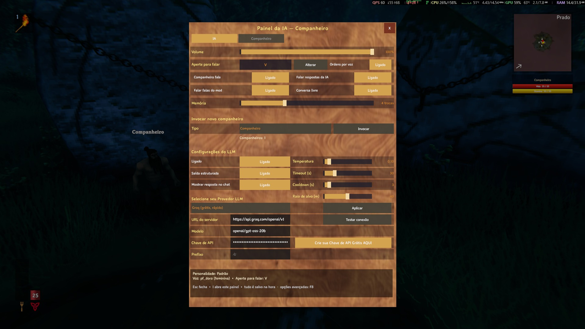

> 🌍 [English](LLM) · **Português** · [Español](LLM-es) · [Français](LLM-fr) · [Italiano](LLM-it)

# LLM (Groq, LM Studio ou OpenRouter)

O mod entende as ordens mandando o texto para um **LLM** por uma API **compatível com a OpenAI**. Há três
caminhos, e você escolhe **um**:

| Caminho | O que precisa | Para onde vai o texto | Quando escolher |
|---|---|---|---|
| **Groq** — **padrão** | internet e uma **chave gratuita** | **sai da sua máquina** (serviço remoto) | Quer usar sem instalar nada, e rápido |
| **LM Studio** (ou Ollama) — opcional | o modelo baixado e o servidor ligado | fica **na sua máquina** | Quer privacidade total ou uso intenso |
| **OpenRouter** — alternativa | internet e uma **chave gratuita** | **sai da sua máquina** (serviço remoto) | Já usa o OpenRouter ou quer testar outro modelo |

Esta página começa pelo **Groq**, porque ele **já é o padrão** do mod: instalou, pôs a chave e pronto. Depois vem a
opção **local** (**LM Studio**, que continua funcionando igual) e, por último, o **OpenRouter** — que também
continua funcionando, mas cujo tier gratuito é **lento** e por isso deixou de ser o padrão.

> **Já tem um `.cfg` de uma versão anterior (ou da 1.8.2)?** Na **1.8.3** o arquivo passou a ser
> **`AiCompanions.cfg`** e as configurações **voltam aos padrões** — inclusive a `ApiKey`, que precisa ser colada
> de novo. A seção também mudou de nome: era `[IA]`, agora é **`[AI]`**, com as chaves em **inglês** (`Model`, não
> `Modelo`). O `.cfg` antigo (`Maddhattr.OfflineCompanionsReborn.cfg`) fica no disco e **não** é lido.
> A **1.9.0 não zera nada**: se o arquivo já é o `AiCompanions.cfg`, ele fica como está (só os padrões fixos antigos
> de voz/idioma viram `auto`).
> Trocar para o Groq é opcional — e é só editar `BaseUrl`, `Model` e `ApiKey` (no `.cfg` ou na seção
> **Configurações do LLM** do painel `I`).

---

## 1. Groq: só a chave e a internet (padrão)

O **Groq** é um serviço que fala a **mesma API da OpenAI** e serve modelos abertos, com um **tier gratuito**. Para o
mod, é o caminho mais rápido: não há nada para instalar nem servidor para deixar aberto — o `.cfg` já vem apontado
para ele.

### 1.1. Crie a sua chave gratuita

1. Abra **https://console.groq.com** e crie a conta (e-mail ou login social).
2. Vá em **https://console.groq.com/keys** e clique em **Create API Key** (dê um nome qualquer, ex.: `Valheim`).
3. **Copie a chave gerada** — é ela que vai no `[AI] ApiKey`. Ela aparece **uma vez só**; se fechar a janela sem
   copiar, crie outra.

### 1.2. O que colocar no `.cfg` (ou no painel)

Abra `<Valheim>\BepInEx\config\AiCompanions.cfg` e confira a seção `[AI]`:

```ini
[AI]
BaseUrl = https://api.groq.com/openai/v1
Model = openai/gpt-oss-20b
ApiKey = <a sua chave>
StructuredOutput = true
```

| Chave | Valor | Por quê |
|---|---|---|
| `BaseUrl` | `https://api.groq.com/openai/v1` | Endereço do Groq — **já é o padrão**. O `/chat/completions` é adicionado sozinho |
| `Model` | `openai/gpt-oss-20b` | O modelo aberto da OpenAI servido pelo Groq — **já é o padrão**. É rápido e obedece bem à saída estruturada |
| `ApiKey` | **a sua chave** | No Groq ela é **obrigatória**. Vazia ou errada, o servidor recusa o pedido com erro de autenticação |
| `StructuredOutput` | `true` | Pede o formato JSON ao servidor — é o que faz modelos pequenos funcionarem. O `gpt-oss-20b` aceita `json_schema` em modo **strict** (decodificação restrita), que é o modo que o mod usa |

Você também pode fazer isso **em jogo**, sem abrir o arquivo: tecla **`I`** → aba **IA** → **Configurações do
LLM**. É onde ficam a **URL do servidor**, o **Modelo**, a **Chave de API** e os botões **Aplicar** e **Testar
conexão** — e, **acima da URL**, o dropdown **"Selecione seu Provedor LLM"**: escolher **Groq**, **LM Studio** ou
**OpenRouter** **preenche a URL e o modelo** sozinho (a **chave não é tocada** e nada é gravado antes do
**Aplicar**). Na linha da **Chave de API** há o botão **"Crie sua Chave de API Grátis AQUI"**, que **abre no
navegador** a página de chaves do provedor escolhido (`console.groq.com/keys` no Groq, `openrouter.ai/keys` no
OpenRouter) — some no LM Studio, que não tem chave.

> Os dois são **só um atalho**: o `.cfg` continua valendo e é ele que manda. O seletor **deduz** o provedor da
> própria `BaseUrl`, então uma URL de **Ollama** ou de um servidor seu aparece como **Personalizado (URL manual)**
> e nada é sobrescrito.



> No print acima o seletor está em **Groq** (o padrão), com a URL `https://api.groq.com/openai/v1`, o modelo
> `openai/gpt-oss-20b` e a chave mascarada. Trocar o seletor para **LM Studio** ou **OpenRouter** preenche a URL e o
> modelo daquele provedor — e o botão da chave passa a apontar para a página dele (ou some, no LM Studio).

> `BaseUrl`, `Model` e `ApiKey` também aparecem no painel **`F8`**, mas são chaves de **texto**: para colar uma
> chave, o campo do painel `I` (ou o próprio `.cfg`) é mais confortável. O que você salva ali vale na **próxima
> mensagem**, sem reiniciar o jogo.

### 1.3. Teste a conexão

Com a URL, o modelo e a chave preenchidos, aperte **Testar conexão** (no painel `I`, ao lado de **Aplicar**). O
teste roda **em segundo plano** — o jogo não trava — e responde no **chat/HUD**, além de deixar uma linha `[IA]
Conexao:` no log. Ele começa pedindo a **lista de modelos** ao servidor e, se o servidor não tiver essa lista,
manda um pedido mínimo de chat. O resultado é um destes:

- **Conexão OK: N modelo(s) no servidor** — a URL respondeu.
- **Conexão OK: … e o modelo configurado está na lista** — o melhor caso.
- **Conexão OK: … mas "<modelo>" não está na lista** — a URL respondeu, mas o nome não apareceu na lista que o
  servidor devolve. Confira se o `Model` está escrito exatamente `openai/gpt-oss-20b` e siga para o teste em jogo,
  mandando uma ordem de verdade.
- **Falha na conexão: …** — vem com o motivo (status/mensagem do servidor): URL errada, chave vazia/errada,
  endereço sem `http://`/`https://`…

> **Quem confirma a chave é uma ordem de verdade.** O **Testar conexão** diz que a URL responde e que o modelo está
> na lista; se ele passar mas a ordem falhar com **401**, o problema é a chave — veja
> **[Problemas comuns](Troubleshooting-pt)**.

### 1.4. O que esperar da resposta

O entendimento continua rodando **em segundo plano**: um modelo lento **não** trava o jogo. A latência aparece no
log, em cada ordem:

```
[IA] Tempo: 378 ms (… tokens, … tokens/s)
```

Com o `openai/gpt-oss-20b` no Groq a resposta chega em **fração de segundo** na nossa medição — bem mais rápido que
o tier gratuito do OpenRouter. O modelo é servido a ~**1.000 tokens/s** e tem janela de **131.072 tokens** (máximo
de conclusão 65.536), o que sobra para o prompt do mod (fonte: https://console.groq.com/docs/models). O mod avisa no
log quando uma ordem passa de **5 s**, e o `[AI] TimeoutSeconds` (padrão **30**) é o teto de espera.

### 1.5. Limites do tier gratuito

O que a documentação do Groq informa hoje para o `openai/gpt-oss-20b` no plano gratuito (fonte:
https://console.groq.com/docs/rate-limits — os números podem mudar):

| Limite | Valor |
|---|---|
| Requisições por minuto (**RPM**) | **30** |
| Requisições por dia (**RPD**) | **1.000** |
| Tokens por minuto (**TPM**) | **8.000** |
| Tokens por dia (**TPD**) | **200.000** |

Na prática, **o TPM é o limite que morde primeiro**: o prompt do mod gasta cerca de **1.800 tokens por ordem**, o
que dá **~4 ordens por minuto**. Acima disso o Groq responde **429** e a ordem é recusada com aviso — nada quebra e
nada fica preso; espere um pouco e mande de novo.

- O teto de **8.000 tokens por minuto** atende uma sessão normal de ordens esporádicas. Uso intenso (muitas ordens
  e conversa o tempo todo) esbarra nele — aí a **opção local** (abaixo) resolve, sem limite de pedidos.
- O `[AI] CooldownSeconds` (padrão **3**) ajuda: ele evita que uma rajada de mensagens vire uma rajada de pedidos.
- **429** é limite de requisições/tokens, **401** é chave — a diferença está em **[Problemas comuns](Troubleshooting-pt)**.

> **A saída estruturada continua valendo.** O `gpt-oss-20b` aceita `json_schema` em modo **strict** e também o modo
> *best-effort*; **streaming** e **tool use** não são suportados junto com a saída estruturada — e o mod **não** usa
> nenhum dos dois (fonte: https://console.groq.com/docs/structured-outputs).

### 1.6. Privacidade e a chave

- **Com o Groq, o texto das ordens e da conversa sai da sua máquina.** Ele vai para os servidores do Groq — a
  persona, a memória e o que você digita entram nesse envio. **Não escreva nada sensível** no chat do companheiro.
- O Groq é um **serviço remoto**: a política de dados dele é que vale, não a do mod.
- O reconhecimento de voz (**STT**) e a **voz do companheiro** (**TTS**) continuam **locais**: só o texto da ordem
  vai para o LLM.
- **A chave fica no `.cfg`.** Não compartilhe esse arquivo com a chave preenchida e nunca versione uma chave. Se ela
  vazar, apague em **https://console.groq.com/keys** e crie outra.
- Quer **nada saindo** da máquina? Use o LM Studio (ou o Ollama) logo abaixo — aí o LLM também é local.

---

## 2. Alternativa local: LM Studio (opcional)

Aqui **nada sai do seu computador**: o modelo roda na sua máquina. É o caminho para quem quer privacidade total,
para quem joga sem internet ou para quem faz uso intenso e não quer depender de fila nem de limite de tokens. Em
troca, você precisa baixar o modelo e deixar o servidor ligado durante o jogo.

### 2.1. Instale o LM Studio

Baixe em **https://lmstudio.ai** e instale. É um aplicativo de janela, sem linha de comando.

### 2.2. Baixe o modelo

O modelo **recomendado** é o **`qwen2.5-3b-instruct`**, quantização **Q4_K_M** (~**1,93 GB**).

No LM Studio:

1. Abra a aba de **busca de modelos** (o ícone de lupa, na barra lateral).
2. Procure por **`qwen2.5-3b-instruct`**.
3. Escolha a quantização **Q4_K_M** e baixe (~1,93 GB).

> **Por que um modelo tão pequeno?** Porque ele é **rápido** (ordens em ~0,35–0,4 s) e, com a **saída
> estruturada** do mod, responde no formato certo de forma confiável. Um 3B roda bem até em CPU.

### 2.3. Carregue o modelo

Na aba de **chat**, no topo, escolha o `qwen2.5-3b-instruct` que você baixou. Ele fica **READY** quando terminar
de carregar.

### 2.4. Ligue o Local Server

Abra a aba **Model Server** na barra lateral (nas versões antigas do LM Studio ela se chama **Developer**) e
ligue o **Local Server** (o botão **Start** / **Running**).


Confira na tela:

| O que olhar | Valor esperado |
|---|---|
| **Status** | `Running` |
| **Porta** | `1234` |
| **Modelo carregado** | `qwen2.5-3b-instruct` (READY, ~1,93 GB) |
| **Parallel** | `4` |
| **Endpoints** | OpenAI-compatible (`/v1/models`, `/v1/chat/completions`) |
| **API Model Identifier** | `qwen2.5-3b-instruct` — é **este** nome que vai no `[AI] Model` |

> O **API Model Identifier** (no painel *Model Information*) é o nome exato que o servidor expõe. Use-o no
> `.cfg`, e não o nome da pasta do download.

### 2.5. O que colocar no `.cfg` para usar o LM Studio

O padrão do mod é o Groq, então **troque** as duas primeiras chaves e **apague** a chave de API:

```ini
[AI]
BaseUrl = http://127.0.0.1:1234/v1
Model = qwen2.5-3b-instruct
ApiKey =
StructuredOutput = true
```

| Chave | Valor | Por quê |
|---|---|---|
| `BaseUrl` | `http://127.0.0.1:1234/v1` | Endereço do servidor do LM Studio. O `/chat/completions` é adicionado sozinho |
| `Model` | `qwen2.5-3b-instruct` | O **API Model Identifier** que o LM Studio mostra |
| `ApiKey` | *(vazio)* | O LM Studio local não pede chave |
| `StructuredOutput` | `true` | Pede o formato JSON ao servidor — é o que faz modelos pequenos funcionarem |

> O **Testar conexão** do painel `I` funciona igual aqui: troque a URL e o modelo nos campos, teste e só depois
> clique em **Aplicar**.

### 2.6. `127.0.0.1` vs `localhost` — use o IP

No caso local, use o endereço **`http://127.0.0.1:1234/v1`** (IPv4) e não `localhost`.

> **No Windows, o `localhost` resolve primeiro para o IPv6 (`::1`)**. O servidor do LM Studio só escuta **IPv4**,
> então cada requisição tenta o IPv6 primeiro, espera o tempo limite e **só depois** cai para o IPv4. Isso
> adiciona cerca de **2,5 s de pedágio em cada ordem**.

Com o endereço explícito `http://127.0.0.1:1234/v1` a resposta volta direto. O texto de ajuda do `BaseUrl` no
`.cfg` (e no painel `F8`) também explica a diferença.

---

## 3. OpenRouter (continua funcionando, mas o gratuito é lento)

O **OpenRouter** foi o padrão até a **1.7.0** e **continua funcionando**. Ele dá acesso a vários modelos com uma
mesma chave, inclusive os **gratuitos** — mas o roteador gratuito (`openrouter/free`) é **lento e imprevisível**:
cada pedido escolhe um modelo gratuito diferente e passa pela fila do provedor. Por isso ele saiu do lugar de
padrão. Use se você **já tem** a configuração ou quer **testar outro modelo** do catálogo.

```ini
[AI]
BaseUrl = https://openrouter.ai/api/v1
Model = openrouter/free
ApiKey = <a sua chave de openrouter.ai/keys>
```

| Chave | Valor | Por quê |
|---|---|---|
| `BaseUrl` | `https://openrouter.ai/api/v1` | Endereço do OpenRouter |
| `Model` | `openrouter/free` | **Free Models Router**: a cada pedido ele escolhe um modelo **sem custo** (e filtra os que suportam a saída estruturada) |
| `ApiKey` | **a sua chave** | No OpenRouter ela é **obrigatória**. A gratuita sai em **https://openrouter.ai/keys** |

- Os modelos **gratuitos** (com `:free` no nome) têm limite de **20 pedidos por minuto** e um **teto diário** por
  conta: **50 pedidos por dia** para quem **nunca comprou crédito** e **1.000 por dia** a partir de **10 créditos
  comprados** (no total, não por mês).
- A latência **varia** de uma ordem para outra e pode demorar alguns segundos em horário de pico.
- O próprio OpenRouter descreve os modelos gratuitos como **para experimentar e para uso de baixo volume**.
- O **Testar conexão** do painel `I` também serve aqui — e, como a lista de modelos do OpenRouter é **pública**, ele
  pode responder `Conexão OK` mesmo com a chave errada: quem confirma a chave é uma ordem de verdade.
- Com o OpenRouter, o texto das ordens e da conversa **sai da sua máquina**, como no Groq. A política de dados dele
  é que vale. Chave vazada? Apague em **https://openrouter.ai/settings/keys** e crie outra.

---

## 4. Como saber que está funcionando

Entre no mundo e digite no chat `colete 10 madeiras` (vale para o Groq, para o **LM Studio** e para o
**OpenRouter**). Se funcionar:

- O companheiro responde (e fala) uma confirmação e sai para coletar.
- No log (`BepInEx\LogOutput.log`) aparecem as linhas `[IA]` com o resultado e o tempo.

---

## 5. Outros modelos e servidores

Qualquer endpoint **compatível com a OpenAI** serve — o mod só faz `POST {BaseUrl}/chat/completions`.

### Modelos

| Modelo | Servidor | Observação |
|---|---|---|
| **`openai/gpt-oss-20b`** | **Groq** | **Padrão.** Modelo aberto, ~1.000 tokens/s, janela de 131.072 tokens. Responde em fração de segundo |
| **`qwen2.5-3b-instruct`** | LM Studio | **Recomendado no local.** Rápido (~0,35–0,4 s por ordem) e confiável com a saída estruturada |
| `openrouter/free` | OpenRouter | Roteador de modelos gratuitos: escolhe um por pedido. Sem instalar nada, mas a latência varia |
| `google/gemma-4-e4b` | LM Studio | Também funciona, mas é **bem mais lento** (~3 s por ordem) |
| Modelos maiores | qualquer | Melhores em conversa, mas **precisam de GPU** para responder rápido no local |
| Modelos pagos do Groq/OpenRouter | — | Basta trocar o `Model` pelo nome do catálogo — e, aí, os créditos da conta é que são gastos |

### Outros servidores

- **Ollama:** `http://127.0.0.1:11434/v1`
- **llama.cpp** com servidor no modo OpenAI
- **API paga** (OpenAI, etc.): aponte o `BaseUrl` e preencha o `ApiKey` — lembrando que, aí, as suas mensagens
  **saem da sua máquina**, como no Groq e no OpenRouter.

> **Nunca versione uma chave de API.** O `ApiKey` fica no `.cfg` local; não compartilhe esse arquivo com a chave
> preenchida.

### Ajustes úteis

| Chave `[AI]` | Padrão | O que faz |
|---|---|---|
| `Temperature` | `0.1` | Mantenha baixo: a mesma ordem deve dar sempre o mesmo JSON |
| `TimeoutSeconds` | `30` | Quanto esperar pelo modelo. O pedido roda em segundo plano — um modelo lento não trava o jogo |
| `StructuredOutput` | `true` | Se o seu servidor/modelo não suportar, o mod cai sozinho no formato antigo e avisa no log |
| `CooldownSeconds` | `3` | Tempo mínimo entre duas ordens, para uma rajada de mensagens não inundar o modelo |

---

## Se não funcionar

Os quatro casos abaixo cobrem quase tudo:

| O que aparece | O que é | O que fazer |
|---|---|---|
| **401** (*unauthorized* / *invalid api key*) | A `ApiKey` está vazia, errada ou de outro servidor | Cole a chave certa: `console.groq.com/keys` (Groq), `openrouter.ai/keys` (OpenRouter) — ou deixe **vazio** no LM Studio/Ollama |
| **429** (*rate limit*) | Limite de **requisições ou de tokens** do tier gratuito | Espere alguns segundos e mande a ordem de novo; reduza a frequência; use o LM Studio local para uso intenso |
| **404** / **400** | A **URL** (`BaseUrl`) ou o **modelo** (`Model`) estão errados | Confira `https://api.groq.com/openai/v1` + `openai/gpt-oss-20b` (Groq) ou `https://openrouter.ai/api/v1` + `openrouter/free` (OpenRouter) |
| **Demora muito** | Fila do provedor ou modelo grande | Veja "a resposta demora" em **[Problemas comuns](Troubleshooting-pt)** |

O passo a passo de cada sintoma está em **[Problemas comuns](Troubleshooting-pt)** — inclusive "ele não responde a
nada", "responde erro de autenticação", "demora muito para responder" e "responde errado ou ignora o número".

<!-- D4: add Español/Français/Italiano -->
