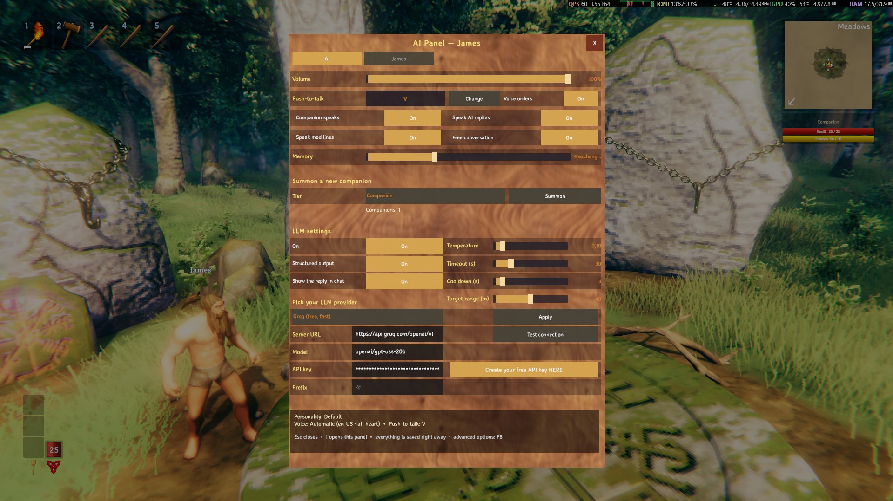
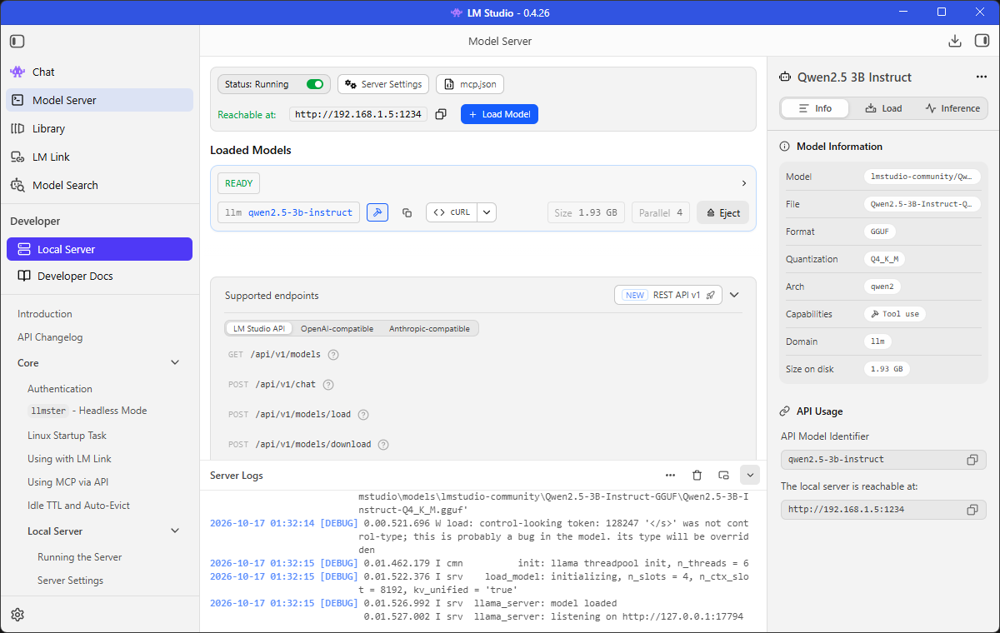

> 🌍 **English** · [Português](LLM-pt)

# LLM (Groq, LM Studio or OpenRouter)

The mod understands the orders by sending the text to an **LLM** through an **OpenAI-compatible** API. There are
three paths, and you pick **one**:

| Path | What it needs | Where the text goes | When to pick it |
|---|---|---|---|
| **Groq** — **default** | internet and a **free key** | **leaves your machine** (remote service) | You want to use it without installing anything, and fast |
| **LM Studio** (or Ollama) — optional | the model downloaded and the server on | stays **on your machine** | You want full privacy or heavy use |
| **OpenRouter** — alternative | internet and a **free key** | **leaves your machine** (remote service) | You already use OpenRouter or want to try another model |

This page starts with **Groq**, because it **already is the default** of the mod: you install it, paste the key and
you are done. Then comes the **local** option (**LM Studio**, which keeps working the same) and, last, **OpenRouter**
— which also keeps working, but whose free tier is **slow** and for that reason is no longer the default.

> **Coming from an older version (or from 1.8.2)?** In **1.8.3** the file became **`AiCompanions.cfg`** and the
> settings **go back to the defaults** — including the `ApiKey`, which has to be pasted again. The section also
> changed its name: it was `[IA]`, now it is **`[AI]`**, with the keys in **English** (`Model`, not `Modelo`). The
> old `.cfg` (`Maddhattr.OfflineCompanionsReborn.cfg`) stays on the disk and is **not** read.
> Switching to Groq is optional — and it is only a matter of editing `BaseUrl`, `Model` and `ApiKey` (in the `.cfg`
> or in the **LLM settings** section of the `I` panel).

---

## 1. Groq: just the key and the internet (default)

**Groq** is a service that speaks the **same API as OpenAI** and serves open models, with a **free tier**. For the
mod, it is the fastest path: there is nothing to install and no server to keep open — the `.cfg` already comes
pointed at it.

### 1.1. Create your free key

1. Open **https://console.groq.com** and create the account (e-mail or social login).
2. Go to **https://console.groq.com/keys** and click **Create API Key** (give it any name, e.g. `Valheim`).
3. **Copy the generated key** — that is the one that goes into `[AI] ApiKey`. It is shown **only once**; if you
   close the window without copying it, create another one.

### 1.2. What to put in the `.cfg` (or in the panel)

Open `<Valheim>\BepInEx\config\AiCompanions.cfg` and check the `[AI]` section:

```ini
[AI]
BaseUrl = https://api.groq.com/openai/v1
Model = openai/gpt-oss-20b
ApiKey = <your key>
StructuredOutput = true
```

| Key | Value | Why |
|---|---|---|
| `BaseUrl` | `https://api.groq.com/openai/v1` | Groq's address — **it already is the default**. The `/chat/completions` is added on its own |
| `Model` | `openai/gpt-oss-20b` | The OpenAI open model served by Groq — **it already is the default**. It is fast and follows the structured output well |
| `ApiKey` | **your key** | On Groq it is **required**. Empty or wrong, the server refuses the request with an authentication error |
| `StructuredOutput` | `true` | Asks the server for the JSON format — it is what makes small models work. `gpt-oss-20b` accepts `json_schema` in **strict** mode (constrained decoding), which is the mode the mod uses |

You can also do it **in game**, without opening the file: key **`I`** → **AI** tab → **LLM settings**. It is where
the **server URL**, the **Model**, the **API key** and the **Apply** and **Test connection** buttons live — and,
**above the URL**, the **"Pick your LLM provider"** dropdown: choosing **Groq**, **LM Studio** or **OpenRouter**
**fills in the URL and the model** on its own (the **key is not touched** and nothing is saved before **Apply**).
On the **API key** row there is the **"Create your free API key HERE"** button, which **opens in the browser** the
key page of the chosen provider (`console.groq.com/keys` on Groq, `openrouter.ai/keys` on OpenRouter) — it
disappears on LM Studio, which has no key.

> Both are **only a shortcut**: the `.cfg` still rules and it is what counts. The picker **deduces** the provider
> from the `BaseUrl` itself, so an **Ollama** URL or a server of your own shows up as **Custom (manual URL)** and
> nothing is overwritten.



> In the capture above the picker is on **Groq** (the default), with the URL `https://api.groq.com/openai/v1`, the
> model `openai/gpt-oss-20b` and the masked key. Changing the picker to **LM Studio** or **OpenRouter** fills in the
> URL and the model of that provider — and the key button starts pointing at its page (or disappears, on LM Studio).

> `BaseUrl`, `Model` and `ApiKey` also show up in the **`F8`** panel, but they are **text** keys: to paste a key,
> the field of the `I` panel (or the `.cfg` itself) is more comfortable. What you save there applies on the **next
> message**, without restarting the game.

### 1.3. Test the connection

With the URL, the model and the key filled in, press **Test connection** (in the `I` panel, next to **Apply**). The
test runs **in the background** — the game does not freeze — and answers in the **chat/HUD**, besides leaving a
`[IA]` line in the log. It starts by asking the server for the **model list** and, if the server does not have that
list, it sends a minimal chat request. The result is one of these:

- **Connection OK: N model(s) on the server** — the URL answered.
- **Connection OK: … and the configured model is in the list** — the best case.
- **Connection OK: … but "<model>" isn't in the list** — the URL answered, but the name did not appear in the list
  the server returns. Check that the `Model` is written exactly `openai/gpt-oss-20b` and go on to the in-game test,
  sending a real order.
- **Connection failed: …** — it comes with the reason (status/message from the server): wrong URL, empty/wrong key,
  address without `http://`/`https://`…

> **What confirms the key is a real order.** **Test connection** says that the URL answers and that the model is in
> the list; if it passes but the order fails with **401**, the problem is the key — see
> **[Troubleshooting](Troubleshooting)**.

### 1.4. What to expect from the reply

The understanding keeps running **in the background**: a slow model does **not** freeze the game. The latency shows
up in the log, on every order:

```
[IA] Tempo: 378 ms (... tokens, ... tokens/s)
```

With `openai/gpt-oss-20b` on Groq the reply arrives in a **fraction of a second** in our measurement — much faster
than the free tier of OpenRouter. The model is served at ~**1,000 tokens/s** and has a window of **131,072 tokens**
(maximum completion 65,536), which is more than enough for the mod's prompt (source:
https://console.groq.com/docs/models). The mod warns in the log when an order goes past **5 s**, and
`[AI] TimeoutSeconds` (default **30**) is the wait ceiling.

### 1.5. Free tier limits

What the Groq documentation states today for `openai/gpt-oss-20b` on the free plan (source:
https://console.groq.com/docs/rate-limits — the numbers can change):

| Limit | Value |
|---|---|
| Requests per minute (**RPM**) | **30** |
| Requests per day (**RPD**) | **1,000** |
| Tokens per minute (**TPM**) | **8,000** |
| Tokens per day (**TPD**) | **200,000** |

In practice, **the TPM is the limit that bites first**: the mod's prompt spends about **1,800 tokens per order**,
which gives **~4 orders per minute**. Above that Groq answers **429** and the order is refused with a warning —
nothing breaks and nothing gets stuck; wait a little and send it again.

- The ceiling of **8,000 tokens per minute** handles a normal session of sporadic orders. Heavy use (many orders
  and conversation all the time) hits it — then the **local option** (below) solves it, with no request limits.
- `[AI] CooldownSeconds` (default **3**) helps: it keeps a burst of messages from becoming a burst of requests.
- **429** is a request/token limit, **401** is the key — the difference is in **[Troubleshooting](Troubleshooting)**.

> **The structured output keeps working.** `gpt-oss-20b` accepts `json_schema` in **strict** mode and also the
> *best-effort* mode; **streaming** and **tool use** are not supported together with the structured output — and the
> mod **does not** use either of them (source: https://console.groq.com/docs/structured-outputs).

### 1.6. Privacy and the key

- **With Groq, the text of the orders and of the conversation leaves your machine.** It goes to Groq's servers —
  the persona, the memory and what you type go with it. **Do not write anything sensitive** in the companion's chat.
- Groq is a **remote service**: its data policy is the one that applies, not the mod's.
- Speech recognition (**STT**) and the **companion's voice** (**TTS**) stay **local**: only the text of the order
  goes to the LLM.
- **The key stays in the `.cfg`.** Do not share that file with the key filled in and never commit a key. If it
  leaks, delete it at **https://console.groq.com/keys** and create another one.
- Want **nothing leaving** the machine? Use LM Studio (or Ollama) right below — then the LLM is local too.

---

## 2. Local alternative: LM Studio (optional)

Here **nothing leaves your computer**: the model runs on your machine. It is the path for whoever wants full
privacy, for whoever plays without internet or for heavy use without depending on a queue or on a token limit. In
exchange, you have to download the model and keep the server on while you play.

### 2.1. Install LM Studio

Download it from **https://lmstudio.ai** and install it. It is a windowed application, no command line.

### 2.2. Download the model

The **recommended** model is **`qwen2.5-3b-instruct`**, quantization **Q4_K_M** (~**1.93 GB**).

In LM Studio:

1. Open the **model search** tab (the magnifier icon, in the sidebar).
2. Search for **`qwen2.5-3b-instruct`**.
3. Pick the **Q4_K_M** quantization and download it (~1.93 GB).

> **Why such a small model?** Because it is **fast** (orders in ~0.35–0.4 s) and, with the mod's **structured
> output**, it answers in the right format reliably. A 3B runs well even on a CPU.

### 2.3. Load the model

In the **chat** tab, at the top, pick the `qwen2.5-3b-instruct` you downloaded. It becomes **READY** when it
finishes loading.

### 2.4. Turn on the Local Server

Open the **Model Server** tab in the sidebar (in older LM Studio versions it is called **Developer**) and turn on
the **Local Server** (the **Start** / **Running** button).



Check on the screen:

| What to look at | Expected value |
|---|---|
| **Status** | `Running` |
| **Port** | `1234` |
| **Loaded model** | `qwen2.5-3b-instruct` (READY, ~1.93 GB) |
| **Parallel** | `4` |
| **Endpoints** | OpenAI-compatible (`/v1/models`, `/v1/chat/completions`) |
| **API Model Identifier** | `qwen2.5-3b-instruct` — it is **this** name that goes into `[AI] Model` |

> The **API Model Identifier** (in the *Model Information* panel) is the exact name the server exposes. Use it in
> the `.cfg`, and not the name of the download folder.

### 2.5. What to put in the `.cfg` to use LM Studio

The mod's default is Groq, so **change** the first two keys and **delete** the API key:

```ini
[AI]
BaseUrl = http://127.0.0.1:1234/v1
Model = qwen2.5-3b-instruct
ApiKey =
StructuredOutput = true
```

| Key | Value | Why |
|---|---|---|
| `BaseUrl` | `http://127.0.0.1:1234/v1` | Address of the LM Studio server. The `/chat/completions` is added on its own |
| `Model` | `qwen2.5-3b-instruct` | The **API Model Identifier** that LM Studio shows |
| `ApiKey` | *(empty)* | The local LM Studio does not ask for a key |
| `StructuredOutput` | `true` | Asks the server for the JSON format — it is what makes small models work |

> The **Test connection** of the `I` panel works the same here: change the URL and the model in the fields, test
> and only then click **Apply**.

### 2.6. `127.0.0.1` vs `localhost` — use the IP

In the local case, use the address **`http://127.0.0.1:1234/v1`** (IPv4) and not `localhost`.

> **On Windows, `localhost` resolves first to IPv6 (`::1`)**. The LM Studio server only listens on **IPv4**, so
> every request tries IPv6 first, waits for the timeout and **only then** falls back to IPv4. That adds about
> **2.5 s of toll on every order**.

With the explicit address `http://127.0.0.1:1234/v1` the reply comes back straight away. The help text of `BaseUrl`
in the `.cfg` (and in the `F8` panel) also explains the difference.

---

## 3. OpenRouter (still works, but the free tier is slow)

**OpenRouter** was the default until **1.7.0** and **keeps working**. It gives access to several models with the
same key, including the **free** ones — but the free router (`openrouter/free`) is **slow and unpredictable**: every
request picks a different free model and goes through the provider's queue. That is why it left the default spot.
Use it if you **already have** the setup or want to **try another model** from the catalogue.

```ini
[AI]
BaseUrl = https://openrouter.ai/api/v1
Model = openrouter/free
ApiKey = <your key from openrouter.ai/keys>
```

| Key | Value | Why |
|---|---|---|
| `BaseUrl` | `https://openrouter.ai/api/v1` | OpenRouter's address |
| `Model` | `openrouter/free` | **Free Models Router**: on every request it picks a **free** model (and filters the ones that support the structured output) |
| `ApiKey` | **your key** | On OpenRouter it is **required**. The free one comes from **https://openrouter.ai/keys** |

- The **free** models (with `:free` in the name) have a limit of **20 requests per minute** and a **daily ceiling**
  per account: **50 requests per day** for whoever **never bought credits** and **1,000 per day** from **10 credits
  bought** (in total, not per month).
- The latency **varies** from one order to another and can take a few seconds at peak times.
- OpenRouter itself describes the free models as **for trying out and for low-volume use**.
- The **Test connection** of the `I` panel works here too — and, because OpenRouter's model list is **public**, it
  can answer `Connection OK` even with a wrong key: what confirms the key is a real order.
- With OpenRouter, the text of the orders and of the conversation **leaves your machine**, as with Groq. Its data
  policy is the one that applies. Key leaked? Delete it at **https://openrouter.ai/settings/keys** and create
  another one.

---

## 4. How to know it is working

Enter the world and type in the chat `collect 10 wood` (it works for Groq, for **LM Studio** and for
**OpenRouter**). If it works:

- The companion answers (and speaks) a confirmation and goes out to gather.
- In the log (`BepInEx\LogOutput.log`) the `[IA]` lines appear with the result and the time.

---

## 5. Other models and servers

Any **OpenAI-compatible** endpoint works — the mod only does `POST {BaseUrl}/chat/completions`.

### Models

| Model | Server | Note |
|---|---|---|
| **`openai/gpt-oss-20b`** | **Groq** | **Default.** Open model, ~1,000 tokens/s, 131,072-token window. Answers in a fraction of a second |
| **`qwen2.5-3b-instruct`** | LM Studio | **Recommended locally.** Fast (~0.35–0.4 s per order) and reliable with the structured output |
| `openrouter/free` | OpenRouter | Free model router: picks one per request. Nothing to install, but the latency varies |
| `google/gemma-4-e4b` | LM Studio | It also works, but it is **much slower** (~3 s per order) |
| Bigger models | any | Better at conversation, but they **need a GPU** to answer fast locally |
| Paid Groq/OpenRouter models | — | Just change the `Model` to the name in the catalogue — and then the account credits are what gets spent |

### Other servers

- **Ollama:** `http://127.0.0.1:11434/v1`
- **llama.cpp** with the server in OpenAI mode
- **Paid API** (OpenAI, etc.): point the `BaseUrl` and fill in the `ApiKey` — remembering that, then, your messages
  **leave your machine**, as with Groq and OpenRouter.

> **Never commit an API key.** The `ApiKey` stays in the local `.cfg`; do not share that file with the key filled
> in.

### Useful settings

| `[AI]` key | Default | What it does |
|---|---|---|
| `Temperature` | `0.1` | Keep it low: the same order should always give the same JSON |
| `TimeoutSeconds` | `30` | How long to wait for the model. The request runs in the background — a slow model does not freeze the game |
| `StructuredOutput` | `true` | If your server/model does not support it, the mod falls back on the old format on its own and warns in the log |
| `CooldownSeconds` | `3` | Minimum time between two orders, so a burst of messages does not flood the model |

---

## If it does not work

The four cases below cover almost everything:

| What shows up | What it is | What to do |
|---|---|---|
| **401** (*unauthorized* / *invalid api key*) | The `ApiKey` is empty, wrong or from another server | Paste the right key: `console.groq.com/keys` (Groq), `openrouter.ai/keys` (OpenRouter) — or leave it **empty** on LM Studio/Ollama |
| **429** (*rate limit*) | **Request or token** limit of the free tier | Wait a few seconds and send the order again; reduce the frequency; use the local LM Studio for heavy use |
| **404** / **400** | The **URL** (`BaseUrl`) or the **model** (`Model`) is wrong | Check `https://api.groq.com/openai/v1` + `openai/gpt-oss-20b` (Groq) or `https://openrouter.ai/api/v1` + `openrouter/free` (OpenRouter) |
| **Takes too long** | Provider queue or a big model | See "takes too long to answer" in **[Troubleshooting](Troubleshooting)** |

The step by step of each symptom is in **[Troubleshooting](Troubleshooting)** — including "he does not answer
anything", "answers with an authentication error", "takes too long to answer" and "answers wrong or ignores the
number".

<!-- D4: add Español/Français/Italiano -->
